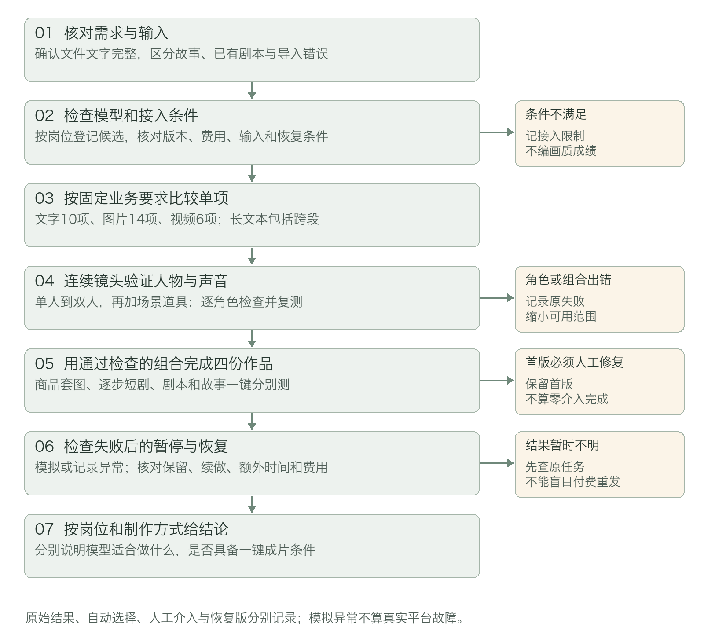
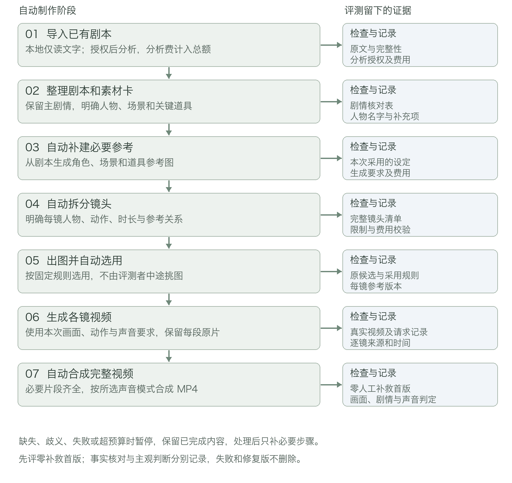

# 视觉创作工作台模型评测与选型方案

版本：V0.5　日期：2026年11月4日　对应需求：产品需求文档V0.5

## 1 评测目的与独立原则

本方案从电商图片和短剧制作的实际需求出发，评估文字、图像、视频模型以及完整制作流程。评测要回答：商品信息能否准确保留，故事能否转成可制作的镜头，多角色与声音是否连续，一键成片是否可用，以及失败后能否保留成果并继续。

评测任务、指标、通过标准和统计口径与具体供应商无关。产品当前接入哪家模型，不改变测试内容，也不构成评测通过的证据。新候选按同一规则加入，已接入模型不合格时保留失败结论；不能为了适配它而删掉多角色、原生声音、长文本或恢复测试。

选型按文字、电商图片、短剧图片和视频四个岗位分别判断，再评整体组合。商品、人物、剧情、对白等关键错误属于质量门槛，不能用速度、低价格或美观抵消。视频同时评画面与原生声音；不能为了让无声模型通过，悄悄删除有声短剧需求。

本文给出评测执行与结论规则，目前没有真实调用数据。模型效果、耗时、实际费用和排名均保持待测；产品自动保存、执行和恢复需要实际运行证据，人工串联不能记为一键自动完成。

### 三类对象分别判断

| 评测对象 | 要回答的问题 | 主要证据 |
| --- | --- | --- |
| 单个模型 | 固定输入下，文字图片或视频是否满足要求 | 原始输出、事实核对、主观评审、耗时与账单 |
| 模型组合 | 上一步产物能否进入下一步，错误如何传播 | 完整来源链、人物对照、首版与修复版 |
| 产品流程 | 自动接续、暂停、保存和恢复是否可靠 | 实际操作、阶段状态、文件版本及新增付费请求 |

不评本地模型安装、量化、显存或离线推理。文件解析、画布排版和本地拼接单独验收，不计入模型画质成绩。

## 2 从哪里开始到哪里结束

先冻结需求与材料，再检查接口、比较单个环节；随后专测多角色，使用通过前置检查的组合跑完整作品，最后检查失败恢复。只有完成这些步骤，才能判断推荐模型适合逐步制作，还是具备进入一键成片的条件。

测试期间保留首次输出和失败证据。任何人工补图、改写、重新生成都要记录，不能把修复版当成第一次自动生成的结果。

## 3 按新版需求准备输入与测试材料

### 导入正确是后续评测的前提

输入范围与需求一致：文字、TXT、DOCX、PDF、MD；单文件不超过20MB，仅读取文字；输入区超过5,000字符自动转TXT；单份正文上限200,000字符，单次处理上限20,000字符，并受模型实际输入限制约束。

下面验证的是文件处理与产品规则，不是文字模型识图能力。若解析漏掉剧情，先记为导入问题；不能把残缺文本交给模型后，将所有错误归因于模型理解差。对应需求A07至A11。

| 编号 | 准备什么输入 | 检查什么 |
| --- | --- | --- |
| L01 | 同一正文的输入框、TXT、DOCX、文字PDF和MD版本 | 提取正文的内容和顺序一致；表格文字可核对；原件与修改稿分开保留 |
| L02 | 低于、等于和高于20MB的文件，以及损坏、加密和旧版DOC | 边界内按格式读取；超限显示实际大小和处理办法；异常不进入模型调用 |
| L03 | 扫描PDF、混合扫描页PDF、带插图的DOCX | 不识图；无文字时阻止生成；疑似漏读页列出位置并要求确认，不能直接当作完整正文 |
| L04 | 分别为5,000和5,001字符的粘贴正文 | 前者不触发转换，后者完整转TXT；展开编辑和下载后正文未变，仍受后续上限约束 |
| L05 | 导入和处理长度各自上限附近的正文 | 200,000字符导入边界与20,000字符处理边界分别检查；分段清单覆盖全部正文，末尾关键情节不丢失 |

执行前统一口径：20MB为20,000,000字节，字符按Unicode码点计数；再核对，浏览器与本地服务采用相同标准。超限处理不能只是报错：还需验证移除图片后另存、转纯文字、追加章节或替换原文的入口，不覆盖已完成内容。TXT转换不是绕过长度限制。

### 固定两套内容材料

商品组使用同一商品的两种款式，配正面图、细节图和人工核实的颜色、容量、包装文字与卖点。商品参考和风格参考分开标注。

短剧组使用一篇故事及其人工确认的对应剧本，先列出不得改变的情节、人物关系和道具变化。单项比较准备两个人物、一张场景和一张道具参考；一键成片测试不提前提供这些图片，由被测组合从剧本补建。

正式材料需有使用权限，冻结文件、版本与判定清单。当前保温杯、递信故事与人物名称均为测试设计，不能作为已测样本。先使用已获使用权限且各候选可接受的虚构角色。写实人像另核对各平台的素材和授权条件；不能默认跨平台产物均可输入，也不能借输入限制推断画质差。

## 4 候选登记与公平比较

### 先按岗位筛选再登记模型

候选从业务能力出发筛选。文字岗位需处理中文故事、剧本、结构化镜头与长文本分段；图片岗位需支持商品保真、指定参考、多角色与局部修改；视频岗位需支持逐镜生成、原生声音，以及与图片产物衔接。原生声音不支持的模型可单列为无声用途，但不能当作完整有声短剧的替代方案。

不预设必须由某一家胜出，也不将当前技术方案中的模型变成唯一参评对象。每岗位在账号和预算允许时至少登记两个可比候选；只测试一个时只能报告适用性，不能声称比较胜出或全市场最优。

| 登记项 | 执行时记录什么 | 不满足时怎样处理 |
| --- | --- | --- |
| 模型身份 | 厂商、模型名、真实调用标识、版本、区域和日期 | 别名更新后分批报告；精度未披露就填未披露 |
| 所承担岗位 | 文字、电商图片、短剧图片或视频，可一模多岗 | 分岗位给结论，不平均电商与人物成绩 |
| 输入输出能力 | 参考模式、数量、格式、尺寸、时长、声音与上下文 | 标明能力缺口，不通过删需求来“公平比较” |
| 接入与计费 | 开通条件、价格版本、币种、账单、查询与下载期限 | 条件未满足记待接入；预存金额不等于实际消耗 |
| 证据 | 官方链接、核验日期、最小调用结果 | 官方支持只证明候选资格，不证明内容质量 |

候选登记表采用M-T01、M-I01、M-V01等编号；在真实执行前填入具体调用信息并冻结。图像同一候选可承担两类图片岗位，仍分别统计。候选名单可以扩充，指标和原有失败结果不得随之改写。

### 把输入模式和产品承诺分开

先用最小调用检查字段、服务开通、素材传输、声音、状态查询和下载，再进行效果评测。图片能生成不等于视频能接受；有任务编号也不代表任何断网状态都可恢复。没有查询或防重复机制的限制，单独进入失败恢复评估。

同一模式下采用相同正文、人工确认的参考和动作要求。图片目标约2K，视频基础用例约5秒、横屏720P且有声；候选没有共同规格时，设置共同支持档位做直接比较，另按产品目标测各自原生能力。降规格结果不得冒充目标规格已通过。

首帧图生视频、首尾帧、多参考分别记录，不混成总分。不同平台素材接入条件无法统一时，说明差异并单列输入路线；不能一方用人工修好的首帧，另一方用自身错误画面，再据此给单项排名。完整链路另用各自真实上游产物，观察误差传播。

每个候选使用相同次数和费用上限的预调试机会，随后冻结提示词与配置。基础轮保持任务语义、材料和输出要求一致；按官方建议优化的轮次单列，保留全部调试成本，不能只公布最佳偶然结果。正式测试有失败或分歧时，按事先约定重复，不只挑漂亮样本。

## 5 单个环节具体测什么

### 文字模型十项

| 编号 | 任务 | 判定重点 |
| --- | --- | --- |
| T01 | 整理两款商品的已核实文字与照片编号 | 款式和照片编号对应；未知材质、容量不编造。视觉识别作为独立能力另测，不混入基本文字成绩 |
| T02 | 规划商品展示图和场景图 | 每项绑定正确款式与参考，不新增无依据卖点 |
| T03 | 故事转可拍摄剧本 | 关键情节、人物关系和结局保留，补充内容能辨认 |
| T04 | 已有剧本整理为结构化场景 | 不重复改写主剧情或对白含义，补充拍摄描述有标记 |
| T05 | 提取人物场景道具卡片 | 同一人不重复拆分，姓名别称对应，不漏关键道具 |
| T06 | 生成镜头清单与逐镜要求 | 人物动作、说话角色、对白、声音要求、时长与参考绑定清楚；台词长度可容纳，镜头前后能接上 |
| T07 | 分别修改运镜与改变递信动作的结果 | 局部运镜不牵连无关镜头；递信变收信后标出下游开信等因果影响，不擅自改写剧情 |
| T08 | 面对原文矛盾和缺失设定 | 剧情歧义交用户确认；允许补外观不等于可补造剧情事实 |
| T09 | 处理长文本和章节衔接 | 分段仍覆盖全部内容，人物名称统一，末尾关键情节保留 |
| T10 | 按可用角色参考和时长拆镜 | 不引用不存在的素材；超限建议可执行拆镜，无法处理时说明原因 |

T09为必测长文本任务：用20,001至40,000字符的完整正文，按单次20,000字符的产品上限拆为两段，再做一次跨段合并检查，共三次文字调用作为基准。末尾放关键情节，人物使用跨段别名，信件持有状态跨段变化；核对全部覆盖范围、人物归一和结局保留。候选上下文更小而需要更多分段时，全部新增调用另记，不能改用短文代替长文本通过。金额计算和最终输入校验由程序核对，不以模型写出的“未超预算”代替校验。

### 图片模型十四项

| 编号 | 任务 | 判定重点 |
| --- | --- | --- |
| I01 | 款式A白底商品图 | 形状、颜色、包装文字和关键细节正确 |
| I02 | 款式A桌面场景图 | 换环境后商品不变，阴影和比例合理 |
| I03 | 款式B同风格场景图 | 不串色、不混用包装或另一款照片 |
| I04 | 同时使用商品和风格图 | 保留商品，仅借用风格，不复制风格图中的商品 |
| I05 | 从共同原图移除一件道具 | 商品和非目标内容保持，改变范围正确 |
| I06 | 人物A在门前的远景 | 对应A的身份与服装，人物未漏掉 |
| I07 | 人物B在门前的中景 | 对应B的身份，与A清楚区分 |
| I08 | A向B递信的双人画面 | 不交换身份；人物、场景、信件参考同时正确 |
| I09 | 人物B持信的近景 | 与前镜为同一B，衣服和道具状态接得上 |
| I10 | 双人换景别与光线后再同框 | 两人分别保持身份，不因位置变化互换 |
| I11 | 对共同人物原图只改光线 | 身份与主要构图不变，未随意换装 |
| I12 | 仅按人物卡生成缺少的设定图 | 符合文字外观设定，足以作为后续人物参考 |
| I13 | 已有款式A图片按统一要求改风格 | 原商品和所属款式保持，背景或画风按约定变化 |
| I14 | 已有款式B图片应用同一风格 | 与I13风格一致，不串款；单张失败可重做，原图保留 |

I01至I05、I13与I14用于电商结论，I06至I12用于短剧结论。I06至I10连起来检查，同一人物不只看一张图。I05和I11使用各候选相同的原图；I12结果不反过来替换前面单项的固定参考，避免比较条件改变。

### 视频模型六项

| 编号 | 相同首帧下的动作 | 判定重点 |
| --- | --- | --- |
| V01 | A缓慢转头，仅有门前环境声 | 方向和身份正确，环境声自然，不凭空加对白或配乐 |
| V02 | A递信并说“这是您的信。”，B不说话 | 动作完成，信件连续；台词可听清且由A说出，口型与说话时机合理 |
| V03 | B展开信并说“谢谢。” | 人物和道具稳定，B的台词正确，手部与声音时机合理 |
| V04 | 双人门前画面拉远，仅有环境声 | 人物环境稳定，无无关人声、爆音或声音突变 |
| V05 | A在另一景别说“请收好。” | 与V02为同一A，脸、音色和说话特征保持，不只看单段声音自然 |
| V06 | 双人近景，B先说“我会收好的。”，A再说“那我先走了。” | 两人不混音色、不错配台词，不无故抢话，短句能在设定时长内说完 |

六项先使用共同首帧路线；额外参考模式另测。逐段观看和收听全片，对照开头、中间、结尾画面；抽帧不能代替检查完整运动与声音。台词逐字核对漏词、错词与说话人，记录可见口型和声音是否相符；短样本不支持长片稳定性结论。

## 6 多角色一致性怎样专门评测

### 先列清楚谁应该出现在什么地方

示例中人物A为短发、黄色外套，人物B为银发、蓝色外套，关键道具为一封信。服装颜色只是辅助，不能只凭黄衣服就判定脸仍是A。测试前固定各人的脸部、发型、年龄感、衣服及道具关系；明确允许变化的光线、朝向和景别。

| 镜头 | 应出现的人物和动作 | 必须衔接的内容 |
| --- | --- | --- |
| 1 | A持信来到门前 | A的身份、衣服；信由A持有 |
| 2 | B在门前等待 | B的身份与服装，地点一致 |
| 3 | A走近B，双人同框 | A与B可区分，不能相互套用外观 |
| 4 | A把信交给B | 身份不换，信件从A转到B |
| 5 | B近景打开信 | 与前镜同一B，信已在B手中 |
| 6 | 两人同框，镜头拉远 | 两人都在，信件仍在B处，环境衔接 |

这是评测样本，不限定产品只能两个人物或六个镜头。镜头4由A说“这是您的信。”，镜头5由B说“谢谢。”，镜头6补入两人各自短句，检查同一角色跨镜音色以及对白归属。原生口型与声音作为内容质量观察，不将专业口型修复当成模型原始成绩。

### 参考组合逐级验证

R01为单角色，R02为双角色，R03为双角色加场景，R04为双角色加场景和道具。每种组合用三个不同视角或景别的镜头连测一组，再独立重复一组。每个图片候选每组合最多六次，四组共二十四次；总量为24乘实际图片候选数。不得只重复同一正面构图来代替跨镜头验证。

单角色组合的三个镜头都出现A；双角色及以上组合的三个镜头都出现A和B。每组固定身份、参考用途及动作，只改变预先约定的视角或光线。请求不能接受时不继续硬发，记录接口限制并停止该组合的费用消耗。

每个镜头分别核对每个人物，记录“应有多少次人物出现、多少次身份正确”，同时记录整镜可采用数量。身份互换、关键角色消失、道具交接错误单列，不能被其他好镜头的平均值掩盖。发生变样时回溯到设定图、镜头图或视频，指出第一次出现问题的阶段。

一组首次成功只能写单次观察。两组都未出现关键身份或角色缺失错误，才可将该组合列为小样本下可暂用，并保留内容复核；有关键错误则不能作为一键模式默认组合。两轮仍不足以承诺普遍稳定。

### 人物数量不等于图片数量

三个人物、同一人物多张照片、衣着刻意相似或明显遮挡可作为压力扩展，分别登记，不从双人结果推断支持。接口允许上传更多图不意味着角色更多仍准确。

基本视频路线只使用已确认的首帧图，人物、场景与道具先在该画面中安排。支持多参考的候选另测双人、双人加场景两组，各两个动作、两轮，共八段视频。按其真实模式明确参考用途，不能把独立人物图强行附加到只接受首帧的模式。无多参考能力记为限制，不自动否定已验证的首帧路线，但也不从首帧成绩推断多参考稳定。

## 7 一键成片如何验证完整流程

逐步基线与一键测试分别留证。重点沿着一份剧本，追踪每个自动阶段有没有保留原要求、正确使用人物参考，并真正得到完整视频。

### 四份完整作品都是必测任务

E01电商套图：用两款商品完成四张图片及导出，记录商品是否准确、局部重做是否有效；另对已有图片的批量改风格运行I13与I14，核对来源、统一风格和局部重做。排版与导出正确性按产品验收检查。

D01逐步短剧：从故事开始，用户在剧本、参考、镜头和画面阶段检查并确认，再生成六段视频和成片。使用测试集预先准备的四张参考，记录人工修改和采用选择。这是人工协助下的组合基线。

D02一键短剧：仅导入已确认的对应剧本，填写画风、比例、目标片长和整单费用上限。不给人物、场景或道具图片，不逐镜人工确认；由组合自动生成两个人物、一张场景和一张道具参考，再制作画面、视频和成片。必须保留没有人工补救的首版。

两种短剧起点和人工投入不同，不能直接把结果差异全部归因于自动模式。若要专门比较人工审核价值，可追加同一份D02剧本的逐步制作作为配对实验，费用另列。

D03故事一键成片：从原故事自动改编开始，不提前提供人物图，完成剧本、参考、镜头、图片、视频和成片。它与D02同为必测入口，不能用T03单项加D02推断已通过。示例按六镜和四张补建参考计数，实际镜头依内容规划，不为了凑数量删减剧情。

### 启动授权与分析费用也要检查

本地读取和边界检查不调用模型；文字分析本身计费。先确认整单上限、文字分析子上限、数量范围与自动补建规则，再启动。分析产生的实际计划未超范围时应自动继续；超出时暂停，保留已发生费用与分析结果，不在未经允许时进入图像视频消费。该规则与选择哪家模型无关。

逐项记录估算来源、预留、已核实扣费和结果不明请求。测试一次正常自动继续、一次分析后超范围暂停、一次用户停止；不能把付费分析放在“确认费用之前的免费预处理”里。

### 每一步都要能说明来源

导入阶段核对正文完整，已有剧本不重写主剧情。角色整理阶段确认人物名字唯一、外观补充有标记，生成的参考能区分各角色。自动补建的人物不必与另一实验的脸完全一样，但后续必须与本次采用设定一致，并满足原剧本给定的外观。

拆镜阶段核对情节覆盖、动作与说话先后、参考绑定和模型限制。生成阶段记录每镜用了哪份设定、哪张画面、哪种输入与声音模式及哪段视频。合成阶段检查必要镜头全部存在、顺序正确、MP4可播放并保留所选原生声音，不能拿静态图或无关视频补位。

声音检查同时听单段与整片：同一角色跨镜不能明显换声，A与B不能交换说话人；对白不漏关键字，环境声和音量不能在接点突然跳变，合成不能丢音、错位或截断句子。另验证静音导出不改原片，也不将已发生的有声费用按无声价重算。声音不合格时保留原版，只修复受影响片段；静音版不等于对白已修复。

一键模式按固定规则自动选用通过文件检查的候选；评测人员先旁观，不替它偷偷选更好的图。首版产出后再由人工判断人物、动作与情节是否可采用。若必须中途改剧本、换参考或选图，原任务不再算无人工介入完成，修复过程另记。

### 流程完成和内容可用分开下结论

流程状态分别为自动完成、按规则暂停、异常终止。内容判定分别为可采用、修改后再看、不能采用；没有成片则不做成片画质判断。可能出现“自动完成，但人物换脸不能采用”，也可能出现“因预算不足正确暂停，尚未得到成片”。两者不能都写成通过。

一键成片可采用，需要零中途人工补救、必要镜头齐全、内容满足剧情、角色和所选声音要求、费用未越界。开始前正常确认方案与成片后评审不计中途介入；手工补参考、改写、挑候选、后期修音和点击额外重做都计入。

只有模型调用而没有自动执行流程时，可先验证模型组合的输入输出衔接，报告必须写人工串联；自动接续、保存和恢复保持待产品验收，不能因手工做出了MP4就宣称一键成片通过。

## 8 失败后怎样恢复也要实际检验

### 先分清失败来自哪里

内容错误由人工审片发现，例如换脸和动作错误；文件或字段错误可由程序检查；超时、余额和下载失效属于接入或服务问题；误覆盖、重复提交和丢失状态属于产品流程问题。记录最先出错的阶段及后续影响，可同时存在多个原因，不一律扣视频模型画质。

模型实测保留自然发生的失败；产品规则可用已保存结果或受控异常回放验证，不为了凑故障反复消耗视频额度。模拟错误和真实平台故障分开统计；只有实际执行并观察到预期行为，才可记录通过，文档走查不能代替执行证据。

### 必测失败用例

| 编号 | 怎样制造或发现问题 | 应观察到的处理结果 |
| --- | --- | --- |
| F01 | 文字输出缺镜头字段或引用不存在的人物 | 阻止受影响的后续生成，指出缺项；保留原结果，不猜一个人物继续 |
| F02 | 提交超出接口或已验证范围的参考组合 | 提交前拦截，提供精简或拆镜；不静默丢图，不产生该项生成费用 |
| F03 | 模型拒绝、未开通或余额不足 | 暂停后续，保存当前成果；不静默换平台，处理后仅继续未完成项 |
| F04 | 已收到任务编号后模拟超时或关闭页面 | 查询同一原请求，下载已有结果；没有再创建一份相同付费任务 |
| F05 | 提交后响应丢失，没有可查询的任务编号 | 状态标为结果不明，停止自动重发，保留输入和时间供对账；不承诺一定找回或一定未收费 |
| F06 | 返回空图、损坏视频或下载链接失效 | 文件检查不通过则不作为成功；优先找回原结果，无法找回时说明重做费用 |
| F07 | 本地写入失败、磁盘不足 | 不显示已保存；保留可读临时内容及原请求记录，暂停依赖步骤，恢复后重存或找回原结果 |
| F08 | 任务中本地服务重启，或浏览器关闭后再打开 | 恢复真实阶段和文件，核对仍在生成的原请求；不整轮重新付费生成 |
| F09 | 首版某一视频角色或动作错误，手动重做该段 | 只新增该镜视频；其他片段文件与采用关系不变，新旧版保留，换用后重新合成 |
| F10 | 改A外观、只改运镜、把递信改为收回信、删除关键镜头 | 以人工整理的引用与因果清单为标准；后续开信须复查，无关成果保留，不能只标当前镜视频 |
| F11 | 缺必要镜头或合成程序报错 | 不输出冒充完整的成片；可恢复片段后只重试合成。主动部分合成必须标片段预览 |
| F12 | 已用金额加待结算请求接近总上限 | 下一次提交前计算预留；额度不足即暂停。人工允许的重试也占上限，不只看已扣款 |
| F13 | 对比主剧情矛盾与仅缺少外观描述的两份剧本 | 前者暂停请用户确认；后者按已同意的规则补设定并标记来源，不把所有缺项都阻断，也不把主剧情矛盾自行补成事实 |
| F14 | 有声对白镜头没有音轨，或审片发现错台词、错说话人 | 缺必需音轨时暂停；内容错误记录不采用，只重做该段。不能默认静音后说有声成片已通过 |
| F15 | 原片有声正确，合成后却丢音、错位或截断对白 | 对照原片定位合成问题，只重试合成，不额外请求生成全部视频；静音导出另查画面和原片保留 |
| F16 | 一键文字分析后超出预算或数量授权 | 分析费计入；后续付费提交停止，调整后复用分析结果；正常范围内不增加不必要确认 |
| F17 | 已有两张图批量改风格，其中一张失败 | 原图与另一成功结果保留，仅重做失败项；重试新增费用单独记录 |

F04与F05必须分开。没有任务编号、查询已经失效，或平台不支持查询时，单靠本地程序不能确认远端是否已经创建并收费。可行处理是暂停、核对账单并由用户决定后续，不能声称自动重试仍绝不重复付费。这个接入限制必须进入一键方案的异常边界，不能由产品文案掩盖。

### 恢复是否成功看四件事

看原成果有没有保住，只补了哪些步骤，能否最终得到合格成片，以及新增时间和费用是多少。对F09保留其他片段的文件校验与采用清单；对F10用人工预先整理的引用与剧情因果清单核对影响范围，不能只相信模型自行分析的清单。

默认重试次数为零时验证不自动新建付费请求；启用有界重试时另测次数和费用预留校验，阻止新增超限提交；已受理消费与结算差异单列。最终报告分别展示首版、暂停记录和恢复版，不能用恢复后的成功覆盖最初失败。

## 9 可客观测量指标与需主观评测的维度

### 判定原则与统计对象

“客观”指有可复核的事实或测量标准，不等于必须由程序自动检查。人工逐字核对包装文字、剧情事件和对白也可以得到客观记录。“主观”指需要判断相似程度、自然度、美感或连贯感；这类结果即使转换成分数，也不能说成纯客观事实。

先固定三种统计单位：请求尝试用于接口耗时与费用；产物用于单张图或单段视频质量；完整制作任务用于整套图片和一部短片。首轮、复测、人工修复分别列，不混用单位或覆盖首次失败。

### 可客观测量指标

| 指标 | 测量与计算方法 | 判定注意事项 |
| --- | --- | --- |
| 请求与文件交付 | 列提交、服务接受、成功、失败、结果不明；文件有效数除应交付数 | 空文件、损坏或仅有失效链接不算有效，未知状态不从表中删除 |
| 字段和引用完备率 | 字段齐全且引用存在的镜头数除输出镜头数 | 对预设结构检查，不能由此推断剧情正确 |
| 导入与分段完整性 | 比对原文、字节、字符数、分段覆盖位置、页码及末尾内容 | 复杂PDF顺序错误计导入问题，不扣模型理解分 |
| 包装文字与商品事实 | 对照核实清单逐项计正确项、错项和缺项 | 人工核字仍是事实核对；材质观感自然度另作主观评估 |
| 情节与状态覆盖 | 对照事先列出的必要事件、关系和道具归属，统计保留与矛盾项 | “A没有交出信而B随后打开信”属于可核对矛盾，叙事节奏另评 |
| 对白字词和说话人 | 逐句核对文本与预先规定角色，记录漏词、错词、加词和错配 | 转写仅辅助；听不清或看不清归属时记无法判断，不当正确 |
| 像素时长与音轨 | 读取原文件尺寸比例帧率时长与音轨 | 后期放大不冒充原生像素；存在音轨不等于对白正确 |
| 等待与整片完成时间 | 单请求发出至本地可打开；整单启动至本地成片可播放 | 分列平台等待、人工等待、本地处理与重做，逐例和中位数同时保留 |
| 费用与新增请求 | 按账单和usage统计全部尝试，区分初次、失败、补参考和修复 | 充值非消耗；未结算写预留或估算，不填假实付 |
| 无人工补救的流程完成率 | 无中途介入且必要文件齐全的任务数除有效启动任务数 | 这是自动流程指标，不代表内容可采用 |
| 故障后保留与续做 | 比对文件校验、采用版本、状态和新增请求 | 检查是否误覆盖、漏片或未经允许重复提交，记录恢复时间和费用 |

对白可报告字符错误率：（替换数＋删除数＋插入数）÷参考字符数；同时报告说话人错配句数，不能用低字错率掩盖角色说反。参考句为空时不计算字错率，另查是否无故生成台词。

各事实清单允许“无法判断”，必须列数量与原因。程序检查、人工核对及辅助模型判断分别标注；辅助模型的未复核评分不能当作事实真值。

### 需主观评测的维度

| 维度 | 评审需要判断什么 | 记录方式 |
| --- | --- | --- |
| 商品外观相似与材质表现 | 形体、质感、颜色观感与真实商品是否相近 | 对照原图写差异，明显结构错另入事实缺陷表 |
| 人物身份与跨镜一致性 | 脸、发型、年龄感和衣着是否像同一人，是否混脸 | 逐人物逐镜比较，不能只凭衣服颜色判定身份 |
| 动作自然与物理可信度 | 手部、交互、运动和遮挡是否自然 | 完整观看视频并记发生时间，抽帧不能代替运动观察 |
| 画面与风格 | 构图、光线、视觉自然度和统一风格是否合适 | 纯审美偏好与关键内容错误分开写 |
| 改编合理与叙事节奏 | 补充内容是否合理，镜头衔接和节奏是否让人理解 | 对照原剧本与整片，不把个人偏好当作原文错误 |
| 声音自然与跨镜音色 | 情绪、声线、角色可区分程度与跨镜连续性 | 统一收听条件，听完整单段与相邻镜头 |
| 声画与声音衔接 | 口型、动作音效、环境声和切点听感是否协调 | 记具体时间和现象；可测的时间偏移另列客观读数 |
| 整体可采用性 | 内容是否足以用于目标场景，需要多少修复 | 可以采用、修改后再看、不能采用，并写出原因 |

主观评分可用1至5分并附锚点：1为严重不可用，3为需要明显修改，5为无明显问题可直接采用；2与4为相邻程度。重要身份、剧情、商品或对白错误仍须独立判不通过，平均分不能抵消。

尽量由两位评审独立盲评，打乱候选顺序；一位时说明限制。分歧保留原判与理由，必要时第三人复核；公布每组分歧数，不只展示平均分。人脸相似度、自动转写等工具仅作为辅助证据。

### 可采用率必须保留失败分母

产物质量可采用率＝被判可以采用的有效产物数÷实际得到且可评审的有效产物数。它回答“拿到的东西有多好”，必须同时列出没有产物的次数。

业务可用率＝得到可采用结果的有效业务尝试数÷全部有效业务尝试数。这是主口径：输入满足事先冻结的业务测试条件即为有效；无输出、拒绝、超时、结果不明和能力拦截都保留在分母。不要因模型不支持任务而把正常业务样本改成无效样本。错误Key等准备问题单列接入结果，不伪装成模型内容零分；对应已发起正常整单仍保留其交付失败记录。

例如十次有效尝试中，九次没有可评产物、一次可采用：产物质量可采用率为1/1，业务可用率为1/10，不能只发布100%。结果不明后找回的产物按预设截止时间另更新最终状态，保留首次统计快照。

自动可采用成片率＝零中途人工补救且整片内容可采用的任务数÷全部有效启动任务数；与“文件齐全即可播放”的自动完成率分开。开始前的正常授权与成片后的评审不算介入，中途补图、改写、挑候选、手工修音和额外重做均算介入。

每部可用成片成本＝同组所有正常制作、失败与修复费用÷最终可采用成片数。同一故事多版本只算一部最终成片；没有可用成片时写无可用产物，不写零成本。角色一致性按应出现的人物次数、整镜通过数两套数量报告，漏人和无法判断不能算正确。

人工可采用性属于主观判断，基于它汇总出的比例标为“含主观判定”；包装核字、情节清单、对白等事实核对结果则保留其客观属性。小样本报告n/N和逐例证据，不给精确尾延迟或普遍成功率。

## 10 选型与开放范围如何决定

先过必须能力与内容门槛，再比较实际总费用和速度。电商关键商品事实、剧本必要事件、多角色身份、关键动作、对白及必要文件出现严重错误时，保留该用例不通过，不能以平均分宣布合格。基准测试中关键缺陷为零是暂用条件，小样本通过仍不代表任意内容都稳定。

明确区分“适合单项”“适合人工逐步制作”“通过一键成片样本及恢复验收”。一键自动出文件但内容不可用，不算一键可采用。若角色或声音只有人工挑选修复后才合格，结论限定逐步制作；只通过环境声而未通过对白时，不宣称可制作完整对白短剧。

一键用途还要检查付费分析授权、自动补参考、整段覆盖、停止恢复和结果不明处理。可控暂停可以是正确产品行为，但该次暂停任务不能算零介入自动完成。能保留成果和等待对账，不等于可以保证完全自动恢复。

质量与速度冲突时，正式交付优先商品、剧情、角色和对白的准确性；预览可以使用更快且标明用途的配置，但不能降低正式输出门槛。质量过关后比较全链路首版及修复总时间、每份可用结果成本，而不只比较单次API速度。审美分数只作解释，不设置一个掩盖关键缺陷的加权总分。

最终选择按岗位给出具体模型、版本、输入模式、已验证参考组合、输出规格与限制。备用方案也需通过该岗位和衔接检查；更换平台或模式需显示输入及费用变化。没有足够证据时写待测或暂不能区分，不替当前工程选择补写效果优势。

## 11 测试数量与费用安排

### 用实际候选数量计算

Nt为文字候选数，Ni为图片候选数，Nv为视频候选数；同一图片候选测两个岗位仍只计入Ni一次。下面是基准清单，数量指生成请求，不把状态查询、本地转换或一次返回多产物误算成新生成。

| 阶段 | 调用数量规则 | 说明 |
| --- | --- | --- |
| 最小接入 | Nt＋Ni＋Nv | 每个候选每岗位路线一次最小调用，单独记成本 |
| 首轮单项 | 12Nt＋14Ni＋6Nv | 文字十项中T09需要三次，其余各一次；图像十四项，视频六项 |
| 参考组合 | 最多24Ni | 每个图片候选四组合，每组合三视角、两轮；接口不接受时提前停止 |
| 四份完整作品 | 每个组合基准58次 | E01为5次，D01为15次，D02为19次，D03为19次；未重复计I13、I14 |
| 关键复测 | 最多再做一轮单项，即12Nt＋14Ni＋6Nv | 根据失败与分歧选择，不为凑数全量重跑 |
| 视频多参考 | 每个实际支持且拟开放该模式的候选另加8次 | 两组合、两动作、两轮，不能混入首帧成绩 |

E01为一次商品规划与四张图。D01为三次文字、六张镜头图、六段视频，参考由测试集提供；D02与D03各为三次文字、四张自动补建参考、六张镜头图、六段视频。这是假定原文在单次处理范围、四参考和六镜的计数例，不限制产品实际镜头数。若同一次输出无法承担约定文字阶段，增加调用并记录，不能隐藏调试成本。

示例仅用于算数量：三岗位各两个候选、一个组合跑四份作品，接入6次、首轮64次、参考组合最多48次、完整作品58次，合计最多176次；再做满单项复测为240次，视频多参考另加。不是固定候选数量，也不是费用或完成率承诺。

长文本T09已纳入首轮，故事一键D03已纳入完整作品，不再作为可省略扩展。更多分段、额外角色、其他剧本、真实局部重做和有声无声对照按实际增量列出。故障测试优先复用已有文件受控回放，实际再次生成仍另记；一次真实F09视频重做至少新增一段视频，F10按受影响节点计费。

### 费用按整条链路估算

执行前分别列文字分析、参考图、镜头图、有声视频、候选调试、失败和修复预留。按实际账号、区域、规格、计价单位和报价日期换算；多币种保留原币，换算汇率另写。充值预存、赠送额度和本轮消耗分开，没有获准金额就不当成预算。

预算检查使用已核实费用＋未结算预留＋下一请求最大估计。未知请求不能释放预留，自动与人工允许的重试都占整单上限；无法核对上界时暂停付费提交，先核价或获准做最小试制。供应商结算或价格变化造成的差异单列，不能声称本地程序可以撤销已经受理的费用。

## 12 结果如何交付和追溯

每份结果保留需求与用例编号、输入版本、实际模型和模式、所用参考及角色、原始输出、自动或人工采用方式、耗时与账单来源。失败补上第一次出错阶段、停止状态、处理动作、恢复调用及新旧结果；密钥不进入评测包。

| 结论项 | 当前状态 | 实测需提供的证据 |
| --- | --- | --- |
| 各岗位模型与配置 | 待测 | 候选登记、T01至T10、I01至I14、V01至V06原始结果 |
| 多角色与原生声音 | 待测 | R组合、逐角色逐镜与跨镜声音对照，不能只看参考张数 |
| 完整制作 | 待验证 | E01、D01、D02、D03首版与介入、修复版及全部费用 |
| 产品功能与失败恢复 | 待验收 | L01至L05、F01至F17实际执行记录，不能以文档描述代替 |

需求对应关系：A01至A06、A22、A29与画布草稿及素材功能分别验收；A07至A11对应L组；A12至A15对应T、I、V及R组合；A16、A28对应D02、D03和T09；A17至A21、A30重点对应F组；A23至A25对应声音单项、整片收听与F14、F15；A26对应I13、I14和F17；A27对应F16。P1备份能力单列，不影响P0模型内容成绩。

最终报告提供好例与失败例，分别写首轮与修复版、客观事实和主观意见、单项与整片、模型问题与产品问题。具体模型名称和版本填入结果表，推荐范围依据证据形成，不依据既定工程接入路线形成。

## 13 执行记录模板与资料要求

每条记录至少包含：用例号、候选号、输入文件校验与版本、请求参数、参考用途、请求时间、平台编号或无编号说明、原始返回、本地文件、采用判定、评审理由、费用来源、人工介入及恢复动作。报价和估算分别标记，密钥不入包。

每个候选附官方模型说明、接口参数、计费与查询下载说明的链接及核验日期。官方能力只用于确认资格和模式，不当作实测成绩；评测执行规则以本文及产品需求V0.5为准。新增候选只补登记资料，不改变已冻结的测试清单、分母和通过标准。

完整结论采用同一格式：“在某日期、某版本、某规格和这些样本中，某岗位通过哪些测试，存在什么失败，是否可进入逐步或一键用途，以及费用和恢复边界是什么。”未执行的测试填写待测，不能把拟采用模型写成实测优胜者。
