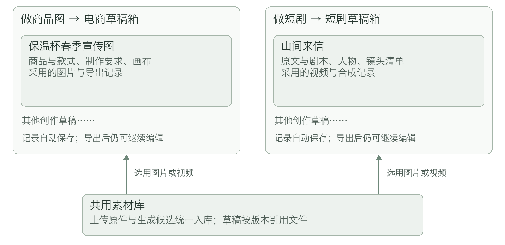
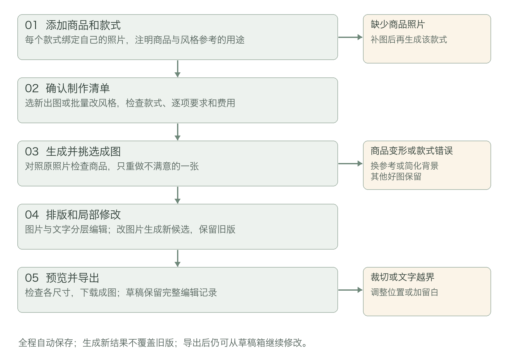
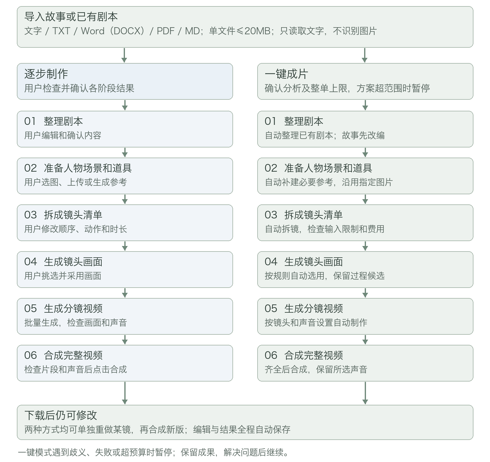
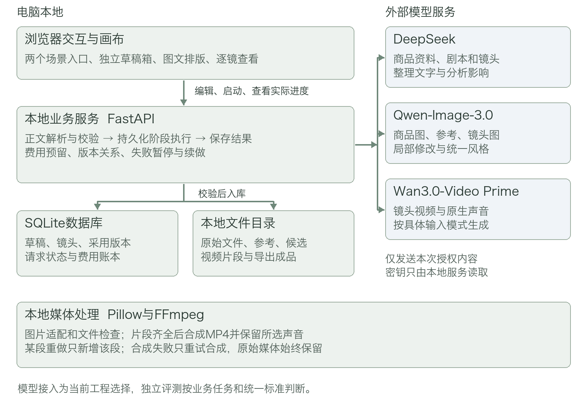

# 视觉创作工作台产品需求文档

版本：V0.6　日期：2026年11月4日　适用范围：产品设计 技术实现与功能验收

## 1 项目背景与核心问题

视觉创作工作台是一款面向图像与视频内容创作者的电脑端创作应用，提供电商素材和短剧制作两个场景。应用在本地管理草稿、素材和编辑结果，通过模型 API 完成文字整理、图像生成和视频生成。

电商制作需要把商品原图加工为不同款式、风格和尺寸的宣传图。创作者通常需要在出图、排版和尺寸工具之间搬运素材，人工核对每张图属于哪个款式。商品形状、颜色或包装被改错时，需要重新处理，但不应牵连已经完成的其他图片。

短剧制作需要把文字变成可拍摄剧本，再准备人物和场景、拆分镜头、生成画面和视频，最后合成。环节之间存在依赖：人物设定改变可能影响多段视频，递信动作改变可能影响后面开信的剧情。只连接多个生成按钮，不能解决角色混淆、剧情断裂、失败重做和成果保存问题。

产品将这些环节组织为可以继续编辑的创作流程，保留原始材料、每次生成结果和采用关系。用户既可以逐步检查，也可以授权系统自动完成短片，发生问题后从具体环节继续。

## 2 目标人群与产品目标

### 目标用户

| 人群 | 主要任务 | 需要解决的问题 |
| --- | --- | --- |
| 电商运营与小型商家 | 为多个款式制作商品图、场景图及宣传图 | 款式与照片对应，商品外观准确，统一风格和批量尺寸导出 |
| 电商视觉设计与内容人员 | 对生成图片排版、改价和局部修改 | 图文分层可编辑，改一处不必重做整套素材 |
| 短剧与故事视频创作者 | 从故事或已有剧本制作完整短片 | 不熟悉分镜也能开始，多角色不混淆，视频可单镜重做 |

### 产品目标与验收口径

目标是让用户在同一应用中完成两条创作链路，并能从草稿箱恢复继续。以下是产品验收目标，不是对任意输入的模型成功率承诺。

| 目标 | 验收方式 |
| --- | --- |
| 电商制作形成闭环 | 两个款式分别生成展示图和场景图，完成分层排版、多尺寸导出及已有图片批量改风格 |
| 短剧提供两种完成方式 | 故事逐步制作、已有剧本一键成片、故事一键成片均覆盖完整环节；没有固定镜头数量 |
| 多角色和声音可检查可修正 | 逐镜追溯人物、参考、对白及采用视频；不支持的组合拦截，错误片段可单独重做 |
| 创作过程可恢复 | 编辑停止约2秒后触发自动保存；恢复最近明确显示已保存的内容，不误报结果状态 |
| 制作费用和失败处理透明 | 每次付费提交有记录，未结算占预留；预算不足或结果不明时暂停，不盲目重发 |

内容质量按独立评测方案核对商品事实、情节、角色、动作和声音。关键事实错误不能以画面美观或生成速度补偿。

## 3 产品范围与功能优先级

P0为核心闭环：两类独立草稿箱、共用素材库、自动保存与恢复；电商款式绑定、出图、批量改风格、分层排版和多尺寸导出；故事与剧本导入、分段处理、角色参考、逐步制作、一键成片、批量视频、单镜重做、原生声音保留、合成与导出；输入校验、费用预留和异常续做。

P1为完整性增强：回收站保留30天、完整草稿备份包导出与导入、片段音量微调。P0仍须支持复制草稿、删除前影响提示、保留已保存成果及保存失败时下载当前文字和设置；完整备份能力不替代自动保存。

本版不包含图片文字识别、专业时间线剪辑、多集长篇管理、独立配音工程、声线克隆、专业口型修复、账号协作和自动发布。长文本按单份创作的章节处理，不建立多集生产系统。

## 4 创作记录与素材管理

视觉创作工作台面向需要制作商品图片和短剧视频的用户，在电脑浏览器中提供“做商品图”和“做短剧”两个入口。电商场景将商品照片制作成可排版、可导出的宣传图；短剧场景将故事或剧本制作成分镜画面、视频片段和完整短片。

短剧支持两种制作方式。“逐步制作”适合希望逐项检查和修改的用户；“一键成片”适合已有剧本、希望自动完成制作的用户。两种方式使用同一份创作草稿，可以中途切换，已有内容与生成结果保留。所有编辑和阶段结果自动保存。

### 草稿箱和素材库各管什么

草稿是一次创作的完整工作记录。电商草稿记录商品、款式、制作要求、画布和成图选择；短剧草稿记录原文、剧本、人物设定、镜头清单、视频版本和成片顺序。两类草稿分别管理，不共用同一份创作记录。

草稿箱是查找和继续这些记录的页面，不是另一份素材文件夹。每个入口都有自己的草稿箱；创建后即出现记录，导出成品后记录仍保留，可按“未导出”“已导出”筛选并继续编辑。

素材库保存实际使用的图片和视频文件，包括上传原件、人物与场景参考、生成候选。两个场景可以从同一个素材库选用文件。草稿记录“用了哪份素材、哪个版本、用在哪里”，而素材库负责保存文件本身。将素材加入草稿不会创建另一份原件，也不会把其他草稿的设定一起带入。

例如，同一张书桌照片可被商品图草稿用作场景参考，也可被短剧草稿用作地点参考。两份草稿分别设置用途，修改其中一份的排版、剧情或镜头，不影响另一份。替换素材时创建新版本，已有草稿继续引用原版本，用户主动换用后才改变。

导出的商品图和成片是某一时刻的结果文件。继续编辑草稿不会改写已经导出的文件；再次导出时生成新版本。素材仍被草稿引用时，删除操作必须说明影响，不能使已有创作记录失去文件。

### 数据和模型服务

草稿与素材保存在本地。生成文字、图片和视频时，通过外部模型 API 发送本次需要的文字和已选参考，结果下载到本地素材库。创作页说明本次将发送哪些内容，未选中的素材不上传；模型配置和密钥管理放在设置中。

## 5 电商素材从照片到成图

### 制作流程

用户准备商品照片，选择要做的图片，检查结果，再排版和导出。每一步的编辑与结果自动保存，离开后可以从草稿箱继续。

### 第一步 添加商品和不同款式

用户创建电商草稿，填写商品名称、已有卖点和目标风格，上传清晰照片。不同颜色、容量或规格分别建为一个款式，并绑定对应照片。例如同款保温杯的“米白色”和“深绿色”。行业中常称这种可独立售卖的款式为 SKU，界面使用“款式”。

没有绑定照片的款式可先留在草稿中，但不能开始要求保留实物外观的生成。缺少容量、材质、认证等信息时标为“待补充”，不能由 AI 编造。暂时用不到的信息不阻止其他步骤。

商品参考决定需要保留的外观，风格参考用于背景、光线或构图。每张参考图注明用途，例如“只参考桌面和光线，不使用图中的杯子”。

### 第二步 选择制作清单

支持商品展示图和使用场景图，用户选择尺寸、风格、数量和商品款式。开始前逐项展示所用款式、照片、图片类型、数量与预计费用，允许删改。

例如两款杯子各做一张商品展示图和一张场景图，共四张。实际数量由用户选择和批次规则控制。

### 已有图片批量改风格

用户可从本草稿或素材库多选已有商品图片，选择统一风格，生成逐张处理清单。每项保留原图、所属款式和商品参考；不能仅凭文件名推断款式。原图来自其他草稿时，先在当前草稿确认商品与款式对应，不带入其他草稿的编辑设置。

提交前预览“只换背景和光线”“统一插画风格”等具体改动范围、保持项和逐项费用。系统逐张生成候选，不覆盖原图，也不自动改写画布。用户可逐张采用、批量采用已检查结果，或只重做失败项；某张失败不删除其余成功结果。改尺寸使用本地适配；改风格调用图像模型，不能把两者混为同一收费动作。

### 第三步 检查和选择成图

用户确认清单与费用后开始生成，每张分别显示结果和来源。用户检查形状、颜色、图案、包装文字及款式是否正确。模型返回文件不等于商品外观准确，界面保留与原照片对照的入口。

每张图片可采用、重新生成、修改要求或标为不用。只重做选中的图片，其他结果保留。再次生成前显示新增费用；商品被改错时，可更换清晰参考或简化背景。

### 第四步 排版和局部修改

画布支持图片、标题、卖点和价格等独立图层，可移动、缩放、调整前后顺序、撤销和重做。关键文字通过文字层编辑，避免依赖模型写对价格、容量或品牌。

若修改图片本身，例如“去掉左边的花，商品不变”，使用选中图片生成新候选。新旧版本均保留，用户采用后替换画布图片；画布中的其他图层不受影响。

### 第五步 预览和导出

提供主图、竖版和横版尺寸预设，支持自定义宽高。改变尺寸时选择完整保留并加留白，或裁切填满并调整位置；不能拉伸商品。文字越界时提示调整。

各尺寸预览确认后，可单独下载或打包下载。导出应包含可见图片与文字图层。可编辑画布、生成候选和所用素材版本自动留在草稿中，后续改价无需重新生成全部图片。

## 6 短剧从故事或剧本到完整视频

### 两种方式共用一条制作流程

故事需要先改编成包含人物、场景、动作和对白的剧本；已有剧本则直接整理结构，保留原有剧情，再拆成镜头。每个镜头先生成关键画面，再生成视频片段，最终按顺序合成完整短片。

逐步制作由用户确认各阶段结果；一键成片由系统在事先确认的方案和费用上限内自动接续步骤。区别在于谁来确认和采用阶段结果，所需制作环节相同。

### 第一步 导入故事或剧本

支持直接输入文字，以及上传 TXT、Word（.docx）、PDF、Markdown（.md）文件。用户选择“这是故事”或“这是已有剧本”；系统可给出识别建议，但不直接覆盖用户选择。已有剧本不重复改编主剧情。

导入区域固定显示：“这里只读取文字，不识别图片。扫描版 PDF、插图中的对白和图片里的文字不会被读取，请先转换为可复制的正文。”Word 按文档顺序读取正文和表格单元格文字。PDF 按页提取文字层，多栏、表格或复杂排版可能顺序不正确，必须提供逐页预览和编辑入口；不能承诺还原所有阅读顺序。图片、批注和页眉页脚不作为剧情正文，重复页眉页脚的自动移除结果可在预览中核对。

读取完成后展示文件名、正文字符数、正文预览和未读取内容提示。PDF 没有文字层时不进入生成；部分页面没有可提取文字时列出页码，由用户检查并补齐。Word 中存在插图也提示不读取图中信息。解析成功不能直接标为内容完整。

原始文件、提取正文和后续改编稿分别保留，修改剧本不覆盖原文。旧版 .doc 文件提示另存为 .docx；加密文件提示提供可正常打开的未加密副本。无法读取时提供更换文件或粘贴正文，不发起模型调用。

### 文件大小和正文长度分别限制

文件大小影响上传和读取，正文长度影响一次改编需要处理的内容。两者分别检查，不能用“文件小”代替“正文不过长”。以下均为产品规则，可通过配置调整。20MB按20,000,000字节计算，字符按Unicode码点计数；浏览器与服务端使用同一口径。

| 检查对象 | 规则 | 超出后的处理办法 |
| --- | --- | --- |
| 单个导入文件 | TXT、DOCX、PDF、MD 均不超过20MB；导入前显示限制 | 拒绝本次导入，显示实际大小和20MB上限；建议移除图片后另存、导出纯文字，或按章节拆成多个文件。压缩包不能直接代替正文文件 |
| 单次导入数量 | 每次导入1份文件；后续章节可分次加入同一草稿 | 导入时明确选择“追加章节”或“替换原文”；替换保留旧版本，不覆盖其他已完成章节 |
| 提取后正文 | 单份文件最多200,000个字符，按Unicode字符计数，包含空格和换行 | 不截取前半段冒充完整内容；提示拆分章节后重新导入，可下载已提取文字用于整理，但未完整导入不能开始生成 |
| 直接输入区 | 累计超过5,000个字符时，自动转为 UTF-8 TXT 附件 | 保留当前全部正文并自动挂入草稿，提示“正文较长，已转为TXT”；可展开编辑或下载，不要求再次上传。达到文件或正文上限时按同样规则处理 |
| 单次故事改编或剧本整理 | 一次最多处理20,000个字符；还须满足当前模型的输入限制 | 展示按章节或场景拆分的建议及完整覆盖范围；用户确认后分段处理，并沿用人物表、已发生事件和道具状态。再做跨段合并与矛盾检查，分段本身不能代替完整性检查；须为分段摘要和输出预留模型上下文。模型限制更小时采用较小范围 |

文件大小在浏览器和本地服务两处校验，超限内容不进入模型服务。转换为 TXT 只是改变输入的呈现方式，不意味着突破正文或模型输入上限。若原文件因内嵌图片变大，优先建议导出纯文字；若纯文字仍过长，建议按章节拆分。

拆分后显示章节清单和每段是否已处理，不能静默漏章。一键成片须先明确全部章节的覆盖范围和目标片长，在统一授权中纳入分段分析和制作费用；分析后的详细安排超出授权时暂停，超出当前可处理范围时暂停并提供拆分入口，而不是仅生成前一部分。

### 第二步 整理剧本

故事改编成可拍摄剧本，明确发生地点、出场人物、行为、对白和场景顺序。已有剧本主要补齐结构和制作字段，不能未经说明改变人物关系、剧情结局或对白含义。

原文中身份冲突、转折缺失等影响剧情的问题列为待确认项；AI 补充的外观或拍摄描述标明来源。逐步制作中，用户可以编辑、局部重写并确认剧本。一键模式下，未提供的外观与拍摄细节可按所选画风补充；影响主剧情的歧义必须暂停询问。

### 第三步 准备人物场景和道具参考

从剧本整理人物、地点和关键道具卡片。支持多个角色，可从素材库选择、上传自己的图片，或生成设定参考。人物卡片包含名字、外观、声音描述和采用版本；同一人物不同衣着或年龄阶段分别命名。声音描述用于保持同一角色的说话特征，不等同于模型已经能严格锁定同一音色。

只为影响画面辨识的内容准备参考，不要求所有物品都配图。逐步制作可边做边补；一键模式自动为缺少图片的必要卡片生成参考，并计入总费用。已有指定参考优先使用，不能无提示重建人物。

### 第四步 拆成镜头清单

分镜脚本就是“每一小段视频拍什么”的清单。每个镜头包括顺序、人物、地点、动作、说话角色与对白、环境声和音效要求、画面远近、镜头移动、预计时长和参考素材。界面使用“全身远景”“脸部近景”“镜头慢慢靠近”等说明。对白太长时延长到可用时长或拆镜，不直接删词或让多人挤在同一时刻说话。

镜头数量由剧情、目标片长和视频能力决定，没有固定数量。用户可增加、删除、拆分、合并或调整顺序。例如“递信”和“打开信”可分成两段，避免一段塞入过多动作。展示每镜将使用的图片与用途，不把整部剧的所有参考都发送给模型。

逐步制作中，用户确认清单后生成画面；一键模式自动拆镜，对照角色名单、必要字段、单镜时长、参考限制和费用检查。无法满足限制时尝试拆镜，仍无法处理则暂停并说明受影响镜头。

### 第五步 生成镜头画面

分镜图是镜头的关键画面，可作为视频开头的画面。支持单镜或勾选多镜批量生成，逐步制作中由用户选定用于视频的候选，检查人物、衣着、道具、位置和构图。

一键模式按已确认的自动制作方案，采用首个通过文件与格式检查的候选继续生成视频，并标为“自动选用”。这表示按规则接续流程，不代表已验证人物和动作准确；人物一致性与剧情表现需要在成片后复核。旧候选和来源始终保留。

### 第六步 生成分镜视频

逐步制作中，用户勾选已采用画面的镜头，一次提交后逐个处理；一键模式自动处理整个镜头清单，可按批次连续完成，不要求用户逐镜点击。

每项记录所用画面、动作与声音要求、时长、模型输入方式和费用。生成设置提供“生成原生声音”和“无声视频”；所选模型支持且通过验证时，默认按镜头要求生成对白、环境声和必要音效。仅支持首帧时使用分镜图；支持且已验证多参考的模式才附加人物或场景参考。不能把接口不接受的图片悄悄丢掉。

模型是否有声音能力按具体版本、模式和账号配置核对。有声与无声可能费用不同，提交前分别展示；模型不能生成所需声音时明确说明，可由用户选择已验证的其他配置，或主动改为无声制作，不能静默降级。用户未要求的背景配乐不主动添加。

每段可单独播放和重新生成，多版并排保留，明确标出当前采用版。只重做某个镜头，不影响其他片段。一键模式完成后同样允许逐镜替换，再重新合成。

### 第七步 合成并导出

按镜头顺序将当前采用片段连接为 MP4。逐步制作中，先展示顺序、片长和缺失项，用户可调整并点击“一键合成”；一键模式完成全部必要片段后自动合成，直接提供完整视频。

完整成片必须包含最终清单中的全部必要镜头，且视频文件可读取、时长与尺寸符合要求。缺失或损坏时暂停，不能跳过后宣称完整。用户可主动排除某些镜头；合成不完整内容时明确标为“片段预览”。

合成默认保留模型片段的原生声音，检查音轨没有丢失、对白未被截断、声音与画面没有错位。提供静音选择，P1增加片段音量调整；跨镜的明显音量跳变、音色漂移或背景声音突变需提示检查。原生有声能力不等同于剧本对白一定准确，用户仍可逐镜检查说话角色、台词和口型表现。

导出可选择保留声音或静音版，不能无提示删除原有声音。静音导出只改变导出文件，不降低已经发生的有声生成费用，原片音轨保留。对白错误、说话人不对或明显音色变化时，可修改该镜要求并单独重做；选择静音版不能作为对白问题已经解决的证明。

导出包含成片、采用片段、剧本、镜头清单和素材对应关系。静态图片串联只标为分镜预览，不能替代真实视频片段。本版使用视频模型自身的音画生成能力，不另建独立配音、声线克隆或专业口型修复流程。

### 一键成片的完整交互

用户上传已有剧本后，在同一页选择画风、比例、目标片长、声音模式和本次总费用上限。系统先在本地免费读取文字、检查导入完整性和大小，显示待发送内容。制作概览同时列出文字分析费用上限、自动补参考规则、镜头与参考数量的估算范围、后续图像和视频费用预留；这里的“免费”仅指本地文件处理，不包含模型分析。

点击“一键生成完整视频”，授权系统在整单上限内先进行有界的文字分析，再自动整理剧本、补建参考、拆镜、生成画面和视频、合成下载文件。故事输入自动包含改编剧本。文字分析本身计费并占整单预算；若仅分析后就停止，已经发生的分析费用仍保留。

分析后形成详细镜头、参考与费用清单。清单未超出已授权的规格、数量范围和预算时自动继续，无需再逐阶段确认。发现关键剧情歧义、估价无法核对、费用不足或计划超出授权范围时暂停，显示已用分析费用和变更项；用户调整或追加授权后继续，不重复执行已经完成的分析。完整正文未读取时不开始模型分析。

执行页显示当前阶段、已完成和待处理镜头，以及已花费和待结算费用。用户可打开阶段结果检查，也可以等待成片。自动采用的内容标为“自动选用”，生成后显示“完整视频已生成，请检查人物、动作、剧情与声音”；不要求用户逐镜确认才能拿到最终文件。有声模式发现必需音轨缺失时暂停处理，不能自动去音后仍作为有声成片提交；有音轨也不代表台词和音色已经正确。

遇到必要参考无法补齐、超过参考限制、请求失败、预算不足或剧情歧义时，暂停后续步骤，列出具体原因和处理入口。用户解决后点击继续，只补未完成或受影响的部分。默认不自动发起额外付费重试；如需启用，开始前单独设置重试次数与费用，并计入总上限。

用户可暂停后续制作；已提交的请求在平台支持且已取得任务编号时查询原状态；缺少可查询信息时标为结果不明，不能承诺立即撤销或退费。手动修改上游内容时，暂停尚未提交的后续步骤，展示影响范围，确认后按新版本继续。已经完成的内容不自动覆盖。

## 7 生成限制与修改影响

### 多角色和参考图片

草稿可以登记多个角色和场景，每镜只选择实际需要的参考。每张图注明人物身份、场景、道具或风格；同一人的多张照片也按图片张数计算，不能把人物数量等同于参考数量。

可用组合取模型当前输入方式的接口限制与实际验证范围的交集。界面说明上限及原因；未验证的组合不能直接宣称可用。两个人物加场景、道具与多张同角色照片分别作为不同组合检查，不只检查图片总张数。

参考过多时可删去非关键项、合成一张明确的构图参考或拆成多个镜头，改变参考方式前展示处理方案。视频只支持首帧时，先在分镜图中安排好人物、场景和道具；切换多参考模式时重新核对支持条件，不能假设所有模式的效果相同。

### 其他制作限制

| 对象 | 产品规则 | 不满足时的处理办法 |
| --- | --- | --- |
| 图片上传 | PNG、JPEG、WebP，单张不超过16MB；实际发送须满足模型更小的限制 | 保留原件，提供压缩或格式转换建议，不无提示裁切人物或商品 |
| 商品款式 | 每款保留外观的生成必须有独立绑定照片 | 缺图款式暂不生成，其他已准备款式可继续 |
| 批次 | 单批默认最多20张图片或10段视频；不限制整份草稿的总数量 | 分批处理；一键成片在已确认总清单和费用内自动接续各批 |
| 单镜时长 | 使用所选模型支持且验证过的档位 | 按动作拆镜，不静默删减关键剧情 |
| 输出比例 | 先选横屏或竖屏，后续镜头保持一致 | 改比例先预览适配，旧素材保留，必要时重做 |
| 分辨率和费用 | 制作前展示规格、预计费用和本次总上限 | 不自动升级清晰度或切换更贵平台；额度不足暂停后续提交 |

所有已提交但未拿到结果的请求都计入费用预留。不能只按已经扣款的金额判断是否超限；没有可核对估算时先完成报价或经用户授权的单项试制，再允许整批制作。

### 上一步改动如何影响后面

改标题文字和镜头顺序通常不需要重新生成；换商品照片、人物外观或镜头动作可能影响已有画面和视频。系统列出受影响内容，标为“需要重新检查”，保留旧结果。

影响按“引用关系”和“剧情状态”共同判断。改人物外套时，引用旧人物版本的镜头画面与视频需要复查。只调整镜头移动速度且不改动作终点时，通常只影响该段视频；若改变起始姿态，画面也需复查。将“递出信”改为“收回信”，还必须标记后续“B打开信”等依赖信件持有者的镜头，不能只标记当前视频。

镜头记录进入状态、发生事件、结束状态及依赖的前序事件。程序先依据素材引用、角色与道具状态规则找出直接影响，再由文字模型辅助发现跨镜语义影响；模型的影响清单不能作为保证。用户确认改动范围后才能将受影响结果重新标为可用。一键模式暂停无法确定的相关后续步骤，其他无关结果保留。删除或调整顺序同样检查前后因果，旧文件不删除。

逐步模式由用户选择重做或继续采用旧版；一键模式先暂停受影响的后续步骤，重新确认变化后的计划与费用。生成新候选不覆盖旧版本，重新采用片段后需重新合成，已导出文件保持原样。

## 8 自动保存与草稿恢复

草稿箱展示名称、封面、最近自动保存时间、当前步骤和导出状态。支持新建、继续、重命名、复制、删除与回收站恢复。复制后创作内容独立，底层原素材可共用，不能相互覆盖。

输入停止约2秒后自动保存；切换步骤、采用新素材和生成阶段完成时立即触发保存。界面显示“正在保存”“已保存”“保存失败”。“已保存”只在本地记录及对应文件成功写入后显示，不依赖用户点击保存按钮。

浏览器暂存尚未写入本地服务的修改。刷新后自动恢复已保存状态；发现较新的临时内容时，展示差异并提供恢复，不直接用旧版本覆盖。保存失败时保留当前内容并自动尝试恢复，持续失败时提供当前文字和设置下载，媒体仅能下载已经成功保存的文件；不能假装保存成功。

草稿保存全链路内容与采用关系：电商包含商品、款式、参考、候选、画布和尺寸；短剧包含导入原文、剧本、设定参考、镜头清单、候选、片段及顺序。生成请求记录提交时的输入版本，继续编辑不能改变已提交内容。

P0删除前展示影响，素材仍被引用时禁止连带物理删除。P1提供30天回收站和完整草稿备份包恢复；同名恢复创建副本，缺失文件明确列出，密钥不进入备份。回收站仍被其他草稿引用的素材不能随单份草稿清理。

## 9 失败与不满意时如何继续

所有异常处理保留原输入、已有结果和实际处理进度，说明哪里需要操作。没有拿到真实结果时不能用示例或静态图替代并标为成功。

### 导入和整理阶段

| 情况 | 显示内容 | 处理办法 |
| --- | --- | --- |
| 文件超过20MB | 实际大小、允许上限、尚未导入 | 去除内嵌图片、导出TXT或按章节拆分，换文件后重试；不发送模型 |
| 正文超出导入或单次处理限制 | 正文字符数、对应上限、未处理范围 | 导入上限超限时拆文件；处理上限超限时确认章节清单再分段，不直接截断 |
| 扫描PDF或部分页面无文字层 | 无正文或疑似未读取页面的页码 | 用户先转为可复制正文，或补齐对应段落；一键模式暂停等待确认 |
| 加密、损坏或格式不支持 | 文件名和具体读取问题 | 提供未加密副本、另存DOCX或粘贴正文，不丢弃当前其他内容 |
| 剧情矛盾或身份不清 | 原文位置、待确认项与建议 | 修改后继续；不得把猜测当作原文事实自动进入后续视频 |
| 一键模式缺少角色或场景图片 | 自动补建清单及预计费用 | 在已同意的方案内生成参考；无法完成时暂停，允许上传或选择已有素材 |

### 图片与视频阶段

| 情况 | 显示内容 | 处理办法 |
| --- | --- | --- |
| 没有可用模型或额度不足 | 当前不能开始的原因与已完成部分 | 补配置或额度后继续；可编辑草稿，不静默切换平台 |
| 参考数量或组合不支持 | 超出哪项限制、受影响镜头 | 精简参考或拆镜；一键模式无法处理时暂停，不静默丢图 |
| 请求被拒绝 | 原因和当前输入版本 | 调整后重做该项；重试费用单独显示 |
| 网络断开或结果超时 | 结果暂不能确认 | 有任务编号且支持查询时查询原请求；没有编号或不能查询时标为结果不明，保留时间和输入供对账，由用户决定是否新建付费请求，不保证一定找回或一定未收费 |
| 商品变形或包装文字错 | 原照片与结果对比 | 重做该图、简化背景或换参考；宣传文字优先用文字层修正 |
| 人物变化或动作错误 | 当前采用版、参考版本和局部重做入口 | 只重做对应画面或视频，可减角色、简化动作或拆镜；其他结果保留 |
| 声音缺失、台词错误或说话人不对 | 当前声音模式、镜头对白与原片播放入口 | 缺必需音轨时暂停；内容问题只重做对应片段，或由用户主动选静音导出，不悄悄去声冒充修复 |
| 一键生成未通过文件检查 | 具体失败阶段和已完成镜头 | 暂停后续，修复并继续；不默认开启无限收费重试 |
| 用户修改上游内容 | 受影响画面、视频及未提交步骤 | 暂停受影响步骤，保留旧候选，确认新方案后继续 |

### 合成保存和导出阶段

| 情况 | 显示内容 | 处理办法 |
| --- | --- | --- |
| 必要镜头缺失或视频损坏 | 镜头编号与缺项 | 一键成片暂停并补齐；用户主动选择不完整合成时标为片段预览 |
| 比例或尺寸不一致 | 留白或裁切的适配预览 | 逐步模式确认后适配；一键模式按开始时选择的方式处理，不拉伸人物 |
| 合成失败 | 保留完整片段和合成顺序 | 修复后只重试合成，可先下载片段，不重新生成全部视频 |
| 合成后音轨丢失、错位或截断对白 | 原片与成片的对照、异常发生位置 | 原片正确时只修复合成；原片声音本身错误时再单独重做该镜，不默认整片重生成 |
| 下载链接失效 | 哪份文件尚未成功保存 | 支持查询时尝试找回原请求；无法找回时说明保存未完成及重做费用，不展示失效成功链接 |
| 自动保存失败或磁盘空间不足 | 未保存状态和当前内容 | 保留临时内容，空间恢复后重存，能读取当前内容时提供文字和设置下载；磁盘不可写时不承诺完整媒体备份 |
| 浏览器关闭或本地服务重启 | 上次草稿与实际任务状态 | 服务仍运行时按已授权方案继续；服务中断则恢复后先核对请求，不自动整轮重做 |
| 成片效果不满意 | 完整成片与每镜来源、采用版本 | 进入逐步制作修改某镜并重新合成，复用其他片段 |

示例素材在页面和产物清单注明来源；静态分镜预览与真实视频成片分别标识。一键自动完成流程也不等同于自动保证内容质量，成片保留可检查、可修改的来源。

## 10 页面与操作组织

首页提供“做商品图”“做短剧”“素材库”。进入场景后显示相应草稿箱，可继续旧稿或新建。草稿箱负责管理创作记录；素材库按图片、视频、上传来源和生成来源筛选，文件可查看被哪些草稿引用。

电商编辑页按商品与款式、制作清单、结果挑选、排版、导出组织。短剧新建页提供逐步制作和一键成片入口，共用导入区；导入区始终显示支持格式、单文件20MB、仅读文字及长文本自动转TXT规则。

逐步短剧页按原文、剧本、人物与场景、镜头清单、镜头画面、视频、合成导出组织。一键页突出方案概览、总费用上限、当前阶段和处理异常；用户可展开阶段结果或切换到逐步编辑。

进度显示实际阶段与已知数量，例如“正在生成第2段视频”“3段已完成，1段需处理”，不虚构百分比或精确剩余时间。自动保存状态始终可见，返回草稿箱不删除制作记录。

## 11 Demo技术方案

### 运行形式与整体架构

采用本地单用户网页应用。用户启动本地服务后，在电脑浏览器访问；草稿、数据库和媒体文件存放本机，模型推理经联网 API 完成。服务默认仅监听本机地址。浏览器负责交互和画布，本地服务负责文件解析、模型调用、流程状态和媒体处理。

| 模块 | 技术选择 | 具体职责 |
| --- | --- | --- |
| 页面与画布 | React、TypeScript、Vite、react-konva | 草稿箱、制作步骤、图片文字图层、撤销重做、尺寸预览与导出 |
| 本地业务服务 | Python、FastAPI、Pydantic | 草稿与素材接口、输入校验、模型适配、阶段执行、费用记录 |
| 数据与文件 | SQLite与本地文件目录 | 保存草稿、输入快照、阶段状态和采用关系；媒体按独立文件存储 |
| 正文解析 | python-docx、pypdf、纯文本解析 | DOCX正文和表格、PDF文字层、TXT与MD正文；不调用OCR |
| 图片与媒体处理 | Pillow、FFmpeg、ffprobe | 图片格式与尺寸检查，片段检查、尺寸适配、保留音轨合成MP4 |
| 模型接入 | 独立HTTP适配层 | DeepSeek处理文字，Qwen-Image-3.0出图和改图，Wan3.0-Video Prime生成视频 |

具体依赖版本在实现时锁定并随项目交付，避免自动升级改变运行行为。浏览器构建产物由同一本地服务提供，不需要外置数据库或部署云端应用。画布保存独立图层对象；模型出图作为图片图层，不依赖模型原生图层拆分能力。［S4至S6］

### 模型分工与当前接入配置

当前工程模型固定为：DeepSeek（文字）、`qwen-image-3.0`（图像标准版，不自动替换为Pro）、`wan3.0-video-prime`（视频优速版）。配置选择与能力验证分别记录；模型评测的样本、客观指标、主观维度及通过门槛不因接入品牌调整。

Qwen-Image-3.0改图按当前官方接口最多3张输入参考做提交前校验；人物、场景、道具共同占用名额。超限时展示待选参考，允许拆镜、改用已确认分镜图或由用户选择参考，不静默丢弃，也不承诺任意数量角色一致。模型名额与实际可用的一致性组合分别验证。

Wan首帧模式与全模态参考模式分别配置，不能混传`first_frame`与`reference_image`等互斥类型。默认720P、按镜头显式指定时长与`audio`；片段生成后校验真实音轨，有声要求未满足时保留片段并提示重做或由用户选择无声，不能自动判为通过。任务提交、查询与结果下载独立保存，网络超时先核对原任务，不直接重新创建。

| 工作 | 当前模型路线 | 初始配置 |
| --- | --- | --- |
| 商品资料、故事改编、剧本与镜头 | DeepSeek | deepseek-flash；冻结本次实际服务版本与调用日期 |
| 商品图、人物参考、镜头图、图片修改 | Qwen-Image-3.0 | qwen-image-3.0；按接口支持的宽高配置；默认单次输出一张 |
| 镜头视频与原生声音 | Wan3.0-Video Prime | wan3.0-video-prime；初始720P、首帧图生视频，按镜头时长调用 |

以上配置作为当前接入初值。DeepSeek别名可能对应更新版本；每次运行记录真实版本，供应商没有暴露精确版本时明确注明。当前模型选择不改变独立评测的任务、指标、权重或门槛，评测不通过的配置不能仅因已接入就标为可用。远端服务未公开精度和量化方式时记录“服务商未披露”，不填写本地部署参数。［S1至S3］

DeepSeek使用https://api.deepseek.com，由服务端提交文字请求。Qwen-Image-3.0与Wan3.0-Video Prime通过千问AI平台的按量付费API接入，共用本地DASHSCOPE_API_KEY；DeepSeek使用独立密钥。接口地址按平台调用示例配置，不沿用火山方舟地址或参数。图片逐张调用；产品的批量处理默认单次输出一张，不依赖原生组图。Wan3.0-Video Prime默认按镜头采用画面生成视频，原生声音开关audio显式设置；多参考是另一种输入模式，不能直接把独立参考拼进首帧模式。［S1至S3］

初始支持横屏与竖屏；视频时长必须取已核对且验证过的范围，生成前把长动作和长对白拆开。当前视频输出不承诺4K。写实人像输入受平台素材与授权机制约束，优先用已验证可接入的虚构角色；同平台生成的图片也需确认是否满足视频输入条件，受限时提示换用合规素材或非写实画风，不自动改成人物无关的画面。［S3］

### 数据如何保存和衔接

数据库记录Draft草稿、Asset素材及版本、ProductVariant商品款式、ScriptSection正文章节、ReferenceCard人物场景道具、Shot镜头、GenerationAttempt生成尝试、Adoption采用关系和Export导出。两种场景共用存储结构，不共用同一草稿内容。镜头包含人物、参考用途、对白、起止状态与前序事件；生成尝试保存完整输入快照及本地编号，平台任务编号允许为空。

本地目录按原件、生成候选、临时下载和导出区分。服务端先保存输入快照和费用预留，再提交模型；返回的媒体先下载到临时区，校验格式、可解码性、尺寸、时长和必需音轨，再以原子方式转入素材目录，最后用数据库事务登记版本和结果。只有完成文件及数据库写入才显示已保存，不能仅凭HTTP成功就进入下一步。

自动保存采用草稿版本号防止旧页面覆盖新修改。浏览器临时修改存入IndexedDB；服务端恢复时对比版本，出现冲突让用户选择恢复内容或另存副本。原始媒体和已经导出的文件不可原位覆盖。孤立临时文件在启动恢复检查中处理，不自动删除可能仍可找回的产物。

### 自动制作如何执行

用持久化阶段执行器按依赖顺序处理当前制作清单，每完成一步就保存检查点。步骤为文字整理、素材卡、必要参考、镜头清单、镜头图、镜头视频、合成；有故事输入时先改编。文件解析和字段校验由程序执行，DeepSeek负责内容整理，Qwen-Image-3.0和Wan3.0-Video Prime负责生成；不能只在浏览器页面中保留运行进度。

每个阶段显示待开始、处理中、等待处理、结果不明、失败或已完成。每次生成保存一份独立尝试，重做不覆盖前次记录。自动采用仅表示格式和依赖检查通过，不表示程序已经确认人物、剧情和声音完全正确。P0没有自动审美评判或自动修脸修音机制。

前端关闭而本地服务仍运行时，已授权流程可继续；本地服务重启后先读取阶段记录。已收到Wan3.0-Video Prime任务编号时查询同一任务；DeepSeek或图片请求没有可用查询编号时，响应丢失不能推断远端未执行，进入结果不明状态。用户核对账单或决定重发后，才新建尝试。适配层关闭SDK隐式付费重试；默认只自动重试已知任务的状态查询和本地下载；用户显式启用有界付费重试时，每次创建新尝试，重新预留费用，并受次数和整单上限约束。

用户改动上游时，先停止提交受影响的后续步骤，保留正在执行请求的输入快照。旧请求返回也不能自动覆盖新草稿。按素材依赖及剧情状态标记复查范围，用户确认后继续；无法判断的因果关系需人工确认。

### 导入合成与费用的实现规则

上传先检查实际字节数、文件签名和可解析性，服务端不信任扩展名。DOCX同时限制解压后正文总量和解析资源；PDF逐页提取并设置处理时限，异常退出保留原文件。TXT与MD无法确定编码时要求选择编码或改存UTF-8，不静默用乱码进入改编。长文本按章节和场景切分，保存覆盖位置、人物别名、事件摘要与道具状态，合并后对照原文核查遗漏。

视频合成前用ffprobe检查全部必要片段及音轨，将画面适配到同一尺寸和帧率，时间戳从零开始；保留原片，合成副本使用浏览器可播放的H.264视频和AAC音频。无对白镜头在有声成片中仍可有环境声；用户明确选择无声时才生成或导出静音。单段对白过长不能通过截断音轨凑片长。合成失败只重试本地合成，不重新请求模型视频。

费用账本区分已核实消耗、待结算预留、下一步最大估计和可用余额。文字按输入输出上限预留，图像按张数，视频按模型的实际计价单位、时长、尺寸和声音模式估算；价格记录地区、币种、时间与来源。不能可靠给出上界时先停止后续付费提交。服务商计费变更、汇率和结算延迟会造成估算差异，费用上限控制提交行为，不承诺能撤销平台已经接受的消费；不明请求保留费用预留直到对账。

### 接口密钥与运行验证

密钥仅从本地服务环境变量读取：DEEPSEEK_API_KEY与DASHSCOPE_API_KEY；模型名和地域可配置。浏览器、导出包和日志不包含密钥。只发送本次授权内容，图片按对应接口支持的文件或URL方式传递，支持Base64时才使用Base64，提交前检查编码后的请求体大小；不要求把整个素材库设为公网可见。需要其他素材传输方式时，另行显示其上传范围和有效期。［S3］

运行环境包括受支持的Python与Node版本以及FFmpeg，安装版本和依赖清单随Demo交付。启动前检查本地目录可写、FFmpeg可用和必要模型配置；未配置Key时可以查看和编辑本地草稿，点击生成时提示配置。样例素材必须标示来源，不伪装成真实API结果。

技术验收覆盖冷启动、两个完整场景、正文边界、自动保存、阶段恢复、结果不明、局部重做、费用暂停及有声合成。产品自动流程需要在实际运行载体中执行才算通过；模型评测则独立记录模型输出质量，二者不能互相代替。

## 12 功能验收

| 编号 | 操作 | 通过标准 |
| --- | --- | --- |
| A01 | 分别新建商品图和短剧草稿 | 各自进入对应草稿箱，内容独立；可从素材库引用同一文件 |
| A02 | 添加两种颜色的商品并分别上传照片 | 清单准确对应款式，不串用照片 |
| A03 | 批量制作多款展示图和场景图，只重做一张 | 每张结果独立，其他已完成图保留 |
| A04 | 排版、撤销重做后直接关闭再打开 | 无需手动保存，可恢复最近显示已保存的图层和内容 |
| A05 | 改背景或道具后切换候选 | 使用选中原图生成，旧图和其他排版保留 |
| A06 | 按多种尺寸导出 | 尺寸正确，图文完整，不拉伸商品；导出后草稿仍可修改 |
| A07 | 分别输入文字或上传TXT、DOCX、PDF、MD | 正文可预览，原件保留，支持选择故事或已有剧本 |
| A08 | 导入20MB边界文件，以及超限、损坏、加密和旧版DOC文件 | 20MB及以内按格式规则读取，超限等异常显示各自原因与替代操作，不进入付费模型调用 |
| A09 | 导入扫描PDF和含无文字页的PDF | 明确不识图；无正文阻止生成，部分缺失列出页码并提示补齐 |
| A10 | 粘贴超过5,000个字符 | 自动转TXT并完整保留，无须重复上传，可展开编辑，仍校验正文上限 |
| A11 | 导入超过200,000字符或处理超过20,000字符 | 分别按导入和处理规则处理，不截断；章节清单显示覆盖与完成情况 |
| A12 | 由故事改编、由已有剧本直接进入制作 | 故事可转剧本，已有剧本不重复改写主剧情；原文和修改稿分开保留 |
| A13 | 准备多个角色并增删拆分镜头 | 数量不固定，每镜角色、参考、动作、顺序和时长可编辑 |
| A14 | 使用超出参考限制的组合 | 提供具体原因和精简拆镜入口，不静默丢图 |
| A15 | 逐步生成镜头画面和批量视频 | 已采用画面用于对应视频，可播放并核对来源 |
| A16 | 仅上传剧本或故事，选择一键成片并确认整单方案 | 自动补必要参考、拆镜、出图、出视频并合成完整MP4，不要求逐镜点击确认 |
| A17 | 一键过程中遇到失败或费用上限 | 暂停并保留结果；按预留校验阻止新增超限提交，重试有界，已受理消费及结算差异单列 |
| A18 | 自动成片后只重做某个视频 | 保留其他片段与旧版本，替换该段后可重新合成 |
| A19 | 合成清单包含缺失镜头 | 不能宣称完整；主动部分合成时标为片段预览 |
| A20 | 改角色外观、改变递信结果或调整镜头顺序 | 同时核对素材引用与剧情因果；标出后续开信等受影响内容，保留无关成果及旧版本 |
| A21 | 模拟保存失败、超时和本地服务重启 | 已保存草稿可恢复；支持查询且有编号时查原请求，其他标结果不明并停止自动重发，不承诺找回所有远端状态 |
| A22 | 复制及删除有引用素材的草稿 | 副本独立；删除前提示影响，仍被引用的文件不连带删除 |
| A23 | 选择生成原生声音，批量生成并合成 | 声音模式和费用明确，合成不擅自去音；对白、说话人与声音连续性按模型评测检查 |
| A24 | 从有声结果导出静音版 | 画面与时长保留，原片声音不受影响，不把静音导出说成降低了已发生的生成费用 |
| A25 | 检查声音错误及合成音轨异常 | 缺必需音轨时暂停；可单镜重做。原片合格而合成丢音时只重试合成，其他片段保留 |
| A26 | 多选已有图片，统一改风格并只重做一张 | 每张绑定款式与参考，改动范围明确；原图和其他成功结果不变，费用逐项可查 |
| A27 | 一键分析后计划超过授权，或结果存在关键剧情歧义 | 分析费用已计入；在图片视频生成前暂停，调整后复用分析结果继续；未超范围则自动接续 |
| A28 | 故事一键成片及跨段文字处理 | 故事自动改编后完成全链路；超过单次处理上限时全段覆盖，合并后人物和末尾情节保留 |
| A29 | P1回收、完整草稿备份及同名恢复 | 引用文件齐全，恢复生成独立副本，缺失文件列明，密钥不进入备份 |
| A30 | 模型返回成功但本地文件尚未写完 | 不显示已保存或采用成功；验证和入库后才允许依赖步骤继续 |

A01至A28及A30属于P0验收，A29属于P1验收。A23中的声音连续性包含主观判断，不由“文件存在音轨”代替。

模型内容质量另按评测方案检查商品保真、人物一致性、动作、对白与声音表现；产品验收同时检查流程可用、信息真实、异常可恢复。正式视频用例必须使用可播放的模型视频，静态预览和示例不能替代。

## 13 技术资料

资料核验日期为2026年11月4日。供应商文档用于核对接口和输入方式，效果以独立评测记录为准；文件大小、自动保存和费用授权属于本产品规则。

S1　[DeepSeek模型与API说明](https://api-docs.deepseek.com/quick_start/pricing/)

S2　[千问图像生成](https://platform.qianwenai.com/docs/developer-guides/image-generation/text-to-image)；[千问图像编辑](https://platform.qianwenai.com/docs/developer-guides/image-generation/image-editing)

S3　[万相3.0视频模式、输入素材与原生声音](https://platform.qianwenai.com/docs/developer-guides/video-generation/wan30-video)

S4　[FastAPI官方文档](https://fastapi.tiangolo.com/tutorial/background-tasks/)

S5　[React Konva官方文档](https://konvajs.org/docs/react/index.html)

S6　[pypdf文字提取及局限](https://pypdf.readthedocs.io/en/stable/user/extract-text.html)
