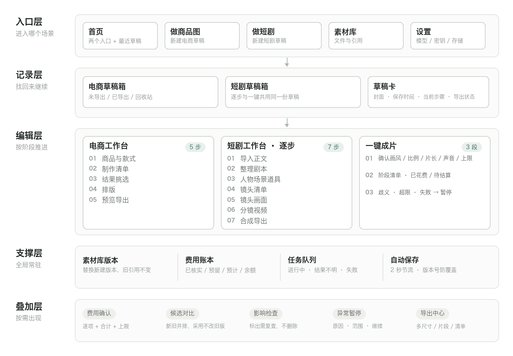
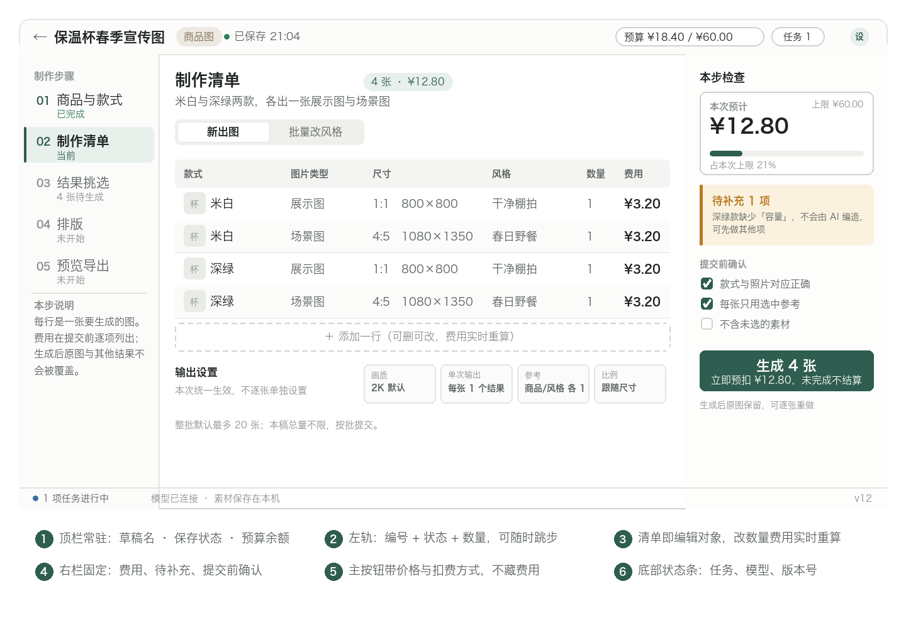
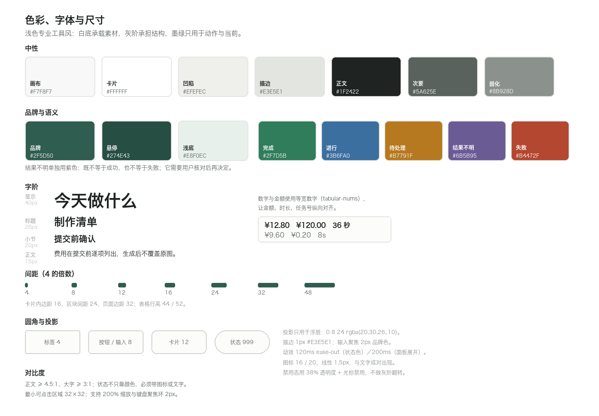
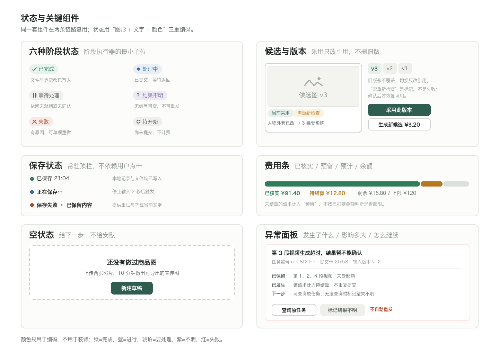
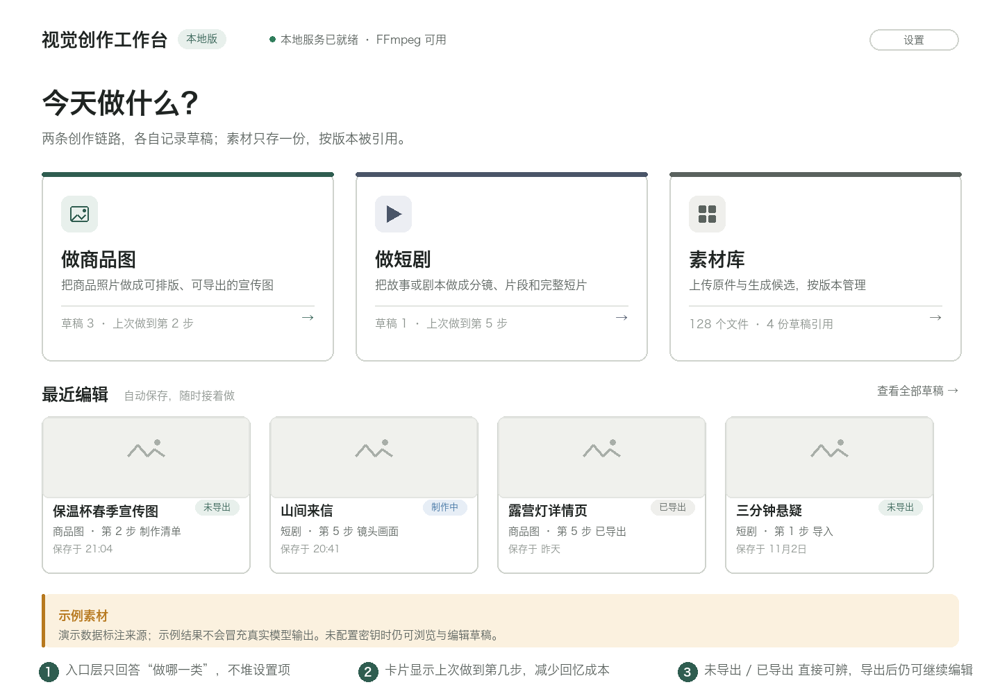
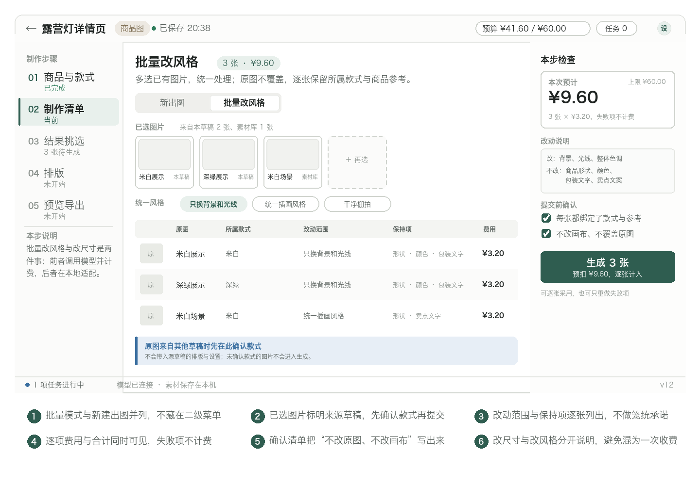
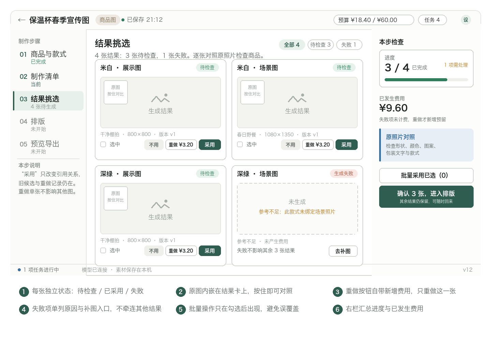
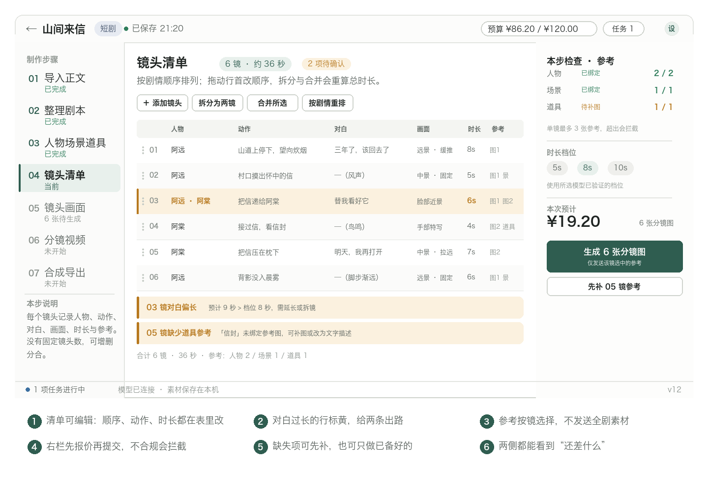
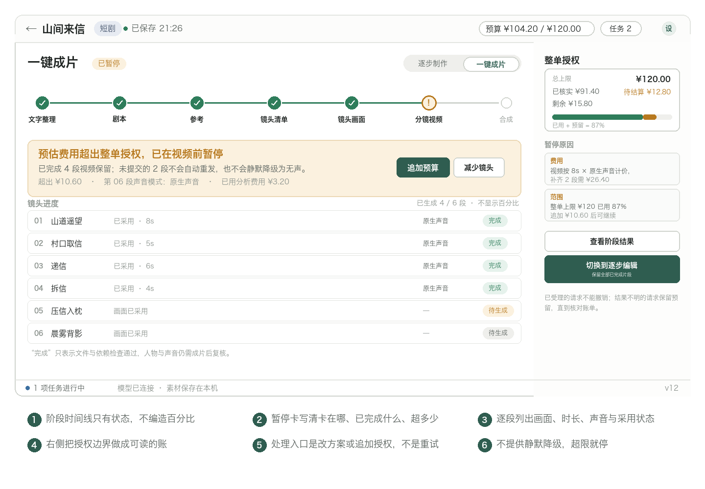

# 视觉创作工作台 Demo 设计方案

版本：V0.5　日期：2026年11月4日　对应文档：产品需求文档 V0.5；模型评测与选型方案 V0.5

本方案回答一个问题：把需求文档里的流程，做成一个可以点、可以看、可以评审的本地网页 Demo，界面应该长什么样，按什么规则动。内容包括信息架构、视觉系统、组件规格、逐页设计、交互与异常状态、前端实现映射和演示脚本。不涉及模型效果判断，模型能力另按评测方案记录。

## 1 设计要解决的问题

### 三个真实的担心

需求文档里的功能很多，但用户犹豫的时刻只有三个：怕白做、怕花冤枉钱、怕关掉就没了。界面如果不专门回应这三点，功能再多也会被当成“又一个生成工具”。

| 用户的担心 | 界面必须给出的回答 | 主要落点 |
| --- | --- | --- |
| 改一处会不会牵连全部 | 旧结果不删除，受影响项被标出，重做只对一项生效 | 候选版本、影响检查、单镜重做 |
| 这一下要点掉多少钱 | 提交前逐项报价，提交后进入待结算，余额常驻 | 右栏本步检查、费用账本、带价格的按钮 |
| 我现在关掉会不会丢 | 保存状态常驻且如实，失败保留内容并给出口 | 顶栏保存状态、恢复对比、下载当前文字 |

### 设计目标

目标不是“界面好看”，而是让三件事在界面上可以被验证：每一步都能回退，每一笔钱都能预见，每一次离开都能续上。三条都能被点出来，Demo 才算成立。

| 目标 | 可观察的验收方式 |
| --- | --- |
| 每一步都能回退 | 生成新结果后旧候选仍在；替换素材后旧引用不变；单张重做不影响其他图 |
| 每一笔钱都能预见 | 所有付费按钮旁标出数量与金额；提交后计入待结算；超上限时按钮禁用并说明原因 |
| 每一次离开都能续 | 停止输入约两秒后显示已保存；刷新恢复最近一次明确显示已保存的内容；保存失败不显示成功 |

### 刻意不做的事

这些不是遗漏，是取舍。做了会破坏上面的承诺，或者超出 Demo 的验证范围。

| 不做 | 原因 |
| --- | --- |
| 进度百分比与剩余时间 | 模型耗时不可预测，编出来的数字会变成新的不信任来源 |
| 自动“优化”“美化”按钮 | 会让用户以为系统替他做了审美判断，而本版没有自动审美评判 |
| 失败后自动重发付费请求 | 费用不可撤销，重发必须由用户决定并重新授权 |
| 把失败项折叠成一个数字 | 用户需要知道是哪一张、为什么、要花多少才能补救 |
| 用 toast 承载需要决策的信息 | 三秒消失的提示不适合承载“超预算”“结果不明”这类必须处理的状态 |
| 在画布上直接改像素 | 改图必须走候选，否则无法保留旧版与来源 |

## 2 设计原则

六条原则按优先级排列。冲突时，上面的赢。

### 原则一　流程可见，阶段可停

所有长任务都以阶段清单呈现，每个阶段有明确状态和数量；不使用百分比。任何阶段都可以暂停，暂停后已完成的成果保留。

反例：一个旋转的加载环加“正在生成中，请稍候”。用户不知道做到哪一步，也不知道现在关掉会怎样。

### 原则二　结果只增不改

生成产生新候选，“采用”只改变引用关系。旧版本永远保留，可以随时切回。素材替换产生新版本，已有草稿继续引用原版本。

反例：重新生成直接覆盖上一张图。用户失去对比能力，也无法解释为什么昨天满意的那版不见了。

### 原则三　费用在按钮上

付费操作的主按钮同时写清动作、数量和金额；右栏常驻显示本次预计、已发生与剩余上限。费用不藏在设置里，也不靠悬停才出现。

反例：一个写着“开始生成”的按钮，点下去才弹出价格。用户在被扣费前没有决策点。

### 原则四　状态不美化

结果不明就显示结果不明，不显示成功也不显示失败；保存失败就显示失败并保留内容。界面宁可难看一点也不撒谎。

反例：网络超时后显示“生成完成”，实际文件没有落盘。用户会在导出时才发现问题，而那时已经付过费。

### 原则五　一处改动，标出回声

修改上游内容后，系统按引用关系与剧情状态找出受影响项，标为“需要重新检查”，但不删除、不自动重算。用户确认范围后才继续。

反例：改了人物外套就静默把所有镜头标为失效，或反过来什么都不提示。

### 原则六　工具退后，素材在前

浅色中性界面，白底承载图片和视频；界面本身只用一种强调色，用在“当前步骤、主操作、金额”上。用户看的是作品，不是工具栏。

反例：深色背景配高饱和渐变按钮，商品图的颜色判断被界面干扰。

## 3 信息架构

### 五层结构

结构分五层：入口层负责选场景，记录层负责找回来，编辑层负责按阶段推进，支撑层是常驻的费用、任务与保存，叠加层是按需出现的确认与处理面板。



分层的好处是：同一套组件在两条链路复用，右侧的检查栏、顶栏的保存状态、底部的任务条在两个场景里长得一样，用户学一次就够。

### 页面清单

| 编号 | 页面 | 路由 | 主要任务 | 对应需求 |
| --- | --- | --- | --- | --- |
| P01 | 首页 | / | 选场景、接着做最近草稿 | A01 |
| P02 | 电商草稿箱 | /shop | 查找、新建、复制、删除 | A01 A22 |
| P03 | 短剧草稿箱 | /drama | 同上，独立记录 | A01 |
| P04 | 素材库 | /assets | 按类型来源筛选，看引用关系 | A22 |
| P05 | 商品与款式 | /shop/:id/variants | 建款式、绑照片、标参考用途 | A02 |
| P06 | 制作清单 | /shop/:id/plan | 选类型尺寸数量，看逐项费用 | A03 A26 |
| P07 | 结果挑选 | /shop/:id/results | 对照原图检查，采用或单张重做 | A03 A05 |
| P08 | 排版 | /shop/:id/canvas | 图文分层编辑，撤销重做 | A04 |
| P09 | 预览导出 | /shop/:id/export | 多尺寸适配与下载 | A06 |
| P10 | 短剧导入 | /drama/:id/import | 导入正文、选故事或剧本、选模式 | A07–A12 |
| P11 | 逐步制作 | /drama/:id/step/:n | 七步逐项确认 | A13–A15 |
| P12 | 一键成片 | /drama/:id/auto | 确认方案与上限，自动执行与暂停 | A16 A17 A27 A28 |
| P13 | 设置 | /settings | 模型、密钥状态、存储、单价来源 | — |
| P14 | 费用与任务抽屉 | 全局浮层 | 明细核对、结果不明处理 | A17 A21 |

### 导航规则

入口到工作台只有一条路：首页选场景，进对应草稿箱，打开草稿进工作台。顶栏返回永远回到草稿箱，不回到首页，避免在两级列表间来回跳。

左轨步骤可以点击跳转，但受校验约束：前一步存在未确认的阻断项时，跳过去会看到提示而不是空白页。跳转不丢内容，也不改变当前保存版本。

## 4 全局框架

### 六区结构

所有编辑页共用一套骨架：顶栏、左轨、主区、右栏、底部状态条，加上按需展开的浮层。



| 区域 | 宽度 | 常驻内容 | 设计要点 |
| --- | --- | --- | --- |
| 顶栏 | 56 高 | 返回、草稿名、场景徽标、保存状态、预算、任务数、设置 | 保存状态与预算永远可见，不随滚动消失 |
| 左轨 | 220 | 步骤编号、名称、状态、计数 | 计数用“4 张待生成”这类事实，不用进度条 |
| 主区 | 自适应 | 当前步骤的清单或画布 | 内容本身可编辑，不做成只读预览 |
| 右栏 | 320，可折叠 | 本步检查：费用、完备度、待确认、提交前确认 | 折叠后主按钮仍显示金额 |
| 状态条 | 34 高 | 进行中任务、模型连接、本地存储、草稿版本 | 版本号用于解释“恢复的是哪一版” |
| 浮层 | — | 费用确认、候选对比、影响检查、异常处理 | 需要决策的内容用浮层，不用 toast |

### 尺寸与断点

以 1440 宽为设计基准，主区最小 720。视口小于 1180 时右栏自动折叠为图标条，点击展开为抽屉；小于 960 时左轨折叠为步骤下拉，两者不同时折叠。

不做手机端适配。画布与镜头表格在窄屏下无法可靠操作，强行适配会得到两个都难用的版本。

### 顶栏的三件事

顶栏只承担三个信息，其余都进设置：现在在哪份草稿、内容是否已保存、这次还能花多少。这三件是用户随时可能回头确认的，其余不是。

保存状态有三种形态，文字必须精确：“正在保存…”不加省略号以外的装饰；“已保存 21:04”带时间；“保存失败 · 已保留内容”必须同时给出重试与下载入口。

## 5 视觉系统

### 基调

浅色专业工具风：白底承载素材，灰阶承担结构，墨绿只用于动作与当前。选浅色不是为了“干净”，是因为商品图检查需要在接近中性的背景上判断颜色；深色界面会让用户对商品颜色的判断产生偏差。



### 色彩

| 角色 | 值 | 用途 |
| --- | --- | --- |
| 画布 | #F7F8F7 | 页面底色，暖灰白，避免纯白的刺眼 |
| 卡片 | #FFFFFF | 内容容器 |
| 凹陷 | #EFEFEC | 分段控件底、表格表头、进度槽 |
| 描边 | #E3E5E1 | 1px 分隔；强调描边 #CFD3CD |
| 正文 | #1F2422 | 主要文字，对比度约 13:1 |
| 次要 | #5A625E | 说明文字，对比度约 6:1 |
| 弱化 | #8B928D | 时间戳、辅助标签，不用于正文 |
| 品牌 | #2F5D50 | 主按钮、当前步骤、激活态 |
| 品牌悬停 | #274E43 | 主按钮悬停与按下 |
| 品牌浅底 | #E8F0EC | 当前步骤底、选中行、品牌徽章底 |

语义色只用于编码，不用于装饰。

| 语义 | 值 | 典型用法 |
| --- | --- | --- |
| 完成 | #2F7D5B | 已完成、已保存、已采用 |
| 进行 | #3B6FA0 | 处理中、任务进行中 |
| 待处理 | #B7791F | 待补充、需重新检查、对白偏长 |
| 结果不明 | #6B5B95 | 无编号可查、状态未知 |
| 失败 | #B4472F | 生成失败、保存失败、合成失败 |

结果不明单独用紫色，是这套系统里最重要的一条颜色规则。它既不是成功也不是失败：用户需要的是“去核对”，而不是“重试”或“放心”。用红色会被理解成失败并触发重试冲动，用灰色会被忽略。

### 字体与数字

中文用系统字体（macOS 为苹方，Windows 为微软雅黑），英文与数字同族，不引入第二套字体。字阶只有五级：40 显示、26 标题、20 小节、15 正文、13 辅助。

金额、时长、任务编号一律使用等宽数字（font-variant-numeric: tabular-nums），保证纵向对齐。对齐的金额比好看的金额更容易核对。

### 尺寸与动效

间距以 4 为基数，常用 8、12、16、24、32。卡片内边距 16，区块间距 24，页面边距 32。圆角只有四档：4 用于标签，8 用于按钮与输入，12 用于卡片，999 用于状态胶囊。

投影只用于浮层（0 8 24 rgba(20,30,26,.10)），页面内层级靠描边和底色区分。动效 120ms 用于状态色变化，200ms 用于面板展开，不使用弹跳和缩放强调。

## 6 组件规格

### 六种阶段状态

阶段执行器的最小单位是状态，不是百分比。六种状态在两条链路、三个阶段层（草稿、任务、请求）使用同一套编码：图形 + 文字 + 颜色，三者缺一不可，保证色觉障碍用户也能分辨。



| 状态 | 图形 | 颜色 | 含义 | 允许的动作 |
| --- | --- | --- | --- | --- |
| 已完成 | 勾 | 绿 | 文件与数据库登记都已写入 | 查看、采用、重做 |
| 处理中 | 实心点 | 蓝 | 已提交，等待返回 | 等待、离开页面 |
| 等待处理 | 双竖线 | 灰 | 依赖未就绪或用户未确认 | 补依赖、确认 |
| 结果不明 | 问号 | 紫 | 无编号可查，不能确认是否已执行 | 查询原任务、标记不明 |
| 失败 | 叉 | 红 | 有明确原因 | 单次重做、更换输入 |
| 待开始 | 空心圈 | 灰 | 尚未提交，不计费 | 提交 |

### 关键组件

| 组件 | 规格 | 什么时候出现 |
| --- | --- | --- |
| 带价格的按钮 | 主文案 + 副文案两行，副文案写扣费方式 | 所有付费提交 |
| 候选与版本 | 图片缩略 + 版本标签 + 采用状态 + 需检查标记 | 结果卡、画面卡、片段卡 |
| 费用条 | 已核实 + 预留 + 剩余，三段堆叠条 | 右栏、费用抽屉 |
| 异常面板 | 标题写事实、三行写已保留/已发生/下一步、两个动作 | 失败、超时、结果不明、超预算 |
| 影响提示条 | 琥珀底 + 受影响数量 + 展开入口 | 上游改动后、保存冲突时 |
| 空状态 | 一句事实 + 一句下一步 + 一个主按钮 | 无草稿、无结果、无素材 |
| 骨架屏 | 仅用于 300ms 以上的加载 | 列表与画布首次渲染 |

### 按钮层级

只有四级，靠填充区分而不是靠颜色堆叠。主按钮实心墨绿，次按钮白底描边，弱按钮灰底无描边，危险按钮浅红底红字且只用于删除与放弃。禁用态统一降为 38% 透明度，并在下方写明原因，不做灰阶翻转。

付费按钮的文案模板固定为“动词 + 数量 + 金额”，例如“生成 4 张 · ¥12.80”“重做这一段 · ¥4.60”。没有金额的进度按钮不允许出现在付费动作上。

## 7 页面设计

### 7.1 首页

目标：三秒内决定做哪一类。



三张入口卡等宽排列，卡内是图标、名称、一句价值、上次进度。最近编辑用横向卡片，显示封面、名称、当前步骤、保存时间与导出状态。右上角是设置，顶栏左侧显示本地服务与 FFmpeg 状态。

关键取舍：不在首页放模板库、推荐风格、创作技巧。它们会增加决策成本，而用户此刻只想选一条路。

空状态：没有草稿时，最近编辑区换成一句“上传两张照片，10 分钟做出可导出的宣传图”加新建按钮。不展示假卡片占位。

### 7.2 草稿箱

两类草稿箱结构相同，只换场景色与卡片内容。工具栏是搜索、筛选段控件（全部 / 未导出 / 已导出）、排序、视图切换与新建。

卡片显示封面、名称、当前步骤、相对保存时间（悬停显示绝对时间）、导出状态。更多菜单里是重命名、复制、删除。

删除前必须显示影响：如果该草稿引用了仍被其他草稿使用的素材，说明“另有 2 份草稿正在使用其中 3 个文件”，并禁止连带物理删除。复制后内容独立，底层原素材共用。

### 7.3 素材库

左栏筛选（类型、来源、引用草稿、时间），中间网格，右侧详情抽屉。详情包含预览、尺寸、大小、来源、版本与引用清单，每条引用可点击跳到对应草稿。

被引用时删除按钮禁用并说明数量。同名素材以版本树呈现，v2 的存在不影响仍引用 v1 的草稿。

### 7.4 商品与款式

主区上半是商品信息卡（名称、卖点、目标风格），下半是款式表。每行一个款式：缩略图拖放区、款式名、照片状态、备注。

未绑定照片的款式显示“暂不能生成”，但保留在表内，其他款式可以继续。缺少容量、材质、认证等字段时，字段旁标“待补充”，并在右栏汇总，明确写“不会由 AI 编造”。

参考图分两列：商品参考（保持外观）与风格参考（背景、光线、构图）。每张图下面是一个用途输入框，默认文案是“只参考桌面和光线，不使用图中的杯子”这类可编辑的完整句子，而不是空白框。

### 7.5 制作清单

目标：把“要生成什么”变成一张可以核对的账单。本页有两个分段：新出图，与批量改风格。

新出图的清单结构见第 4 节图示：每一行是一次生成，列出款式、图片类型、尺寸、风格、数量与费用；行可删可改，改数量时合计实时重算。表头下方是输出设置的四个只读块（画质、单次输出、参考、比例），说明本批统一生效。右栏固定四块：本次预计与上限进度、待补充项、提交前确认清单、带价格的主按钮；主按钮的副文案写明扣费方式“立即预扣 ¥12.80，未完成不结算”。

批量改风格是同一页的另一个分段，切换后表格变成“原图 × 所属款式 × 改动范围 × 保持项”。



这个页面的关键是先确认归属再提交：原图可能来自本草稿，也可能来自素材库，界面必须标出来源，并要求在当前草稿确认款式；不带入源草稿的排版与设置。改动范围与保持项逐张列出，不用“统一优化”这种笼统说法。

改尺寸与改风格严格分开：前者在本地适配、不计费，后者调用图像模型、按张计费。两者混成一次收费动作，用户就无法判断钱花在了哪里。

### 7.6 结果挑选

目标：逐张判断商品是否被改错，并且只重做有问题的那一张。



每张结果卡包含标题、状态徽章、结果图、原图缩略（按住对比）、来源行（风格、尺寸、版本）、勾选框与三个动作：不用、重做（带价格）、采用。

失败卡不显示空图，而是显示“未生成”、失败原因与一个直接可用的补图入口。失败卡下方写“失败不影响其余 3 张”，把用户最担心的事情直接说出来。

右栏汇总进度与已发生费用，并明确“失败项未计费”。“采用”是关系，不是替换：批量采用只在勾选后出现，避免误操作。

### 7.7 排版

画布居中，左侧图层列表，右侧属性面板，顶部工具条（撤销、重做、对齐、缩放、比例）。

图片、标题、卖点、价格都是独立图层，可移动缩放、调整前后顺序、显示隐藏与锁定。价格与容量这类关键文字必须用文字层，界面在图片层上给出提示，避免依赖模型写对数字。

修改图片本身走“局部修改”：选中图片层，输入“去掉左边的花，商品不变”，生成新候选。新旧版本都保留，采用后替换画布图片，其他图层不动。

画布的撤销栈按图层操作记录，不按自动保存批次。自动保存不进入撤销栈，避免“撤销一次退回十分钟前”。

### 7.8 预览导出

左侧尺寸列表：主图 1:1、竖版 3:4、横版 16:9、自定义。选中尺寸后中间显示预览，右侧选择适配方式：完整保留并加留白，或裁切填满并调整位置。禁止拉伸，界面上不提供这个选项。

文字越界时在预览上标出越界区域，并给“自动缩小字号到 90%”的建议按钮，不自动改。

底部是导出清单：勾选尺寸，单独下载或打包下载。导出说明固定写一句“导出的是此刻的结果文件，草稿继续修改不会改写已导出文件”。

### 7.9 短剧导入

上半是导入区：拖放或粘贴，右下角实时显示字符数。超过 5000 字符时提示“正文较长，将转为 TXT 附件”，不阻断。下半是类型选择：这是故事 / 这是已有剧本，并有系统建议徽标，但不覆盖用户选择。

固定提示条原文照录：这里只读取文字，不识别图片。扫描版 PDF、插图中的对白和图片里的文字不会被读取，请先转换为可复制的正文。

校验结果卡显示文件名、字符数、正文预览（可编辑）、未读取提示与章节清单。PDF 无文字层时不显示“开始”按钮，而是显示“先去转为可复制正文”和一个粘贴入口。

模式选择在页面底部：逐步制作（推荐首次使用）与一键成片（需要确认总上限）。选择一键时，右栏立即显示费用分解与授权范围，而不是等到下一页。

### 7.10 逐步制作 · 镜头清单

目标：让分镜表本身成为编辑对象，而不是一份只读输出。



表格列：拖动手柄、序号、人物、动作、对白、画面、时长、参考。行高 52，两行文字空间。行首可拖动排序，工具条提供添加、拆分为两镜、合并所选、按剧情重排。

校验就地呈现，不进弹窗：对白预计时长超过所选档位时，该行标黄并在下方给出“预计 9 秒 > 档位 8 秒，需延长或拆镜”。缺参考时同理，并给一个“先补 05 镜参考”的次按钮。

右栏是参考检查（人物、场景、道具各自已绑定数量）、时长档位、本次预计与带价格的主按钮。参考上限写在下方：“单镜最多 3 张参考，超出会拦截”。

逐步制作的其余六步复用同一结构，只是右栏的检查项不同：

| 步骤 | 右栏检查重点 | 主按钮 |
| --- | --- | --- |
| 整理剧本 | 待确认项、来源标注 | 确认剧本并继续 |
| 人物场景道具 | 必需卡片是否齐、采用版本 | 确认设定并继续 |
| 镜头画面 | 已采用画面数、参考是否超限 | 生成 6 张分镜图 |
| 分镜视频 | 声音模式、时长档位、费用差异 | 生成 6 段视频 |
| 合成导出 | 缺失镜头、音轨检查、顺序 | 一键合成 |

### 7.11 一键成片

目标：把“自动”做成一份可核对的授权，而不是一个魔法按钮。



页面分三段。第一段是方案确认：画风、比例、目标片长、声音模式、本次总费用上限，以及费用分解（文字分析、自动补参考、镜头与参考数量估算范围、图像与视频预留）。这里必须写明“这是上限，不是报价”。

第二段是执行：顶部是七个阶段的时间线，只有状态没有百分比；下面一张当前状态卡，写清正在做什么；再下面是镜头进度列表，每段显示画面来源、时长、声音模式与采用状态。

第三段是暂停与继续：当费用或范围超限、出现剧情歧义、必要参考补不齐、请求失败时，暂停卡写明卡在哪、已完成什么、超出多少，并给出“追加预算”“减少镜头”“切换到逐步编辑”三个出口。已完成的片段保留，未提交的不自动重发。

自动采用的内容标“自动选用”，并在成片后显示“完整视频已生成，请检查人物、动作、剧情与声音”。系统不做审美判断，也不假装做了。

### 7.12 设置与费用抽屉

设置只放四类：模型与密钥（只读掩码 + 连通性测试）、模型能力表（是否支持原生声音、参考上限、时长档位）、存储路径与 FFmpeg 状态、费用单价来源（地区、币种、记录时间）。

费用抽屉从顶栏预算进入：顶部是四格账本（已核实、待结算、下一步最大估计、可用余额），下面是明细表（时间、动作、对象、金额、状态、任务号）。结果不明的条目单独分组，带“查询原任务”与“标记结果不明”。

## 8 交互规范

### 自动保存

停止输入约两秒触发；切换步骤、采用新素材、阶段完成时立即触发。保存状态分三态，只在本地记录与对应文件都成功写入后显示“已保存”。

保存失败时保留当前内容，自动重试两次，仍失败则显示“保存失败 · 已保留内容”，提供重试与“下载当前文字与设置”。媒体只允许下载已经成功保存的文件。

### 恢复与冲突

刷新后恢复最近一次明确显示已保存的内容。发现浏览器里存在更新的临时内容时，不直接覆盖，而是展示差异摘要（改了哪些字段、多少图层、哪一版更新），让用户选择恢复哪一版或另存副本。

版本号用于判断新旧，不用于判断对错。两份内容都可能是用户想要的。

### 进度表达

只用三种句式：

| 场景 | 文案 |
| --- | --- |
| 有明确数量 | 正在生成第 2 段视频（共 6 段） |
| 有完成与待处理 | 3 段已完成，1 段需处理 |
| 只有阶段 | 正在整理剧本 · 第 2 / 7 阶段 |

禁止出现“45%”“预计还需 2 分钟”“马上就好”。等待超过 20 秒时追加一句“仍在处理，可以离开此页面”。

### 费用与授权

费用分四个口径，界面上不混用：已核实消耗、待结算预留、下一步最大估计、可用余额。所有已提交但未拿到结果的请求都计入预留，不按已扣款金额判断是否超限。

超出上限时禁用提交并说明差额，不给“仍然继续”的灰色入口。追加授权是显式动作，需要再次确认金额。

### 影响范围

上游修改后，系统按两类规则找受影响项：素材引用关系（哪一版被谁引用）与剧情状态（进出状态、发生事件、依赖的前序事件）。结果是一个清单，不是一次自动失效。

界面呈现为顶部一条琥珀色提示“3 项需要重新检查”，点开是清单，每项写明原因（引用了旧版人物外套 / 依赖“递信”事件）。用户确认后才把状态从“需要重新检查”改回“可用”。

### 键盘与批量

| 快捷键 | 动作 |
| --- | --- |
| ⌘Z / ⇧⌘Z | 画布撤销 / 重做 |
| Space | 播放或暂停当前片段 |
| J / K | 上一条 / 下一条镜头 |
| 1–7 | 跳转到对应步骤 |
| ⌘A | 当前列表全选（仅在表内焦点时） |
| Esc | 关闭浮层，不保存未确认的修改 |

批量操作只在勾选后出现，且按钮上写明数量。删除类操作需要二次确认，确认框里写清受影响的对象数量。

### 文案规范

统一用“动词 + 对象 + 数量 + 金额”。禁止模糊词：正在努力生成、智能优化、一键搞定、效果更佳。允许的诚实表达：暂不能确认、不会由 AI 编造、已保留、需要重新检查。

## 9 状态与异常设计

### 状态机

| 当前状态 | 触发 | 进入状态 | 界面变化 |
| --- | --- | --- | --- |
| 待开始 | 用户提交 | 处理中 | 行内出现进行态，费用转入预留 |
| 处理中 | 返回文件并通过校验 | 已完成 | 出现缩略图与采用按钮，费用转已核实 |
| 处理中 | 返回失败原因 | 失败 | 显示原因与单次重做，费用回到余额 |
| 处理中 | 超时且有任务号 | 处理中（可查询） | 显示“结果暂不能确认”，提供查询 |
| 处理中 | 超时且无编号 | 结果不明 | 紫色徽章，停止自动重发，保留预留 |
| 等待处理 | 依赖补齐 | 待开始 | 主按钮恢复可用 |
| 需要重新检查 | 用户确认 | 已完成 | 标记消失，可继续依赖 |

### 异常矩阵

异常处理统一三段式：发生了什么、影响多大、怎么继续。下表是主要异常在界面上的落点。

| 情况 | 界面显示 | 处理入口 |
| --- | --- | --- |
| 文件超过 20MB | 实际大小、上限、尚未导入 | 去除内嵌图片、导出 TXT、按章节拆分 |
| 正文超出处理上限 | 字符数、上限、未处理范围 | 确认章节清单后分段，不截断 |
| 扫描 PDF 无文字层 | 页码、未读取提示 | 转可复制正文或粘贴 |
| 加密或损坏 | 文件名、具体读取问题 | 换未加密副本、另存 DOCX、粘贴正文 |
| 剧情矛盾 | 原文位置、待确认项 | 修改后继续，不把猜测当事实 |
| 参考组合超限 | 超出哪一项、受影响镜头 | 精简参考或拆镜，不静默丢图 |
| 请求被拒绝 | 原因、输入版本 | 调整后重做，重试费用单独显示 |
| 网络断开或超时 | 结果暂不能确认 | 有编号则查询，无编号标结果不明 |
| 商品变形 | 原照片与结果对照 | 重做该图、简化背景、换参考 |
| 声音缺失 | 当前声音模式、必需音轨 | 暂停，不自动去音 |
| 合成失败 | 保留的片段与顺序 | 只重试合成，不重新生成视频 |
| 导出链接失效 | 哪份文件未保存成功 | 查询原请求，说明重做费用 |
| 自动保存失败 | 未保存状态与当前内容 | 保留临时内容、重试、下载文字 |
| 服务重启 | 上次草稿与任务状态 | 恢复后先核对请求，不整轮重做 |

### 不静默降级的清单

以下情况必须让用户看见，而不是系统自己选一个更省事的方案：

声音模式从有声改成无声、参考图被丢弃、清晰度被降低、镜头被删除、字数被截断、费用从估算变成固定报价、结果从失败改成“已完成”。这七项任何一项发生，界面必须出现明确说明并要求确认。

## 10 前端实现映射

### 路由与组件树

| 路由 | 页面组件 | 关键子组件 |
| --- | --- | --- |
| / | HomePage | EntryCard、RecentDraftList |
| /shop | DraftListPage（scene=shop） | DraftCard、FilterBar、ImpactDialog |
| /drama | DraftListPage（scene=drama） | 同上 |
| /assets | AssetLibrary | AssetGrid、AssetInspector、VersionTree |
| /shop/:id/:step | ShopWorkbench | RailNav、StepContent、Inspector、CostBar |
| /drama/:id/import | DramaImport | DropZone、PasteBox、ParseReport、ModePicker |
| /drama/:id/step/:n | DramaWorkbench | RailNav、ShotTable、CandidateGrid、AudioBadge |
| /drama/:id/auto | AutoRunPage | StageTimeline、PausePanel、BudgetLedger |
| /settings | SettingsPage | ProviderCard、CapabilityTable、StorageCard |

AppShell 负责顶栏、状态条与抽屉，页面只渲染主区与右栏内容。这样保存状态、预算、任务数在切换页面时不重新请求，也不会闪烁。

### 状态切片

| 切片 | 内容 | 更新方式 |
| --- | --- | --- |
| draft | 当前草稿内容、版本号、脏标记 | 本地编辑即时更新，保存后同步版本号 |
| save | 三态、最后保存时间、重试计数 | 由防抖保存器驱动 |
| jobs | 阶段与任务状态、结果不明列表 | SSE 推送，断线后轮询兜底 |
| cost | 已核实、预留、预计、余额 | 每次提交与回执后重算 |
| selection | 勾选项、批量操作可用性 | 页面内局部状态 |
| ui | 面板开合、抽屉、浮层 | 不进持久化 |

### 数据契约

前端只依赖稳定字段，不依赖模型返回的原始结构。核心类型如下：

```ts
type StageState = 'pending' | 'running' | 'waiting' | 'unknown' | 'failed' | 'done';

interface Draft {
  id: string; scene: 'shop' | 'drama'; name: string;
  step: number; version: number; exported: boolean;
  updatedAt: string;
}

interface AssetVersion {
  id: string; assetId: string; version: number;
  kind: 'image' | 'video'; width: number; height: number;
  bytes: number; source: 'upload' | 'generated'; createdAt: string;
}

interface GenerationAttempt {
  id: string; targetId: string; inputSnapshotId: string;
  state: StageState; providerTaskId?: string;
  startedAt: string; finishedAt?: string; error?: string;
}

interface CostEntry {
  id: string; kind: 'analysis' | 'image' | 'video' | 'compose';
  amount: number; currency: 'CNY'; status: 'reserved' | 'settled' | 'released';
  attemptId?: string; taskId?: string; createdAt: string;
}
```

### 与本地服务的接口

| 接口 | 方法 | 用途 |
| --- | --- | --- |
| /api/drafts | GET / POST | 列表与新建 |
| /api/drafts/{id} | GET / PATCH | 读取与增量保存（带版本号） |
| /api/assets | POST | 上传，返回版本 |
| /api/assets/{id}/refs | GET | 引用清单 |
| /api/jobs | POST | 提交生成，返回尝试编号 |
| /api/jobs/stream | GET | SSE 推送阶段变化 |
| /api/costs | GET | 账本与明细 |
| /api/costs/quote | POST | 提交前报价 |
| /api/import/parse | POST | 解析正文并返回报告 |

版本冲突返回 409 与服务器版本号，前端进入对比恢复流程，不自动覆盖。生成类接口一律返回“尝试编号”，前端不把 HTTP 200 当成成功，只把阶段变为已完成当成成功。

接口在服务端的实现——状态机、持久化执行器、预留与结算事务、崩溃恢复——见《Demo 后端技术方案》（04），本文不复述。

### 渲染与性能

列表超过 40 项时启用虚拟滚动；图片按缩略图与预览图两档，网格只加载缩略图。画布只对交互层重绘，文字层与图片层分开缓存。SSE 单连接复用，页面切换不重建。

无障碍：焦点环 2px 品牌色，Tab 顺序按“左轨 → 主区 → 右栏”，浮层打开后焦点锁定并在关闭时归还。所有状态图标配文字，所有图标按钮有 aria-label。

## 11 Demo 演示范围与动线

### 交付范围

Demo 必须能真实点通五件事，其余可以用静态数据但必须标注为示例。

| 编号 | 可点通的内容 | 不可用时的处理 |
| --- | --- | --- |
| D1 | 新建电商草稿、建两个款式、绑照片、生成清单 | 无密钥时停在提交前，提示配置 |
| D2 | 结果挑选、单张重做、采用、进入排版、多尺寸导出 | 用本地占位图，界面标“示例” |
| D3 | 导入 DOCX、选类型、拆镜、改时长、生成片段 | 无密钥时展示阶段与暂停 |
| D4 | 一键成片：方案确认、执行、超预算暂停、追加继续 | 用脚本回放真实阶段状态 |
| D5 | 自动保存、刷新恢复、保存失败降级 | 可直接演示，不依赖模型 |

### 三条演示动线

| 动线 | 时长 | 步骤 |
| --- | --- | --- |
| 电商闭环 | 8 分钟 | 新建 → 两款保温杯 → 清单 4 张 → 只重做深绿场景图 → 画布加价格 → 导出三个尺寸 |
| 短剧逐步 | 10 分钟 | 导入《山间来信》→ 拆 6 镜 → 改 03 镜对白 → 采用画面 → 生成 2 段有声视频 → 合成 |
| 一键成片与异常 | 7 分钟 | 确认上限 ¥120 → 执行到第 6 阶段 → 超预算暂停 → 追加 ¥10.60 → 完成 → 单镜重做 |

另有一条两分钟的反向演示，专门讲“不撒谎”：断网提交一次视频，界面进入结果不明，显示保留的预留与查询入口，不显示成功也不自动重发。这条最能说明产品与普通生成工具的区别。

### 演示数据

| 对象 | 内容 |
| --- | --- |
| 电商 | 保温杯两个款式（米白、深绿），各 3 张照片，商品参考 2 张，风格参考 2 张 |
| 短剧 | 《山间来信》，6 镜，3 个人物卡（阿远、阿棠、旁白不建卡），1 个场景，1 个道具 |
| 费用 | 单张 ¥3.20，单段 8 秒有声 ¥13.20，总上限默认 ¥120 |
| 示例标注 | 所有非模型产物在卡片角标注明“示例”，产物清单同样注明来源 |

## 12 设计验收对照

下表把需求文档的验收编号映射到可检查的界面位置。检查时看界面，不看文档描述。

| 编号 | 界面检查点 | 位置 |
| --- | --- | --- |
| A01 | 两个入口进入各自草稿箱，列表不混用 | 首页、草稿箱 |
| A02 | 款式行与照片一一对应，未绑定行标“暂不能生成” | 商品与款式 |
| A03 | 每张结果独立卡，单张重做不影响其他 | 结果挑选 |
| A04 | 撤销重做后直接关闭，重开恢复到已保存状态 | 排版、顶栏 |
| A05 | 改图生成新候选，画布其他图层不动 | 排版 |
| A06 | 多尺寸导出，商品不被拉伸，越界有提示 | 预览导出 |
| A07 | 四种格式导入后正文可预览，原件保留 | 导入 |
| A08 | 超限、损坏、加密分别显示原因与替代操作 | 导入 |
| A09 | 无文字层 PDF 时“开始”按钮不存在 | 导入 |
| A10 | 粘贴超 5000 字自动转 TXT 并完整保留 | 导入 |
| A11 | 章节清单显示覆盖与完成情况 | 导入 |
| A12 | 故事改编与剧本整理分开保留原文 | 导入、整理剧本 |
| A13 | 镜头可增删分合，每镜字段可编辑 | 镜头清单 |
| A14 | 参考超限被拦截，给精简或拆镜入口 | 镜头清单右栏 |
| A15 | 已采用画面用于对应视频，可播放核对来源 | 镜头画面、分镜视频 |
| A16 | 一键成片无需逐镜确认，自动补齐并合成 | 一键成片 |
| A17 | 超限暂停，已受理消费与结算差异单列 | 一键成片、费用抽屉 |
| A18 | 自动成片后单镜重做，其他片段保留 | 分镜视频 |
| A19 | 缺镜头时不能标完整，部分合成标“片段预览” | 合成导出 |
| A20 | 改外套或改递信结果，标出后续开信受影响 | 影响提示条 |
| A21 | 保存失败、超时、重启各有明确状态与出口 | 顶栏、异常面板 |
| A22 | 删除前提示引用，副本独立 | 草稿箱、素材库 |
| A23 | 声音模式与费用在提交前分别展示 | 分镜视频 |
| A24 | 静音导出版与原片音轨分开说明 | 导出 |
| A25 | 缺必需音轨时暂停，不自动去音 | 分镜视频、合成 |
| A26 | 批量改风格逐项费用，原图不变 | 制作清单 |
| A27 | 分析后超范围在出图前暂停，复用分析结果 | 一键成片 |
| A28 | 跨段处理覆盖全段，合并后人物与结局保留 | 导入、整理剧本 |
| A29 | 回收站与备份包为 P1，入口灰显并说明 | 草稿箱菜单 |
| A30 | 模型成功但文件未写完时不显示已保存 | 顶栏、结果卡 |

## 13 设计令牌附录

以下变量是前端实现的唯一来源，页面里不写死颜色与间距。

```css
:root {
  /* 中性 */
  --canvas: #F7F8F7;
  --surface: #FFFFFF;
  --sunken: #EFEFEC;
  --line: #E3E5E1;
  --line-strong: #CFD3CD;
  --ink: #1F2422;
  --ink-muted: #5A625E;
  --ink-faint: #8B928D;

  /* 品牌 */
  --brand: #2F5D50;
  --brand-hover: #274E43;
  --brand-tint: #E8F0EC;

  /* 语义 */
  --ok: #2F7D5B;      --ok-tint: #E6F2EC;
  --info: #3B6FA0;    --info-tint: #E7EEF6;
  --warn: #B7791F;    --warn-tint: #FBF1DF;
  --unknown: #6B5B95; --unknown-tint: #EEEAF5;
  --danger: #B4472F;  --danger-tint: #F9E8E3;

  /* 文字 */
  --font: -apple-system, "PingFang SC", "Microsoft YaHei", sans-serif;
  --text-xs: 11px; --text-sm: 13px; --text-md: 15px;
  --text-lg: 20px; --text-xl: 26px; --text-2xl: 40px;

  /* 间距与圆角 */
  --s1: 4px; --s2: 8px; --s3: 12px; --s4: 16px;
  --s5: 24px; --s6: 32px; --s7: 48px;
  --r-sm: 4px; --r-md: 8px; --r-lg: 12px; --r-full: 999px;

  /* 结构 */
  --topbar: 56px; --rail: 220px; --inspector: 320px; --statusbar: 34px;
  --shadow-pop: 0 8px 24px rgba(20, 30, 26, .10);

  /* 动效 */
  --ease: cubic-bezier(.2, 0, 0, 1);
  --fast: 120ms; --base: 200ms;
}
```

金额与统计数字统一加 `font-variant-numeric: tabular-nums`，右栏与表格中的数字列使用 `text-align: right`。

本方案只定义 Demo 的界面与交互口径，不改变需求文档中的产品规则、费用规则与验收标准。两者冲突时，以需求文档为准，并回写本方案。
