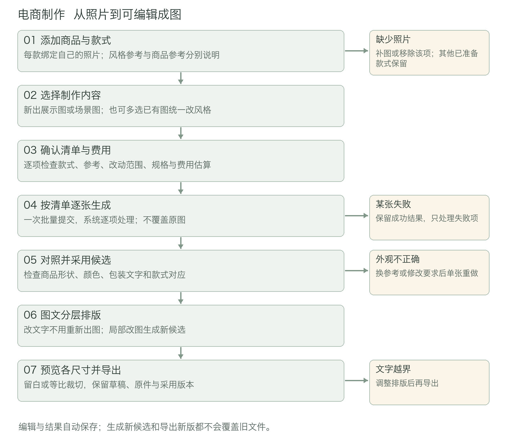
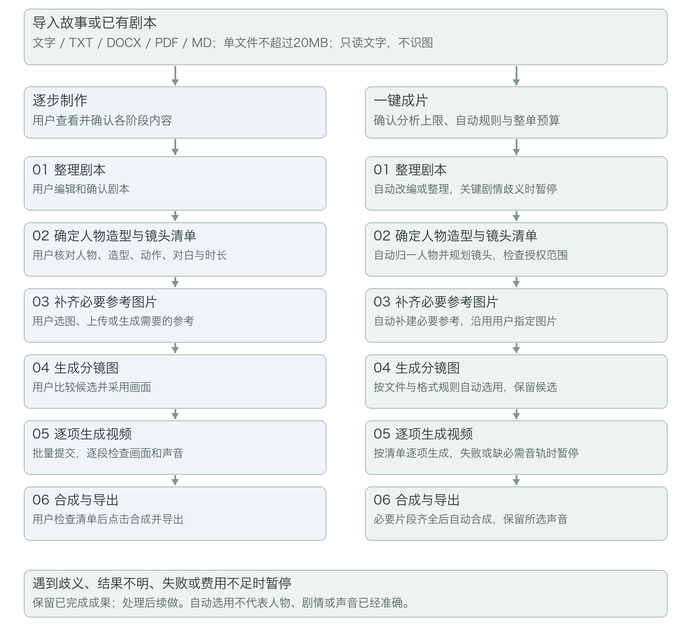
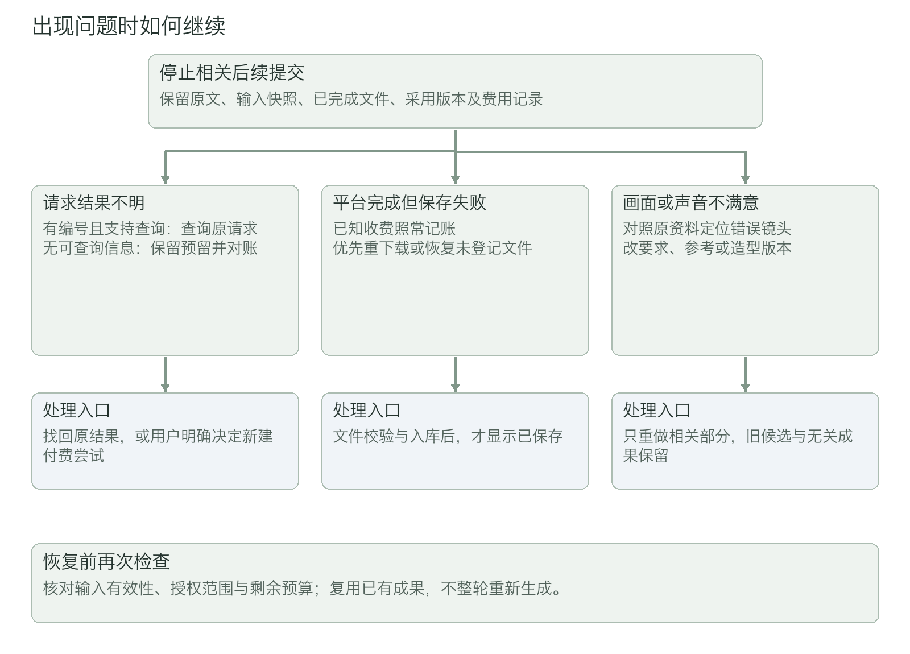
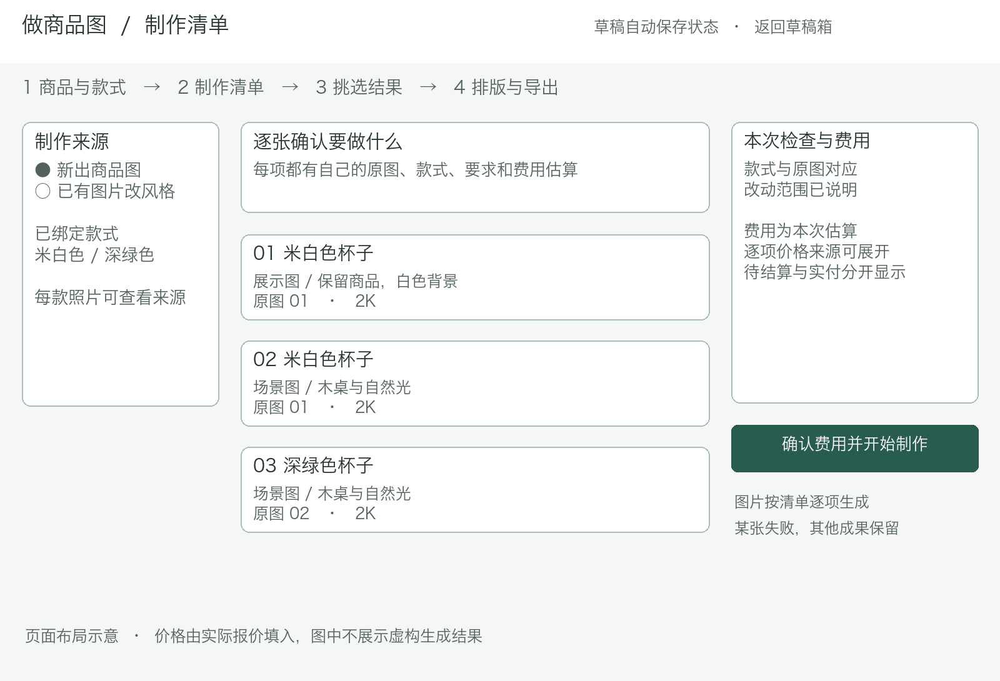
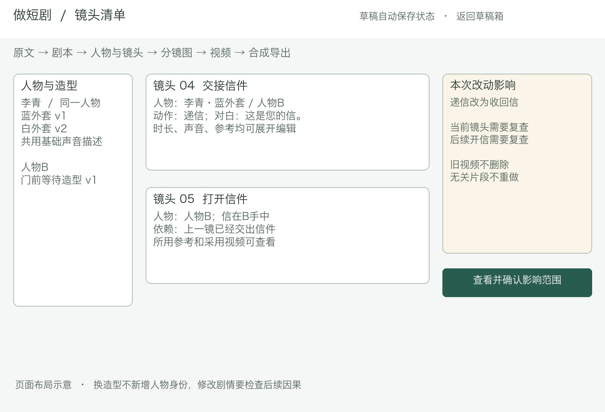
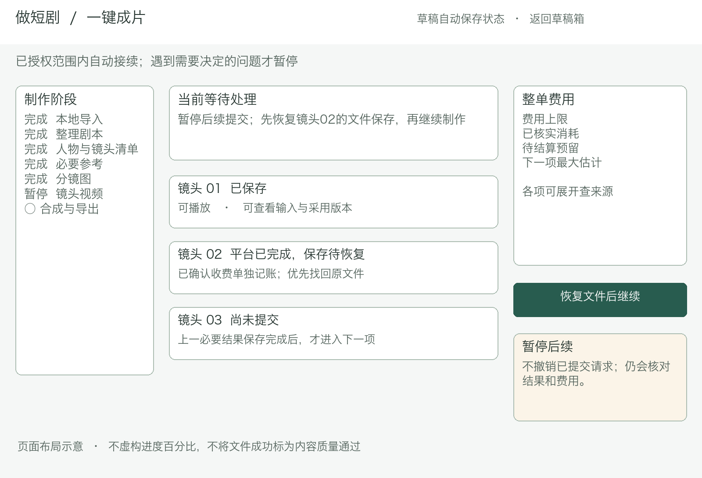

# 视觉创作工作台产品设计方案

版本：V1.2　日期：2026年11月4日  
依据：《视觉创作工作台产品需求文档》V0.6  
文档范围：产品交互与开发实施设计  
适用范围：P0 完整闭环；P1 功能在第 13 章单独说明


## 0. 文档使用方式与设计结论

### 0.1 实施口径

本方案覆盖两个独立创作入口，以同一素材库和本地服务支撑；每次制作按阶段顺序执行。当前模型配置为DeepSeek、Qwen-Image-3.0、Wan3.0-Video Prime，模型评测的任务、指标和通过标准保持独立。

本方案将需求转换为页面、组件、服务、接口、数据表、状态机和验收用例。开发时以本方案为直接拆分依据；若供应商模型能力与本文默认配置不一致，以“能力探测与验证配置”为准，不允许通过静默降级绕过限制。

### 0.2 已确定的关键决策

1. **运行形态**：本地单用户应用，FastAPI 同时提供 REST API 和 React 静态构建产物；默认只监听 `127.0.0.1`。
2. **前端**：React + TypeScript + Vite，Konva/react-konva 实现图层画布，IndexedDB 保存尚未落盘的编辑内容。
3. **后端**：Python + FastAPI + Pydantic，SQLite 保存结构化数据，本地文件系统保存媒体、原文、快照与导出文件。
4. **持久化执行**：所有一键成片与批量生成由后端持久化阶段执行器运行，不依赖浏览器在线。
5. **真实性原则**：HTTP 成功不代表产物可用；文件校验、原子落盘和数据库事务全部成功后，才允许显示“已保存”或进入依赖步骤。
6. **版本原则**：原文、素材、生成尝试、采用关系和导出结果均不可原位覆盖；编辑产生新草稿版本，生成产生新候选，采用只切换指针。
7. **费用原则**：所有已提交未结算请求都占用预算预留；结果不明不自动重发；付费重试必须单独授权。
8. **影响分析**：素材引用图负责直接影响，镜头事件与道具状态负责确定性因果影响，文字模型仅补充语义建议，最终须允许人工确认。
9. **声音原则**：有声、无声是显式配置；不支持的组合拦截，不静默去音；合成默认保留原生音轨。
10. **本地优先**：无密钥、断网或模型不可用时，仍可新建、编辑、查看、排版和管理已保存内容。

### 0.3 统一术语

- **草稿 Draft**：一次创作的完整工作记录，类型为 `ECOMMERCE` 或 `DRAMA`。
- **素材 Asset**：逻辑文件实体；**素材版本 AssetVersion** 对应不可变文件。
- **生成尝试 GenerationAttempt**：一次独立模型请求，重做不会覆盖旧尝试。
- **采用 Adoption**：某业务对象当前选用哪个候选版本，不删除其他候选。
- **制作运行 WorkflowRun**：一次自动或半自动制作计划；**阶段 StageRun** 是其中可恢复的执行单元。
- **费用预留 CostReservation**：提交前冻结的估算上界，结算后转为实际或释放差额。
- **结果不明 UNKNOWN**：请求可能已被远端受理，但本地无法确认最终状态，禁止直接判失败重发。


## 1. 产品范围与用户流程

### 1.1 用户与核心任务

| 用户 | 核心任务 | 产品支撑 |
|---|---|---|
| 电商运营、小型商家 | 多款式展示图、场景图、统一风格、多尺寸导出 | 款式—照片强绑定、逐项生成、独立重做、画布与尺寸预设 |
| 电商视觉人员 | 局部改图、改价、改文案、复用素材 | 独立图层、候选切换、引用版本、无需重生成全部图片 |
| 短剧创作者 | 故事/剧本到分镜、视频和成片 | 统一草稿、逐步与一键切换、角色参考、因果复查、单镜重做 |

### 1.2 P0 范围

- 两类独立草稿箱、共用素材库、自动保存与冲突恢复。
- 电商：商品与款式、制作清单、展示图/场景图、批量改风格、候选检查、分层画布、局部改图、多尺寸导出。
- 短剧：文本/DOCX/PDF/MD 导入、故事改编或剧本结构化、人物场景道具卡、拆镜、镜头图、视频、有声或无声、合成导出。
- 一键成片：统一方案与预算授权、自动接续、异常暂停、续做、切换逐步编辑。
- 费用账本、模型能力限制、结果不明处理、局部重做、引用与剧情影响分析。

### 1.3 非目标

OCR、专业时间线、多集管理、独立配音、声线克隆、专业口型修复、多人账号协作、自动发布均不在本版。不得为完成演示而以静态图片冒充视频，或以示例结果冒充模型结果。

### 1.4 两条主流程

以下流程图面向使用者：电商从款式照片到成图，短剧保留逐步检查和一键成片两种入口。图中的暂停不会删除已有成果。








**电商**：新建草稿 → 商品与款式 → 绑定商品/风格参考 → 制作清单或批量改风格 → 费用确认 → 逐图生成 → 对照检查与采用 → 图层排版/局部修改 → 尺寸预览 → 导出。

**短剧**：新建草稿 → 导入并确认完整性 → 故事改编或剧本整理 → 参考卡 → 镜头清单 → 镜头图 → 视频 → 合成 → 导出。逐步模式由用户确认与采用；一键模式在已授权范围内自动确认“流程可继续”，不宣称内容质量已验证。


## 2. 总体架构

### 2.1 逻辑架构

```text
电脑浏览器
├─ React SPA：草稿箱、编辑器、费用确认、任务进度、素材库
├─ Konva 画布：图层编辑、命令式撤销重做、尺寸预览、PNG 渲染
├─ IndexedDB：未落盘编辑、恢复快照、未提交编辑元数据
└─ HTTP/SSE
       │
       ▼ 仅 127.0.0.1
FastAPI 本地服务
├─ API 层：校验、本机访问边界、草稿版本、幂等键、统一错误
├─ 领域服务：草稿/素材/电商/剧本/分镜/画布/导出
├─ 阶段执行器：计划、检查点、暂停恢复、任务查询
├─ 生成服务：输入快照、费用预留、模型适配、结果校验入库
├─ 影响分析：引用依赖 + 状态事件规则 + 可选语义建议
├─ 媒体服务：DOCX/PDF/TXT/MD、Pillow、FFmpeg/ffprobe
└─ SQLite 事务 + 本地原子文件写入
       │
       ├─ DeepSeek：改编、结构化、拆镜、语义辅助
       ├─ Qwen-Image-3.0：商品图、参考图、镜头图、图片修改
       └─ Wan3.0-Video Prime：首帧视频、经验证的多参考视频、原生声音
```

### 2.2 单份计划顺序执行

本版一次执行一份制作计划。批量表示用户一次提交多个项目，再由系统逐项处理；图片、视频和不同草稿之间不同时发起多个生成请求。界面不提供多任务并发、任务优先级或跨草稿调度设置。

- 一个 FastAPI 进程提供页面与 API，一个后台执行器按计划顺序运行；浏览器不承担关键进度记录。
- 当前批次按清单顺序生成，完成或明确失败后处理下一项；单项失败不删除已完成结果。短剧遇到必要片段失败时暂停相关后续，等待修复。
- 数据库中一个全局执行槽记录当前 `workflowRunId`。领取、释放与恢复均以事务和条件更新完成，防止重复点击启动两份计划；其他草稿仍可浏览、编辑和自动保存。
- 已有计划运行时，新启动入口说明当前计划及“返回当前制作”操作，不建立后台等待队列。用户结束当前计划并完成在途请求核对后，才释放执行槽启动下一份。
- 文件解析、媒体转换和网络等待放在后台执行，不占用处理页面请求的事件循环；本地耗时处理逐项运行。
- 用户暂停只阻止后续新提交。已提交请求继续查询、下载和记账；结果不明时保留预留并进入人工处理，不能通过释放执行槽隐式重发。
- 关闭浏览器不停止已授权的后台流程；本地服务重启后先核对旧尝试，再决定续做。租约过期只说明执行器失联，不能证明远端没有执行。

### 2.3 后端模块边界

```text
app/
  api/                 路由、请求响应模型、错误映射
  domain/
    drafts/            草稿、复制、删除、版本冲突
    assets/            素材、版本、引用、下载与校验
    ecommerce/         商品、款式、批次、画布
    drama/             导入、剧本、参考卡、镜头、事件
    workflow/          计划、阶段、租约、检查点、恢复
    generation/        尝试、采用、输入快照、重试
    costs/             报价、预留、结算、预算
    impact/            引用图、事件状态、语义影响
    exports/           商品图、视频、清单与包
  infrastructure/
    db/                SQLite、迁移、事务
    files/             目录、临时区、原子移动、磁盘检查
    models/            DeepSeek/Qwen-Image-3.0/Wan3.0-Video Prime 适配器
    media/             文档解析、图片、FFmpeg
  bootstrap/           启动检查、恢复扫描、静态页面
```

依赖方向固定为 `api → domain → infrastructure`，领域服务不得直接调用供应商 SDK；模型访问只经适配器。


## 3. 前端设计

### 3.1 技术组织

- React Router 管理路由；TanStack Query 管理服务端数据、失效与轮询；Zustand 管理当前编辑器瞬时 UI 状态。
- React Hook Form + Zod 做表单即时校验；服务端 Pydantic 为最终校验来源。由 OpenAPI 生成 TypeScript 类型，禁止手写两套字段定义。
- Dexie 封装 IndexedDB；Konva 只负责画布交互，草稿权威数据仍为结构化 JSON 与服务端记录。
- SSE 通道 `/api/v1/events` 推送保存、阶段、生成和费用变化；SSE 断线时以 5 秒指数退避重连，并调用运行详情接口补偿漏事件。
- UI 组件库、精确依赖版本在初始化时锁定，提交 lockfile；运行构建不自动升级依赖。

### 3.2 路由与页面

| 路由 | 页面 | 关键内容与操作 |
|---|---|---|
| `/` | 首页 | 做商品图、做短剧、素材库；本地服务与模型配置状态 |
| `/ecommerce/drafts` | 电商草稿箱 | 新建、继续、重命名、复制、删除、未导出/已导出筛选 |
| `/ecommerce/:draftId/product` | 商品与款式 | 商品资料、款式卡、照片绑定、资料待补充标记 |
| `/ecommerce/:draftId/plan` | 制作清单 | 类型、尺寸、风格、数量、款式、逐项价格、批量改风格 |
| `/ecommerce/:draftId/results` | 结果挑选 | 原图对照、来源、候选、采用/重做/不用、失败项重做 |
| `/ecommerce/:draftId/canvas` | 排版 | 图层、属性、撤销重做、局部修改、文字越界提示 |
| `/ecommerce/:draftId/export` | 尺寸与导出 | 主图/竖版/横版/自定义、留白或裁切、下载记录 |
| `/drama/drafts` | 短剧草稿箱 | 同上，另显示制作方式与当前阶段 |
| `/drama/new` | 新建短剧 | 共用导入区、故事/已有剧本、逐步/一键入口 |
| `/drama/:draftId/source` | 原文 | 文件信息、逐页预览、缺失页、章节覆盖、正文编辑 |
| `/drama/:draftId/script` | 剧本 | 版本、待确认项、局部重写、原文对照、确认 |
| `/drama/:draftId/references` | 人物与场景 | 人物/地点/道具卡、声音描述、用途、采用版本 |
| `/drama/:draftId/shots` | 镜头清单 | 顺序、动作、对白、声音、景别、运镜、时长、参考、事件 |
| `/drama/:draftId/frames` | 镜头画面 | 单镜/批量生成、候选对照、采用、参考用途 |
| `/drama/:draftId/videos` | 分镜视频 | 批量清单、播放、多版本、声音模式、单镜重做 |
| `/drama/:draftId/compose` | 合成导出 | 缺失项、顺序、片长、音轨检查、完整片/片段预览 |
| `/drama/:draftId/auto` | 一键成片 | 方案概览、总上限、阶段、已用/预留费用、暂停续做 |
| `/assets` | 素材库 | 图片/视频、上传/生成、引用草稿、版本、预览与选用 |
| `/settings` | 设置 | 模型名、地域、能力验证结果；密钥只显示“已配置/未配置” |

所有编辑页固定展示草稿名、自动保存状态、当前步骤、费用摘要和返回草稿箱入口。估算、待结算预留、已核实消费分别标注，未结算时不展示精确实付。

### 3.3 关键页面示意



制作清单先展示每张图片对应的款式、原图、制作类型和改动范围，再显示估算与启动按钮。未绑定款式或缺少必要商品照片的项目单独指出；用户可移除该项后制作其余内容。批量改风格沿用同一清单，逐项保留原图。



镜头页同时显示人物与造型、动作、对白、声音、时长和参考。修改“递信”为“收回信”后，受影响的后续“开信”镜头进入复查清单。用户可查看具体原因，修改、重做或确认继续采用旧版，旧结果始终可查看。



一键页将制作阶段、镜头结果与费用分开显示。例如“平台已完成，文件待保存”不能显示成“成片已保存”；“暂停后续”按钮说明已提交请求仍会继续处理。正常执行无需逐镜确认，遇到问题才出现对应处理入口。

### 3.4 核心组件

- `DraftShell`：步骤导航、保存状态、版本冲突弹窗、全局任务提示。
- `AssetPicker`：只返回素材版本 ID 与用途，不复制原文件，不携带其他草稿设置。
- `ReferenceBindingList`：明确商品参考、人物、场景、道具、风格等用途及参考说明。
- `CostConfirmDialog`：逐项规格、数量、单价依据、最大估计、已预留、整单余额；确认后生成授权令牌。
- `GenerationItemCard`：状态、输入版本、模型真实版本、候选、错误、结果不明与对账入口。
- `CandidateCompare`：原图/参考与候选同步缩放，展示采用状态和来源。
- `ImpactReviewDialog`：直接影响、剧情影响、模型建议分别展示，用户勾选复查或继续采用旧版。
- `WorkflowTimeline`：实际阶段和已知数量，不展示无依据百分比或精确剩余时间。
- `MediaValidationList`：尺寸、时长、可解码性、必需音轨及错误位置。
- `RecoverableErrorPanel`：问题、影响范围、已完成内容、下一步操作、是否可能产生费用。

### 3.5 编辑器状态与自动保存

前端区分三类状态：

1. **服务端权威状态**：已显示“已保存”的草稿及版本号。
2. **本地编辑状态**：输入、画布命令和当前选择，约 2 秒防抖提交。
3. **IndexedDB 暂存**：每次本地变更立即写入，包含 `draftId/baseVersion/localRevision/payload/updatedAt`。

保存流程：

```text
本地变更 → 立即写 IndexedDB → 停止输入约 2 秒
→ PUT 草稿聚合（baseVersion + clientMutationId）
→ 服务端事务成功且涉及文件已落盘
→ 返回 newVersion → 更新权威状态并清理对应暂存 → 显示已保存
```

- 切换步骤、采用候选、阶段完成时立即保存，不等待防抖。
- `clientMutationId` 唯一，服务端保存结果以支持安全重试；网络超时可查询该 mutation 是否已提交。
- `baseVersion` 不匹配返回 `409 DRAFT_VERSION_CONFLICT`，不得覆盖；展示服务端版本与本地暂存差异，可选择“恢复本地内容”或“另存副本”。
- 保存失败显示“保存失败”，持续保留 IndexedDB；提供文字与设置 JSON/TXT 下载，媒体只列已成功保存的文件。
- 页面刷新优先加载服务端版本；发现更新暂存时显示恢复条，不自动用暂存覆盖。

### 3.6 画布模型与交互

`CanvasDocument` 保存逻辑坐标、图层与尺寸变体，不保存 Konva 节点实例：

```json
{
  "schemaVersion": 1,
  "baseWidth": 1000,
  "baseHeight": 1000,
  "layers": [
    {
      "id": "layer_uuid",
      "type": "IMAGE",
      "assetVersionId": "av_uuid",
      "x": 0, "y": 0, "width": 1000, "height": 1000,
      "rotation": 0, "scaleX": 1, "scaleY": 1,
      "zIndex": 0, "visible": true, "locked": false,
      "crop": null, "fitMode": "CONTAIN"
    }
  ],
  "variants": []
}
```

- 图层类型：`IMAGE`、`TEXT`、`SHAPE`；文字层保存内容、字体、字号、行高、颜色、对齐、边框和逻辑包围盒。
- 所有变更封装为命令 `do/undo`，命令栈仅存当前会话，结构化结果存草稿；撤销栈上限 100 步。
- 图片变换保持宽高比，禁止非等比拉伸商品；锁定商品层后仍可移动文字。
- 局部改图从当前图片层所用版本发起新尝试，采用后仅更换该层 `assetVersionId`，其他图层不变。
- 尺寸变体独立保存各层位置与适配方式：`CONTAIN` 完整留白或 `COVER` 等比裁切；切换时生成建议布局并允许手动调整。
- 文字越界按渲染后的实际包围盒检测；导出前必须无阻断错误。
- 前端按目标像素比例渲染 PNG/JPEG，上传服务端校验尺寸、格式和文件完整性后登记导出；已导出文件不可被后续编辑覆盖。

### 3.7 一键成片交互

同一页依次呈现：导入完整性 → 输入类型 → 画风/比例/目标片长/声音模式 → 参考补建规则 → 镜头与参考数量范围 → 文字分析上限 → 图像视频预留 → 整单上限 → 可选付费重试次数。

点击“一键生成完整视频”后获得不可变 `PlanAuthorization`。详细计划超范围或关键歧义时暂停；追加授权创建新授权版本，已完成分析复用。运行中允许暂停“尚未提交”的步骤；已提交任务按可查询性处理。


## 4. 后端领域设计

### 4.1 草稿服务

职责：创建、读取聚合、版本化更新、复制、删除、筛选、导出状态维护。

- 新建即写入草稿并出现在对应草稿箱；`type` 创建后不可变更。
- 更新采用聚合边界：商品资料、镜头、画布等可分资源更新，但共享草稿 `version` 做乐观锁。
- 复制通过领域复制器建立新业务 ID；素材版本只新增引用，不复制底层文件；输入快照和候选可复制记录，是否复制导出文件默认不复制，仅复制导出状态所需的元数据并将副本标为未导出。
- 删除为 P0 逻辑删除并保留文件；删除前返回引用与导出影响。P1 回收站在此基础上增加 30 天到期清理。
- 执行进度与费用变化使用独立 `eventRevision`，不增加编辑用的草稿 `version`；否则后台每出一张图就可能造成前台自动保存冲突。用户采用、改画布或改镜头顺序才更新编辑版本。
- 每次采用变化、画布变化、镜头顺序变化更新 `updatedAt` 和 `currentStep`；导出后保留草稿，记录最近导出时间。

### 4.2 素材服务

职责：上传、生成结果入库、版本、用途、引用、预览、删除保护。

- 上传先写临时文件，检查真实字节数、文件签名、可解析性、图片尺寸或媒体可解码性。
- 原文件以内容哈希命名；同内容可复用物理文件，但素材版本与引用独立记录。
- 替换素材创建新版本；已有引用仍指向旧版本。
- 删除素材前查询所有 `AssetRef` 与生成快照。仍被引用时禁止物理删除，只允许从当前选择移除。
- 生成结果必须走统一 `ingestGeneratedMedia`，禁止模型适配器直接写正式素材目录。

### 4.3 电商服务

- 商品可含多个款式；款式保留外观的生成必须至少绑定一张商品参考图。
- 制作清单展开为独立 `GenerationItem`，每项固定款式、参考版本、图片类型、风格、尺寸、数量和输入快照。数量为 N 时展开 N 个独立尝试槽位，避免一个失败拖垮整批。
- 批量改风格从素材选择创建逐项清单；跨草稿素材必须确认当前商品与款式映射，禁止按文件名推断。
- 改尺寸为本地适配任务，费用为 0；改风格为模型任务，必须报价和授权。
- 采用候选只修改对应结果槽位或画布图片层，不自动修改其他画布。

### 4.4 短剧服务

- `SourceDocument` 保存原件、提取状态、字符数、缺页与解析警告；`ScriptVersion` 保存改编/整理结果，永不覆盖原文。
- 章节拆分记录完整覆盖区间和处理状态；跨段上下文包含人物表、别名、已发生事件、道具状态与摘要，并为上下文和输出预留 token。
- `ReferenceCard` 区分 `CHARACTER/LOCATION/PROP`，人物身份与造型版本分开：`Character` 保存稳定人物ID、姓名别称与声音描述，`CharacterLookVersion` 保存某次衣着、年龄阶段、外观与采用图片。角色参考卡指向具体造型版本；地点和道具仍各有参考卡。声音描述只是提示信息，不宣称声线锁定。
- `Shot` 保存制作字段和剧情状态。对白过长时建议延长到模型支持档位或拆镜，禁止自动删词。
- 每镜只发送已选参考；适配器按能力矩阵验证图片数量、身份组合、输入模式和声音选项。

### 4.5 人物身份与造型版本

同一人物换衣服不是新增人物。例如“李青·蓝外套”和“李青·白外套”拥有同一个 `characterId`，分别使用不同 `lookVersionId`。镜头同时绑定人物ID和造型版本，台词说话人绑定人物ID，避免换衣服后系统丢失声音与身份对应关系。

人物姓名别称、声音描述和基础身份按人物修订版本保存；造型说明与图片按不可变造型版本保存。更改仅新增版本，已经生成的镜头继续引用旧快照。换用新造型只复查引用该造型的镜头；改基础身份或声音设定则复查所有引用该人物且相关的画面或对白片段。

自动分析先归一人物别名，再提取各场景需要的造型；无法判断两名称是否为同一人时列为待确认项，不能擅自合并。每镜的图片限制按实际发送图片和已验证组合检查，不按人物库总人数限制整部故事。

### 4.6 生成保存与收费分别记录

一次生成至少有三类状态。远端成功不等于文件已保存，文件无效也不等于平台没有收费。

| 记录 | 状态 | 含义与约束 |
|---|---|---|
| 请求 `requestStatus` | READY / SUBMITTING / RUNNING / UNKNOWN / SUCCEEDED / FAILED / NOT_SUBMITTED | 仅表示请求是否提交和远端执行结果；UNKNOWN不得自动改为失败重发 |
| 本地交付 `deliveryStatus` | PENDING / DOWNLOADING / VALIDATING / RECOVERY_REQUIRED / STORED / INVALID / NOT_APPLICABLE | 仅STORED表示校验与文件数据库登记完成；下载或落盘失败可找回原结果 |
| 费用 `billingStatus` | RESERVED / PENDING_SETTLEMENT / SETTLED / CONFIRMED_NO_CHARGE | 已确认收费即记实际消耗，不等文件保存成功；只有确认未收费才释放对应全部预留 |
| 内容复核 `reviewStatus` | UNREVIEWED / ADOPTABLE / NEEDS_CHANGE / REJECTED | 表示人工内容判定，与文件技术状态独立 |

请求典型路径为 `READY → SUBMITTING → RUNNING → SUCCEEDED/FAILED`。同步文字图片请求可以从SUBMITTING直接得到结果；SUBMITTING或RUNNING无法确认时进入UNKNOWN。仅能证明尚未发出时才能标NOT_SUBMITTED并安全重新提交；本地取消标志不替代远端状态。

图片与视频只有在文件校验、正式落盘和数据库登记完成后才允许进入依赖步骤。文字结果则校验JSON结构、必要字段、人物和素材引用并保存原始响应及结构化产物；不套用视频音轨检查。

界面用三类记录生成实际文案，例如“平台已完成，文件待恢复，已核实消费”；自动选用要求交付和依赖检查通过，仍不代表商品、人物、动作、台词或音色已准确。

每次重做创建新尝试、新输入快照和新费用预留。原请求、旧文件及其费用记录保留。采用记录只新增并更新当前指针，记录 `adoptionSource=AUTO/USER`；旧请求迟到返回时只归入其原版本候选，不覆盖新采用关系。

### 4.7 阶段执行与暂停恢复

阶段类型为 `ADAPT_SCRIPT / STRUCTURE_SCRIPT / BUILD_CARDS / BUILD_SHOTS / GENERATE_REFERENCES / GENERATE_FRAMES / GENERATE_VIDEOS / COMPOSE / EXPORT`。故事入口包含改编，已有剧本入口只整理结构；先形成镜头及必要参考清单，再补建实际需要的图片，避免生成不会使用的参考。

阶段执行状态为 `PENDING/RUNNING/WAITING_USER/PAUSED/UNKNOWN/FAILED/SUCCEEDED/CANCELLED`；另设 `validity=VALID/NEEDS_REVIEW`。已完成但输入改变的结果保持执行成功，标为需要复查，不把 `STALE` 混入执行状态。合成也使用同一有效性字段。

- 运行保存输入版本、计划版本、授权版本、阶段依赖、游标和检查点。每步先校验输入有效、授权范围、报价和预算，再持久化尝试并发出请求。
- 领取阶段使用条件更新和执行器租约。过期租约恢复时先核对尝试；有远端编号查原请求，无可查询信息标结果不明，不能从头重做。
- “暂停后续”修改运行控制状态，阻止新提交；正在执行的请求继续查询、下载和结算，不能把已提交尝试直接标CANCELLED。
- “结束本次制作”取消尚未提交的步骤；在途请求依然跟踪保存与收费。结果不明保留预留，用户对账后可继续保留不明记录或按证据核销；不得把核销解释为平台退款。
- 恢复前检查待处理结果、输入版本、授权剩余、必要参考和模型配置。预算或计划改变时重新授权，已完成且有效的分析与文件复用。
- 上游改动将相关阶段的有效性标为NEEDS_REVIEW。系统暂停受影响的后续，用户确认继续采用旧版或生成新版后再恢复。


## 5. API 设计

### 5.1 通用约定

- 基础路径 `/api/v1`，JSON 使用 camelCase；数据库使用 snake_case，由序列化层转换。
- ID 使用 UUID；时间为带时区 ISO 8601；金额用十进制字符串和币种，禁止浮点数。
- 列表参数：`cursor`、`limit`（默认 20，最大 100）、`type/status/query`；返回 `items/nextCursor`。
- 所有草稿更新带 `baseVersion`；所有付费提交带 `Idempotency-Key` 和 `authorizationId`。
- 上传使用 multipart；媒体下载经 `/api/v1/files/{fileId}`，服务端校验路径映射，禁止客户端传任意磁盘路径。
- 长任务立即返回 `202 + attemptId/workflowRunId`，进度经 SSE 和查询接口获得。

统一错误：

```json
{
  "error": {
    "code": "REFERENCE_LIMIT_EXCEEDED",
    "message": "当前模式最多接受 2 张参考图，本镜选择了 4 张",
    "details": {"shotId": "...", "selected": 4, "maximum": 2},
    "retryable": false,
    "affectedIds": ["..."],
    "requestId": "..."
  }
}
```

核心错误码：`VALIDATION_ERROR`、`FILE_TOO_LARGE`、`TEXT_TOO_LONG`、`TEXT_LAYER_MISSING`、`ENCRYPTED_FILE`、`DRAFT_VERSION_CONFLICT`、`ASSET_IN_USE`、`MODEL_NOT_CONFIGURED`、`PLAN_CHANGED`、`QUOTE_EXPIRED`、`IDEMPOTENCY_CONFLICT`、`EXECUTION_SLOT_BUSY`、`CAPABILITY_UNVERIFIED`、`REFERENCE_LIMIT_EXCEEDED`、`BUDGET_EXCEEDED`、`AUTHORIZATION_EXPIRED`、`RESULT_UNKNOWN`、`MEDIA_VALIDATION_FAILED`、`REQUIRED_AUDIO_MISSING`、`DISK_FULL`、`EXPORT_INCOMPLETE`。

### 5.2 草稿与素材接口

| 方法与路径 | 用途 | 关键请求/响应 |
|---|---|---|
| `POST /drafts` | 新建 | `type/name` → 草稿与初始版本 |
| `GET /drafts` | 草稿箱 | 类型、导出状态、关键词、游标筛选 |
| `GET /drafts/{id}` | 草稿聚合 | 元数据、当前步骤、版本、保存状态 |
| `PATCH /drafts/{id}` | 重命名/步骤 | `baseVersion` 乐观锁 |
| `POST /drafts/{id}/copy` | 独立副本 | 新草稿 ID，共享不可变素材版本 |
| `GET /drafts/{id}/delete-impact` | 删除影响 | 素材引用、导出、其他草稿引用 |
| `DELETE /drafts/{id}` | 逻辑删除 | 需 `confirmImpact=true` |
| `GET /drafts/{id}/recovery` | 恢复信息 | 服务端版本、可用快照、未完成阶段 |
| `POST /assets` | 上传素材 | 文件、来源；返回版本与校验结果 |
| `GET /assets` | 素材筛选 | 媒体、来源、类型、草稿引用 |
| `GET /assets/{id}` | 素材详情 | 版本、元数据、当前草稿外引用数 |
| `GET /assets/{id}/references` | 引用列表 | 草稿、用途、业务对象、版本 |
| `POST /drafts/{id}/asset-refs` | 引用素材 | `assetVersionId/usage/subjectId/note` |
| `DELETE /asset-refs/{id}` | 移除用途 | 不删除物理文件 |

### 5.3 电商接口

| 方法与路径 | 用途 |
|---|---|
| `PUT /ecommerce/{draftId}/product` | 保存商品名称、卖点、目标风格与待补充字段 |
| `POST /ecommerce/{draftId}/variants` | 新建款式 |
| `PUT /ecommerce/variants/{id}` | 修改款式与资料 |
| `PUT /ecommerce/variants/{id}/references` | 绑定商品照片，明确版本和用途 |
| `POST /ecommerce/{draftId}/plans/validate` | 校验制作清单与逐项可生成性 |
| `POST /ecommerce/{draftId}/plans/quote` | 返回逐项最大费用和报价 ID |
| `POST /ecommerce/{draftId}/batches` | 在授权下创建图片批次 |
| `POST /ecommerce/{draftId}/restyle-plans` | 从多选图片建立改风格清单 |
| `GET /submissions/{idempotencyKey}` | 核对本地提交结果，返回原尝试与预留 |
| `GET /generation-batches/{id}` | 批次逐项状态、成功/失败/不明数量 |
| `POST /generation-attempts/{id}/adopt` | 采用候选 |
| `POST /generation-items/{id}/retry` | 单项重做，需新增费用授权 |
| `PUT /ecommerce/{draftId}/canvas` | 保存 CanvasDocument，乐观锁 |
| `POST /ecommerce/{draftId}/local-edit` | 从选中图片层创建局部改图计划 |
| `POST /ecommerce/{draftId}/export-preview` | 校验尺寸、越界和适配配置 |
| `POST /ecommerce/{draftId}/exports` | 接收渲染结果并原子登记导出 |
| `GET /ecommerce/{draftId}/exports` | 导出历史 |
| `POST /exports/{id}/package` | 多尺寸 ZIP 打包 |

### 5.4 短剧导入与编辑接口

| 方法与路径 | 用途 |
|---|---|
| `POST /drama/{draftId}/imports` | 上传 TXT/DOCX/PDF/MD，先本地解析 |
| `POST /drama/{draftId}/source-text` | 保存直接输入；超 5000 字符转 UTF-8 TXT |
| `GET /drama/imports/{id}` | 文件、正文、缺页、警告、字符数 |
| `GET /drama/imports/{id}/pages/{page}` | PDF 逐页提取预览 |
| `PUT /drama/imports/{id}/text` | 用户修订提取正文，保留原件 |
| `POST /drama/{draftId}/chapters/suggest` | 本地章节建议与覆盖范围 |
| `PUT /drama/{draftId}/chapters` | 确认章节清单 |
| `POST /drama/{draftId}/script/plans` | 创建改编或整理计划 |
| `GET /drama/{draftId}/script-versions` | 剧本版本与待确认项 |
| `PUT /drama/script-versions/{id}` | 编辑剧本，生成新修订 |
| `POST /drama/script-versions/{id}/rewrite` | 局部重写，付费授权 |
| `POST /drama/script-versions/{id}/confirm` | 确认剧情歧义已处理 |
| `POST /drama/{draftId}/reference-cards/extract` | 从剧本整理卡片 |
| `CRUD /drama/{draftId}/characters` | 人物姓名别称、基础身份与声音描述版本 |
| `POST /drama/characters/{id}/look-versions` | 新增不可变造型，绑定参考图片版本 |
| `CRUD /drama/{draftId}/reference-cards` | 卡片增删改查与采用参考 |
| `POST /drama/{draftId}/shots/generate-plan` | 拆镜报价与计划 |
| `PUT /drama/{draftId}/shots` | 整表编辑、增删、拆分、合并、排序 |
| `POST /drama/{draftId}/shots/validate` | 字段、对白时长、参考组合、剧情依赖校验 |
| `POST /drama/shots/{id}/frame-batches` | 镜头图生成 |
| `POST /drama/{draftId}/video-batches` | 已采用画面镜头的视频批次 |
| `POST /drama/{draftId}/compose/validate` | 必要镜头、文件、尺寸、时长、音轨检查 |
| `POST /drama/{draftId}/compositions` | 创建合成任务；完整或片段预览 |
| `POST /drama/{draftId}/exports` | 导出有声/静音版及清单包 |

### 5.5 一键、费用与恢复接口

| 方法与路径 | 用途 |
|---|---|
| `POST /drama/{draftId}/auto/estimate` | 本地检查后返回分析、参考、镜头范围与费用估计 |
| `POST /drama/{draftId}/auto/authorize` | 冻结方案与整单上限，创建授权版本 |
| `POST /drama/{draftId}/auto/runs` | 启动持久化执行器 |
| `GET /workflow-runs/{id}` | 当前阶段、镜头数量、费用、异常 |
| `POST /workflow-runs/{id}/pause` | 暂停后续新提交，在途请求继续核对 |
| `POST /workflow-runs/{id}/stop` | 结束未提交步骤，在途请求与费用记录保留 |
| `POST /workflow-runs/{id}/resume` | 从检查点续做，复核预算与失效输入 |
| `POST /workflow-runs/{id}/reauthorize` | 追加范围或预算，生成新授权版本 |
| `POST /workflow-runs/{id}/switch-to-manual` | 保留所有结果，转逐步模式 |
| `GET /drafts/{id}/cost-ledger` | 实际、预留、下一步估计、可用余额 |
| `POST /cost-reservations/{id}/reconcile` | 人工对账确认或继续保留预留 |
| `POST /generation-attempts/{id}/query` | 有编号且支持查询时核对原任务 |
| `POST /generation-attempts/{id}/resolve-unknown` | 用户确认后保留、重发或核销，不自动推断 |
| `GET /impact/{draftId}?changeSetId=...` | 返回直接、因果、语义建议影响 |
| `POST /impact/change-sets/{id}/confirm` | 确认复查、重做或继续采用旧版 |

### 5.6 计划报价与重复提交规则

`planId + planVersion`定位完整制作清单；`quoteId`定位服务端保存的报价快照，包括计划哈希、输入版本、模型模式、规格数量、价格规则版本、币种、预算换算规则、最大费用和有效期。`authorizationId`定位用户确认的范围和费用上限。三者必须能互相校验，不能仅信任浏览器传入的金额或任意字符串编号。

报价本身只做本地估算，不在报价接口偷偷调用付费模型。没有正文分析结果时，先按用户确认的数量范围、分析上限与制作规格报价；分析结束后生成新的详细计划版本，仍在授权范围内则自动继续，否则暂停。

所有付费提交先在同一事务校验授权、输入版本、报价有效期与预算，创建尝试、预留和提交记录后再出网。修改素材、数量、模式或规格后旧报价不能直接复用。旧报价到期后可生成新报价；单价及规格未变且仍在原授权内可继续，超出原授权才要求追加确认。

重复提交按 `(operationScope, Idempotency-Key)` 唯一，保存规范化请求哈希及原响应。相同编号相同内容返回原结果，不增加生成或预留；相同编号不同内容返回 `409 IDEMPOTENCY_CONFLICT`。客户端等待超时后先查询本地提交记录，不能靠换编号绕过检查。该机制只能避免本地重复创建，不能保证供应商无编号请求可恢复。

成功复用相同请求编号时，比较的是同一业务操作和完整输入哈希；密钥及授权头不参与可导出快照和请求哈希。账本事件使用唯一entryKey，重复处理同一结算证据不再记第二笔。

### 5.7 关键契约示例

创建付费批次：

```json
{
  "planId": "plan_uuid",
  "planVersion": 3,
  "quoteId": "quote_uuid",
  "authorizationId": "auth_uuid",
  "clientMutationId": "mutation_uuid"
}
```

运行详情响应：

```json
{
  "id": "run_uuid",
  "status": "WAITING_USER",
  "currentStage": "GENERATE_VIDEOS",
  "progress": {"completed": 3, "pending": 1, "failed": 0, "unknown": 0},
  "cost": {
    "actual": "12.40", "reserved": "8.00",
    "nextMaximum": "8.00", "available": "5.60", "currency": "CNY"
  },
  "blockingIssue": {"code": "BUDGET_EXCEEDED", "additionalRequired": "2.40"},
  "updatedAt": "2026-11-04T21:38:00+08:00"
}
```


## 6. 数据库设计

### 6.1 通用规则

- SQLite 开启 `foreign_keys=ON`、`journal_mode=WAL`、`busy_timeout`；所有写操作使用显式事务。
- 金额和价格统一用Decimal十进制定点计算并以规范十进制文本持久化，保留原币种及服务商原始账单值，不使用二进制浮点数。预算预留向上取整到配置精度，展示再按币种格式化，不逐次把小额文字费用四舍五入成0。
- 业务表包含 `id/created_at/updated_at`；软删包含 `deleted_at`。
- 输入快照、文件内容不可更新；草稿聚合更新通过版本号防止旧页面覆盖。
- 迁移使用版本化 migration，禁止启动时无备份破坏性改表。

### 6.2 核心表

| 表 | 关键字段 | 约束与用途 |
|---|---|---|
| `drafts` | `id,type,name,version,cover_asset_version_id,current_step,export_status,deleted_at` | 两类草稿共用表、内容独立；`version` 乐观锁 |
| `draft_mutations` | `id,draft_id,client_mutation_id,request_hash,response_json` | 客户端变更幂等，唯一 `(draft_id,client_mutation_id)` |
| `assets` | `id,kind,origin,created_from_attempt_id,deleted_at` | 逻辑素材；`kind=IMAGE/VIDEO/DOCUMENT/OTHER` |
| `asset_versions` | `id,asset_id,version_no,file_id,metadata_json,supersedes_id` | 不可变版本，唯一 `(asset_id,version_no)` |
| `files` | `id,storage_key,sha256,byte_size,mime_type,validation_status` | 物理文件元数据，路径由服务管理 |
| `asset_refs` | `id,draft_id,asset_version_id,subject_type,subject_id,usage,note` | 草稿级用途与引用；禁止隐式跨草稿带设置 |
| `products` | `draft_id,name,selling_points,target_style,missing_fields_json` | 一个电商草稿一个商品主体 |
| `product_variants` | `id,draft_id,name,spec_json,missing_fields_json` | 款式；规格缺失不由 AI 编造 |
| `canvas_documents` | `draft_id,schema_version,document_json,version` | 独立图层与尺寸变体 |
| `source_documents` | `id,draft_id,source_file_id,source_type,input_kind,char_count,parse_status,warnings_json` | 原件与提取状态 |
| `source_pages` | `id,source_document_id,page_no,text,char_count,status` | PDF 逐页预览和缺页 |
| `script_sections` | `id,draft_id,source_document_id,ordinal,start_offset,end_offset,text,status,summary_json` | 完整覆盖、分段状态、跨段摘要 |
| `script_versions` | `id,draft_id,base_source_id,parent_version_id,mode,content_json,pending_issues_json` | 故事改编/已有剧本整理，版本不可覆盖 |
| `characters` | `id,draft_id,canonical_name,aliases_json,current_profile_version_id` | 同一人物的稳定身份，不随换装变化 |
| `character_profile_versions` | `id,character_id,version_no,identity_json,voice_description,source` | 基础人物与声音设定不可变修订 |
| `character_look_versions` | `id,character_id,profile_version_id,version_no,name,appearance_json,asset_version_id` | 某套服装、年龄与外观参考的不可变版本 |
| `reference_cards` | `id,draft_id,type,name,description,character_id,look_version_id,description_version,adopted_asset_version_id,source` | 人物/地点/道具及采用版本 |
| `shots` | `id,draft_id,ordinal,script_version_id,location_id,action,dialogue_json,audio_json,shot_size,camera_move,duration_ms,aspect_ratio,start_state_json,end_state_json,required,status` | 镜头制作与剧情状态 |
| `shot_characters` | `shot_id,character_id,profile_version_id,look_version_id,role` | 镜头出场与说话角色关联 |
| `shot_references` | `shot_id,asset_version_id,usage,reference_card_id,character_id,look_version_id` | 每镜实际发送的参考 |
| `shot_dependencies` | `shot_id,depends_on_shot_id,event_key,dependency_type,source` | 前序事件与依赖来源 |
| `generation_batches` | `id,draft_id,kind,plan_id,plan_version,quote_id,authorization_id,status` | 图片或视频批次 |
| `generation_items` | `id,batch_id,subject_type,subject_id,ordinal,current_attempt_id,status` | 每张图/每镜独立处理槽位 |
| `generation_attempts` | `id,item_id,draft_id,provider,model,mode,input_snapshot_file_id,input_version,remote_task_id,request_status,delivery_status,billing_status,review_status,provider_account_namespace,cost_reservation_id,error_json,created_at` | 独立请求、真实模型版本、可空远端编号 |
| `attempt_outputs` | `id,attempt_id,asset_version_id,validation_json,is_auto_eligible` | 已校验候选，不表示内容质量通过 |
| `adoptions` | `id,draft_id,subject_type,subject_id,attempt_id,asset_version_id,source,created_at` | 采用历史；当前采用取最新有效记录 |
| `workflow_runs` | `id,draft_id,mode,plan_id,plan_version,authorization_id,status,current_stage,event_revision` | 自动/半自动运行 |
| `stage_runs` | `id,workflow_run_id,type,status,validity,depends_on_json,checkpoint_json,lease_owner,lease_expires_at,input_version,error_json` | 持久化阶段与恢复点 |
| `production_plans` | `id,draft_id,current_version_id,kind` | 制作计划的稳定标识 |
| `plan_versions` | `id,plan_id,version_no,input_version,content_json,content_hash,created_at` | 不可变清单、人物造型及依赖快照 |
| `quotes` | `id,plan_version_id,input_hash,rate_version_ids,currency,fx_snapshot_json,items_json,max_cost_decimal,expires_at` | 不可变报价快照，明确本地估算与价格来源 |
| `submission_records` | `id,scope,idempotency_key,request_hash,response_json,created_at` | 重复提交核对，唯一(scope,idempotency_key) |
| `execution_slots` | `id,current_workflow_run_id,lease_owner,lease_expires_at` | 全库只有一个执行槽，限制一份制作计划 |
| `plan_authorizations` | `id,draft_id,parent_id,spec_json,max_cost_decimal,currency,analysis_cap_decimal,allowed_retries,plan_version_id,spec_hash,status` | 不可变授权版本 |
| `price_rates` | `id,provider,model,mode,region,currency,unit,rule_json,effective_at,source` | 价格来源、地区与时间 |
| `cost_reservations` | `id,draft_id,attempt_id,authorization_id,quoted_max_decimal,reserved_decimal,actual_decimal,currency,billing_status,price_rate_id,fx_snapshot_json` | 预留、结算、释放、不明保留 |
| `cost_ledger_entries` | `id,draft_id,reservation_id,entry_type,amount_decimal,currency,entry_key,balance_after_decimal,evidence_json,created_at` | 只追加账本 |
| `change_sets` | `id,draft_id,base_version,change_json,status,created_at` | 上游修改快照 |
| `impact_items` | `id,change_set_id,subject_type,subject_id,impact_type,reason,rule_source,resolution` | 直接/因果/语义建议及用户处置 |
| `compositions` | `id,draft_id,shot_order_json,is_complete,status,validity,output_asset_version_id,validation_json` | 合成顺序和完整性 |
| `exports` | `id,draft_id,kind,file_id,source_version,options_json,created_at` | 不可覆盖的导出历史 |
| `app_settings` | `key,value_json` | 非秘密设置；绝不存 API Key |

### 6.3 主要关系

```text
Draft 1─N AssetRef N─1 AssetVersion N─1 File
Draft 1─N ProductVariant / ScriptSection / ReferenceCard / Shot
Character 1─N CharacterProfileVersion / CharacterLookVersion
Shot N─N Character + 指定人物与造型版本（shot_characters）
Shot N─N AssetVersion（shot_references）
GenerationBatch 1─N GenerationItem 1─N GenerationAttempt
GenerationAttempt 1─N AttemptOutput N─1 AssetVersion
Adoption → Subject + Attempt + AssetVersion
ProductionPlan 1─N PlanVersion 1─N Quote；Authorization绑定范围与计划版本
WorkflowRun 1─N StageRun；Authorization 1─N Reservation；Attempt 1─N LedgerEntry
Draft 1─N Composition / Export / ChangeSet
```

### 6.4 索引与完整性

- `drafts(type,deleted_at,updated_at DESC)`、`asset_refs(draft_id,subject_type,subject_id)`、`asset_refs(asset_version_id)`。
- `shots(draft_id,ordinal)`；远端编号非空时唯一约束为 `(provider,provider_account_namespace,remote_task_id)`，不能把不同供应商或账号的相同编号当作同一任务。
- `generation_attempts(request_status,created_at)`、`stage_runs(status,lease_expires_at)`、`cost_ledger_entries(draft_id,created_at)`。
- 文件与素材版本不可级联物理删除；草稿删除不级联删除共享文件。
- 镜头顺序使用事务内重排；若需高频拖动可用稀疏 `position`，导出前规范化连续序号。


## 7. 文件与目录设计

### 7.1 目录结构

```text
workspace-data/
  app.db
  originals/{assetId}/{versionId}/{safeName}
  generated/{draftId}/{attemptId}/{outputId}.ext
  exports/{draftId}/{exportId}/...
  snapshots/{draftId}/{attemptId}.json
  temp/{operationId}/...
  recovery/{draftId}/...
  logs/app.log
```

### 7.2 原子写入顺序

1. 在数据库事务中保存输入快照元数据、报价和费用预留；快照文件先写入并 `fsync`。
2. 提交模型后更新尝试状态与远端编号。
3. 返回媒体下载到 `temp`，计算哈希，检查真实文件签名和大小。
4. 图片用 Pillow 解码并核对尺寸；视频用 ffprobe 读取容器、时长、尺寸与音轨，再做本地完整解码检查；只探测到元数据不等于全片无损坏。
5. 将临时文件 `fsync` 后以同文件系统原子 `rename` 到正式目录。
6. 在单个数据库事务中登记 `files/asset_versions/attempt_outputs`、本地交付状态和检查点。费用依据独立账单证据结算，可以早于或晚于此步，不能因文件保存失败遗漏已经发生的消费。
7. 事务成功后发送 SSE；此前不得显示“已保存”或启动依赖步骤。

若第 6 步失败，正式文件仍保留为“未登记可恢复文件”，启动恢复扫描重新匹配哈希；不自动删除可能可找回的产物。


## 8. 核心功能实现方案

### 8.1 文档导入与长文本处理

**校验顺序**：上传数量 → 实际字节数 → 文件签名 → 格式可解析性 → 正文 Unicode 码点数 → 单次模型处理范围。

- 四种文件均不超过 20,000,000 字节；每次一份，可“追加章节”或“替换原文”，替换保留旧版本。
- TXT/MD 优先 UTF-8；编码不确定时让用户选择或改存 UTF-8，禁止乱码进入模型。
- DOCX 按文档 XML 顺序读取段落与表格单元格，不读取图片、批注、页眉页脚；限制解压总量、XML 节点数、解析时间与内存，防压缩炸弹。
- PDF 用 pypdf 按页提取文字层，设置总时限和单页异常隔离；保存每页文本与状态。无文字页列出页码，全部无文字禁止生成。重复页眉页脚只作为可核对建议，不静默删除正文。
- 旧 `.doc`、加密、损坏文件均不调模型，给出明确替代操作。
- 直接输入累计超过 5,000 Unicode 码点：前端创建 UTF-8 TXT Blob 并上传，服务端将当前完整正文转为文档附件；保留可展开编辑与下载。
- 提取正文超过 200,000 码点：允许下载已提取文字用于整理，但草稿标为导入不完整，禁止模型分析。
- 单次改编/整理默认不超过 20,000 码点，同时取模型上下文允许值与产品上限的较小者。

**分段算法**：

1. 优先按章节、场景、段落及句末切分；单段超过处理上限时继续按完整句拆分。没有可用句界且单句仍超限时暂停，给出原文位置和人工拆分入口，不静默截断或自动删句。
2. 生成章节清单，校验所有区间并集覆盖完整正文、无重叠、无空洞。
3. 每段携带人物表、别名、前段事件摘要、道具状态和正文；先计算token，连同系统提示和输出预留满足模型上下文。20,000字符是正文上限，不是token上限，元数据过长时减小本段或先压缩摘要并保留来源。
4. 每段输出先程序校验结构与覆盖，再更新跨段上下文。
5. 全部段完成后做跨段合并和矛盾检查；任何未处理段都禁止进入一键后续。
6. 合并结果与原文建立来源映射；“原文区间已处理”与“关键情节保留”分别检查。前者用偏移覆盖判断，后者对照事件、人物和结局清单复核，不能用覆盖报告证明剧情正确。
7. 故事改编、已有剧本整理、角色提取、拆镜和跨段合并分别记调用与费用；不得在分析完成后以“补字段”为名隐式新增付费重试。

### 8.2 模型能力配置与适配器

当前工程模型固定为：DeepSeek（文字）、`qwen-image-3.0`（图像标准版，不自动替换为Pro）、`wan3.0-video-prime`（视频优速版）。配置选择与能力验证分别记录；模型评测的样本、客观指标、主观维度及通过门槛不因接入品牌调整。

Qwen-Image-3.0改图按当前官方接口最多3张输入参考做提交前校验；人物、场景、道具共同占用名额。超限时展示待选参考，允许拆镜、改用已确认分镜图或由用户选择参考，不静默丢弃，也不承诺任意数量角色一致。模型名额与实际可用的一致性组合分别验证。

Wan首帧模式与全模态参考模式分别配置，不能混传`first_frame`与`reference_image`等互斥类型。默认720P、按镜头显式指定时长与`audio`；片段生成后校验真实音轨，有声要求未满足时保留片段并提示重做或由用户选择无声，不能自动判为通过。任务提交、查询与结果下载独立保存，网络超时先核对原任务，不直接重新创建。


千问按量付费接入：服务端读取 `DASHSCOPE_API_KEY`，图像可采用 OpenAI 兼容 `/images/generations`（改图传入 image）；视频采用 DashScope 异步 `/api/v1/services/aigc/video-generation/video-synthesis` 和 `/api/v1/tasks/{task_id}`。Base URL独立配置，按账号模型页示例冻结，视频不得拼接到文字兼容接口下。密钥不进入浏览器、快照或日志。

统一接口：

```text
TextProvider.generateStructured(inputSnapshot, schema, budget) -> TextResult
ImageProvider.generate(inputSnapshot) -> RemoteMediaResult
VideoProvider.create(inputSnapshot) -> RemoteTask
VideoProvider.query(remoteTaskId) -> RemoteTaskStatus
ProviderCapabilities.validate(mode, references, duration, audio, size) -> ValidationResult
```

- `ModelCapability` 配置包含供应商、真实模型名、区域、输入模式、最大参考数、允许的身份组合、时长档位、尺寸、声音能力、是否可查询、计价规则和验证时间。
- 能力状态为 `VERIFIED/UNVERIFIED/DISABLED`；只有 `VERIFIED` 可用于自动制作。供应商宣称支持但尚未验证的组合显示原因并拦截。
- DeepSeek 只负责文字结构化；所有输出使用 JSON Schema/Pydantic 校验，不合法结果不进入下游。
- Qwen-Image-3.0 使用模型ID `qwen-image-3.0`，默认单张输出，批量由本地任务拆分。
- Wan3.0-Video Prime 默认首帧图生视频；`audio` 显式传递。多参考是独立模式，切换时重新验证，不把参考图静默拼入首帧。
- 适配器关闭 SDK 隐式重试；状态查询和本地下载可做有界免费重试，创建新生成请求不属于免费重试。
- 每次记录请求模型名、返回真实版本、调用时间；供应商未披露精确版本时保存“服务商未披露”。

### 8.3 报价、预算与账本

制作概览中的预计总价与后续费用分配属于规划，不重复计入账本冻结金额。执行器只为即将发出的尝试创建费用预留；一次批量确认可以授权整份清单，但不将整单估算与逐项预留叠加计算。已确认实际费用替换该尝试对应的预留占用，未结算差额仍保留，不能把同一笔钱既计实付又全额计预留。

草稿可用余额：

```text
可用余额 = 当前授权上限 - 已核实消耗 - 全部有效预留
可提交条件 = 本次最大估计 <= 可用余额
```

- 文字按输入与输出 token 上界预留；图片按张数；视频按实际计价单位、时长、尺寸和声音模式估算。
- `PriceRate` 固定本次报价规则、地区、币种、来源与时间；报价有过期时间，过期须重新报价。
- 提交流程必须在同一事务内检查授权、创建预留和尝试，再执行网络提交，避免重复提交绕过预算。
- 一旦有可核实收费证据就登记实际消耗，与文件保存解耦；未拿到账单保持待结算。生成成功但下载失败、内容不采用或磁盘写满，都不能据此推断未收费。
- 请求被拒且确定未受理可释放预留；`UNKNOWN`费用预留一直保留到有证据对账；用户结束制作不自动释放，人工调整必须保留依据并明确不是退款。
- 下一步无上界报价时暂停，可先请求报价或由用户授权单项试制。
- 一键分析费用占整单预算；分析后详细计划超范围，只暂停后续，不重复收费分析。
- 用户设置的付费重试次数纳入授权，每次重试创建新尝试、新预留并递减剩余次数。
- 每笔费用事件以独立 `entryKey` 只追加记账，重复查询、下载或回执不得重复扣账；账单调整追加冲正与新记录，不覆盖历史。
- 制作授权采用单一预算币种。供应商原币账单另存，报价冻结换算时间、汇率来源和预留余量；不能直接把美元和人民币相加。费率变更或实际结算超预留时显示差异并暂停后续。
- 费用上限只约束本地提交，不承诺撤销远端已接受消费；费用明细显示该边界。

### 8.4 电商生成与局部重做

1. 校验款式资料与照片绑定；缺少容量、材质、认证等标“待补充”，不写入生成事实。
2. 将商品参考、风格参考及用途说明加入不可变输入快照。
3. 用户确认逐项清单和费用后，服务端创建批次与项目。
4. 每项独立执行；失败只更新本项，其他项目继续。
5. 候选入库后，用户对照商品原图检查形状、颜色、图案、包装文字和款式。
6. 重做仅针对所选项目，展示新增费用；批量采用只处理“用户已检查”的项目。
7. 批量改风格保留原图与款式绑定；来自其他草稿时必须先确认映射。
8. 画布局部修改以当前采用图为输入，采用新候选只替换目标图片层。
9. 改尺寸在本地执行且无模型费用；画布尺寸变体不会反向修改原始候选。

### 8.5 短剧逐步制作

- **剧本确认**：故事允许改编，已有剧本仅补结构；主剧情歧义进入 `pendingIssues`，未解决不得一键继续。
- **参考卡**：用户指定版本优先；未指定才允许自动补建。每镜从卡片选实际参考，不发送整部剧素材。
- **镜头确认**：程序校验必要字段、时长、对白、参考组合；对白超时给出延长或拆镜建议。
- **镜头图**：只有已确认清单可生成；候选采用后才进入视频批次。
- **视频**：快照记录首帧、动作、对白、声音、时长和输入模式；模型不支持所需声音时停止并让用户换配置或主动改无声。
- **合成**：默认使用当前采用版；单镜新版本采用后将旧合成标为 `validity=NEEDS_REVIEW`，但不删除已导出成片。

### 8.6 一键成片

**计划授权 JSON** 至少包含：源版本、输入类型、画风、比例、目标片长范围、声音模式、镜头数量范围、参考数量范围、自动补参考规则、文字分析上限、图像/视频预留、整单上限、付费重试次数、适配方式。

执行规则：

1. 本地解析与完整性检查免费；未完整读取不得发起文字模型。
2. 先创建有界文字分析尝试，完成剧本/章节与镜头估算。
3. 程序形成完整镜头和必要参考清单，再将详细计划与授权逐项比较：规格、数量、范围、预算和关键歧义；图片尚未生成也可按设定用途绑定待生成的参考槽位。
4. 未超范围则补建必要参考、将实际采用图片绑定到已规划镜头、逐项生成镜头图和视频并合成；超范围进入WAITING_USER。后续任一清单再次变更，都重复范围与预算校验，不只在首次分析后检查。
5. 自动采用仅基于文件和格式检查；用户界面明确“自动选用”及质量复核提示。
6. 有声模式必需音轨缺失时暂停；不得自动去音后交付“有声成片”。
7. 所有必要片段完成并校验后自动合成；完整视频提示检查人物、动作、剧情和声音。
8. 用户暂停后恢复、修改或追加预算后，从最近有效检查点继续，已完成且未受影响的阶段不重复。
9. 可随时切换逐步模式；只是确认责任切换，草稿、候选和采用关系不变。

### 8.7 影响分析

建立两张图：

- **引用依赖图**：素材版本/参考卡/剧本版本/镜头图 → 镜头 → 视频 → 合成 → 导出。
- **剧情事件图**：镜头开始状态、动作事件、结束状态、道具持有者、人物状态、前序事件。

变更处理：

1. 保存 `ChangeSet`，对比前后结构化字段。
2. 素材引用变化沿图标记所有下游“需要重新检查”。
3. 只改文字层或镜头顺序且经因果校验无冲突，不要求重生成；顺序变化仍检查前后事件。
4. 改人物外观，标记引用旧人物版本的镜头图、视频和合成。
5. 改运镜但不改动作终点，通常只影响当前视频；改起始姿态同时影响镜头图。
6. 改“递出信”为“收回信”，规则引擎更新信件持有者，沿 `letter_held_by` 依赖标记后续“开信”等镜头。
7. 规则无法覆盖时，可让文字模型输出带原文依据的候选影响；单独标为 `SEMANTIC_SUGGESTION`，不能作为完整保证。
8. 用户逐项选择重做、确认仍可用或继续采用旧版；确认记录到 `impact_items.resolution`。
9. 一键模式暂停受影响且无法确定的后续提交；已完成无关成果保留。当前计划解决问题后顺序续做，新计划超授权时重新确认，不另开其他制作计划。
10. 新候选不覆盖旧文件。采用新视频使合成需要复查或重建，旧导出文件仍保留；改变参考造型时沿具体造型版本追溯，不把同一人物所有衣着无差别重做。

### 8.8 视频合成与导出

**合成前检查**：最终必要镜头齐全、用户主动排除项明确、每镜采用视频存在、文件可解码、尺寸时长合法、有声模式下必需音轨存在。

**FFmpeg 处理**：

- 所有片段按统一比例适配到同一宽高与帧率，采用授权的留白或等比裁切，禁止拉伸。
- 视频重编码为 H.264，音频为 AAC，统一时间戳从零开始，输出浏览器可播放 MP4。
- 无对白镜头可保留环境声；只有明确静音导出才移除音轨。
- 不用截断音轨解决对白过长；先回到镜头时长或拆镜。
- 合成后再次 ffprobe，并检查总时长、各段衔接、音轨持续时间和峰值异常；明显音量跳变只提示人工检查，不宣称自动修复。
- 原片合格而合成异常，仅重试本地合成；原片内容错误才重做该镜模型请求。
- 缺少必要镜头时用户可主动生成“片段预览”，文件元数据和页面均标识，不得命名为完整成片。

**导出包**：

```text
成片.mp4（或片段预览.mp4）
采用片段/shot_001.mp4 ...
剧本.txt + script.json
镜头清单.csv + shots.json
素材对应关系.json
导出说明.json（版本、时间、声音模式、完整性、模型版本）
```

静音版只改变新导出文件，原片音轨与既有费用不变。商品多尺寸导出以 ZIP 打包并附尺寸清单。

### 8.9 异常与恢复

| 异常 | 系统行为 | 用户入口 |
|---|---|---|
| 保存失败/磁盘满 | 保留 IndexedDB，停止假报成功，恢复后重存 | 下载文字与设置、查看未存媒体 |
| 请求超时且有任务编号 | 查询同一任务，有限免费重试查询 | 查看原任务状态 |
| 请求超时且无编号 | 标 `UNKNOWN`，保留预留和快照 | 对账、保留或授权新尝试 |
| 下载失败 | 保留远端编号与临时文件，有限重试下载 | 重新找回或查看失败原因 |
| 文件校验失败 | 不入正式候选，暂停依赖步骤 | 查看具体格式/音轨问题并单项重做 |
| 服务重启 | 扫描租约、UNKNOWN、临时文件和未登记文件 | 恢复运行或人工处理 |
| 模型未配置/不可用 | 本地编辑继续，不自动换平台 | 设置配置后续做 |
| 预算不足 | 阻止新增付费提交，已完成结果保留 | 追加授权或缩减计划 |
| 合成失败 | 不重新请求视频模型 | 修复后只重试合成、下载片段 |

启动恢复顺序：数据库完整性检查 → 过期阶段租约 → 有编号任务查询 → 无编号结果不明 → 临时/未登记文件清单 → 可恢复草稿提示。禁止启动时自动整轮重跑。


## 9. 非功能设计

### 9.1 安全与隐私

- 默认绑定 `127.0.0.1`；若用户显式改监听地址，需额外访问控制，本版默认不提供局域网访问。
- 密钥仅从 `DEEPSEEK_API_KEY`、`DASHSCOPE_API_KEY` 环境变量读取；浏览器响应、日志、快照、导出包、错误堆栈均不得包含密钥。
- 日志对授权头、Base64 图片和正文敏感内容默认脱敏；请求快照仅保存在本地受限目录。
- 文件上传验证签名和大小，输出路径由服务端生成，防路径穿越；下载只能按文件 ID。
- DOCX/PDF 设置解压、页数、处理时间和内存限制；外部模型只发送本次快照列明内容。
- 不将素材库暴露为公网静态目录；如未来改用临时 URL，必须另列上传范围与有效期。
- 依赖与模型政策检查需覆盖写实肖像合规；受限时提示换合规素材或画风，不自动改成无关内容。

### 9.2 性能目标

以下为本地开发验收目标，不是模型生成耗时承诺：

- 常规草稿页面本地数据首屏 P95 ≤ 1 秒；千级素材列表游标分页，不一次加载全部媒体。
- 文本输入自动保存防抖约 2 秒；普通结构化保存 P95 ≤ 500 ms，不含大文件写入。
- 图片缩略图异步生成，画布使用缩略图交互、原始版本导出。
- 大文件流式上传和下载，避免 Base64 在浏览器长期驻留；仅模型请求需要时编码并检查请求体大小。
- FFmpeg、解析和生成按当前计划逐项执行；页面持续显示真实数量状态，不把后台处理能力扩展为多任务调度。
- SQLite 单写事务短小，网络请求、下载和 FFmpeg 不得持有数据库写事务。

### 9.3 可靠性与可观测性

- 每个请求有 `requestId`，每次尝试有独立时间线：预留、提交、远端编号、下载、校验、入库、结算。
- 日志分级且本地滚动，不记录秘密；提供诊断信息导出，默认排除正文与密钥。
- 启动检查目录可写、磁盘空间、SQLite、FFmpeg/ffprobe、模型环境变量；生成前再检查具体能力。
- 数据库升级前备份；文件与数据库通过恢复扫描对账。
- 所有状态显示可追溯，禁止“假进度”“假保存”“假成功”。

### 9.4 可用性与可访问性

- 所有长任务可离开页面后回来查看；删除、结束制作及追加预算展示具体影响后确认，不对普通编辑重复确认。
- 费用、模型能力、内容质量和文件技术校验使用不同标签，避免“文件成功”被理解为“内容正确”。
- 表单错误定位到具体款式、章节、镜头或图层；键盘可完成主要表单操作。
- 视频提供播放、逐镜来源和采用版本；图像对照支持缩放。


## 10. 测试与验收设计

### 10.1 测试分层

1. **领域单元测试**：字符边界、章节覆盖、画布适配、状态机、预算公式、引用图、事件因果、引用删除保护。
2. **数据库与文件测试**：乐观锁、幂等、事务回滚、原子移动、恢复扫描、共享文件不级联删除。
3. **适配器契约测试**：使用录制响应覆盖成功、拒绝、超时、无编号、任务查询、无效媒体、必需音轨缺失；禁止测试替身改变真实状态语义。
4. **API 集成测试**：权限边界、文件签名、版本冲突、报价过期、重复提交、SSE 断线补偿。
5. **前端组件与端到端测试**：两条完整链路、自动保存恢复、画布撤销、候选切换、一键暂停续做。
6. **真实模型验收**：真实生成与下载、可播放视频、有声合成；另按独立评测检查商品保真、人物、动作、对白与声音，产品测试不替代内容质量评测。

### 10.2 必测边界与故障注入

- 20,000,000 字节与 +1 字节；200,000 与 200,001 Unicode 码点；5,000 与 5,001 输入字符；20,000 处理边界及模型更小上下文。
- 多字节 emoji、组合字符、换行和空格计数；浏览器与服务端结果一致。
- DOCX 超大解压、PDF 无文字层/部分无文字/加密/异常页、TXT 未知编码、旧 DOC。
- 重复 mutation、重复 Idempotency-Key、旧 baseVersion、两个标签页同时编辑。
- 提交前预算足、重复点击启动、执行槽占用、报价过期、相同编号不同输入、UNKNOWN长期预留、追加授权和重试耗尽。
- 模型 HTTP 成功但下载中断、文件损坏、数据库登记失败、磁盘满、服务在各阶段被强制终止。
- 有声请求返回无音轨、原片有声合成丢音、片段尺寸不同、缺必要镜头、用户主动部分合成。
- 改人物外套、改递信结果、改起始姿态、只改运镜、只改文字层、调整镜头顺序。

### 10.3 重点故障用例

| 编号 | 操作或故障 | 必须观察到的结果 |
|---|---|---|
| DES01 | 平台已确认扣费，随后下载失败 | 实际费用入账，本地交付为待恢复；优先找回原结果，不自动再次生成 |
| DES02 | 视频在远端运行时暂停或结束本次制作 | 后续不提交；原请求继续核对、保存和记账，返回候选不误覆盖新版本 |
| DES03 | 人物换衣服后继续说话 | 人物ID和声音描述沿用，造型版本改变；只标相关镜头复查，不把换装识别成新人 |
| DES04 | 相同提交编号重复点击，再用同编号改数量 | 前两次得到同一尝试和预留；改数量返回冲突，不产生第二笔消费 |
| DES05 | 报价后换参考或改规格，再启动 | 原报价失效，显示差异并校验新计划；不得按旧授权执行新内容 |
| DES06 | 同时点击两份草稿的生成 | 只有一份取得执行槽，另一份明确提示当前制作，未发起第二个请求 |
| DES07 | 后台生成结果返回时前台正在输入 | 只更新执行事件版本，不制造无关编辑冲突；真正编辑冲突仍提示处理 |
| DES08 | 超长单段、无句界文本、末尾关键剧情 | 正常分段完整覆盖；无法安全拆分则定位并暂停，不截断；情节保留另行核对 |
| DES09 | 远端成功，文件已移动，数据库登记失败 | 文件及原尝试可匹配恢复，不重新生成；已知费用不因入库失败消失 |
| DES10 | 服务重启时请求已发出但无可查询编号 | 标结果不明并保留预留，不把执行租约失效当作可安全重发证据 |

这些是产品恢复与数据验收，不替代独立模型效果评测。受控故障可以使用录制响应，真实生成质量仍需实测。

### 10.4 需求验收追踪

| 编号 | 方案落点 | 核心测试证据 |
|---|---|---|
| A01 | 草稿服务、素材引用 | 两类草稿隔离，同一素材版本可跨草稿引用 |
| A02 | 款式绑定与计划校验 | 两颜色照片不串用，缺图款阻断仅本项 |
| A03 | 批次项目与单项重做 | 一项重做，其余尝试和采用不变 |
| A04 | CanvasDocument、自动保存 | 关闭重开恢复最后已保存图层与撤销后状态 |
| A05 | 局部改图与采用 | 仅目标图片层换版本，旧候选和其他层保留 |
| A06 | 尺寸变体与导出 | 像素尺寸正确、不拉伸、文字完整、草稿可继续改 |
| A07 | 文档导入 | 四种格式正文预览、原件保留、输入类型可选 |
| A08 | 文件校验 | 边界与异常原因准确，无付费请求 |
| A09 | PDF 逐页状态 | 扫描件阻止、缺页列页码、可补齐 |
| A10 | 长输入转 TXT | 5001 字符完整转换，可编辑下载，无重复上传 |
| A11 | 章节覆盖与分段 | 不截断，全部章节状态与合并结果可查 |
| A12 | ScriptVersion mode | 故事改编；已有剧本不改主剧情，原文独立 |
| A13 | Shot CRUD | 多角色，增删拆并排序、字段与时长可编辑 |
| A14 | 能力矩阵 | 超组合显示具体限制，无静默丢图 |
| A15 | 镜头图/视频批次 | 采用首帧与视频来源可核对、可播放 |
| A16 | 一键执行器 | 无逐镜确认完成真实 MP4，全阶段留痕 |
| A17 | 账本与暂停 | 预留阻止超支，有界重试，结算差异单列 |
| A18 | 单镜重做与合成过期 | 其余片段不变，替换后可重新合成 |
| A19 | 合成完整性 | 缺失不称完整；主动部分合成标片段预览 |
| A20 | 双图影响分析 | 开信等后续被标，旧文件和无关结果保留 |
| A21 | 恢复与 UNKNOWN | 有号查原任务，无号不自动重发，保存可恢复 |
| A22 | 复制与删除保护 | 副本业务独立，共享文件不被连带删 |
| A23 | 原生声音与合成 | 模式和费用明确，音轨保留；内容质量另评 |
| A24 | 静音导出 | 画面时长不变，原片音轨和既有费用不变 |
| A25 | 音轨故障分层 | 原片问题单镜重做，合成问题只本地重试 |
| A26 | 批量改风格 | 每项款式绑定、范围费用明确、单项独立 |
| A27 | 计划再授权 | 分析费用保留，超限暂停，复用分析继续 |
| A28 | 故事一键与跨段 | 全链路、全章节覆盖，人物与结尾保留 |
| A29 | P1 备份恢复 | 独立副本、缺文件清单、无密钥 |
| A30 | 原子入库 | 文件未写完不显示保存/采用成功，不触发下游 |

### 10.5 发布门槛

- P0 的 A01–A28、A30及本方案DES01至DES10全部通过；无阻断级数据丢失、重复付费或音轨静默删除问题。
- 真实模型用例不能用 mock、静态图或示例素材替代。
- 独立模型质量评测单独出结果，不以流程通过抵销内容质量不通过。
- 冷启动、服务重启、磁盘失败、UNKNOWN 和预算暂停均有可复现测试记录。


## 11. 部署、配置与运行

### 11.1 本地目录

```text
visual-workbench/
  frontend/             React 源码、lockfile、构建配置
  backend/              FastAPI 源码、依赖锁定、迁移
  runtime/              本地数据目录（不纳入源码版本控制）
  scripts/              启动、检查、备份与诊断脚本
  tests/                单元、集成、E2E、契约测试
  docs/                 配置、模型能力验证、验收记录
```

### 11.2 启动过程

1. 检查受支持的 Python、Node（仅构建需要）和 FFmpeg/ffprobe 版本。
2. 创建数据目录并检查读写、可用磁盘；执行非破坏性数据库迁移。
3. 读取非秘密模型配置；检查环境变量是否存在，但不在日志输出值。
4. 加载能力矩阵和价格规则；未验证能力只展示不可用于自动生成。
5. 执行恢复扫描，再启动调度器，避免重复领取。
6. FastAPI 提供 `/api/v1`、SSE 和前端静态文件；浏览器访问本地地址。

### 11.3 配置项

| 配置 | 默认 | 说明 |
|---|---|---|
| `HOST` | `127.0.0.1` | 不默认暴露局域网 |
| `PORT` | 启动时固定并写入本地运行信息 | 端口冲突时明确提示 |
| `DATA_DIR` | 应用数据目录 | 数据库、媒体、快照、导出 |
| `DEEPSEEK_API_KEY` | 空 | 仅服务端环境变量 |
| `DASHSCOPE_API_KEY` | 空 | 仅服务端环境变量 |
| `DEEPSEEK_BASE_URL` | `https://api.deepseek.com` | 文字服务 |
| `ARK_REGION` | 北京区域 | 与供应商配置一致 |
| 模型名 | PRD 给定初值 | 运行时记录真实版本 |
| 当前制作计划 | 1份 | 图片和视频逐项处理，不提供多任务调度开关 |
| 图片/视频单批 | 20 / 10 | 产品默认，不限制草稿总量 |
| 自动保存 | 2 秒 | 关键动作立即保存 |
| 付费重试 | 0 | 仅用户显式授权可增加 |

### 11.4 备份与诊断（P0 基础）

P0 至少支持保存失败时下载当前文字与设置、导出已保存媒体和结果；数据库迁移前自动备份。完整草稿备份包属于 P1。诊断包只包含版本、配置存在性、错误码、任务状态和文件校验信息，不包含密钥，正文默认排除。


## 12. 开发任务拆分与实施顺序

### 阶段 1：工程骨架与本地数据底座

- 初始化前后端、OpenAPI 类型生成、统一错误和日志。
- SQLite 迁移、文件目录、原子写入、草稿 CRUD、素材上传与引用。
- 启动检查、模型配置存在性检查、基础页面框架。
- **完成标准**：两类草稿可创建恢复，素材跨草稿引用，重启数据不丢。

### 阶段 2：自动保存与生成公共能力

- IndexedDB、防抖保存、乐观锁、mutation 幂等、冲突恢复。
- 生成尝试、报价预留、账本、能力矩阵、输入快照、候选与采用。
- 模型适配器及 mock 契约、媒体校验、结果不明、SSE。
- **完成标准**：任何生成可追踪，故障不重复提交，未入库不显示成功。

### 阶段 3：电商闭环

- 商品款式、制作清单、图片批次、结果对照、单图重做。
- 批量改风格、画布命令栈、局部修改、尺寸变体、导出。
- **完成标准**：A02–A06、A26 通过。

### 阶段 4：短剧逐步闭环

- 文档导入、长文本、章节覆盖、剧本版本、参考卡、镜头 CRUD。
- 拆镜、镜头图、视频批次、声音模式、影响分析、合成导出。
- **完成标准**：A07–A15、A18–A20、A23–A25、A28 的逐步部分通过。

### 阶段 5：一键成片与恢复强化

- 持久化执行器、统一授权、详细计划比较、自动补参考、暂停续做。
- 上游变更暂停、结果不明对账、启动恢复、故障注入。
- **完成标准**：A16、A17、A21、A27、A28、A30 全链路通过。

### 阶段 6：验收与交付

- 全量回归、真实模型验收、性能与安全检查、依赖锁定。
- 完成安装运行说明、模型能力验证表、价格来源记录、验收证据。
- P1 另排回收站、完整备份恢复和片段音量微调，不阻塞 P0。

### 12.1 建议开发优先级

优先实现“保存与恢复、生成尝试、费用、文件入库”四个公共底座，再做具体生成页面。若先堆页面与生成按钮，后续返工会集中在版本覆盖、重复扣费和结果不可恢复，违背产品核心目标。

### 12.2 每个功能的完成定义

- 页面、API、数据库、状态与错误处理同时完成。
- 正常、边界、失败、恢复路径均有测试。
- 付费操作有报价、授权、预留、尝试记录与结算状态。
- 媒体操作有真实文件校验和原子保存。
- 文案不夸大能力，自动采用不等同内容正确。
- 对应验收编号有可复现证据后才算完成。


## 13. P1 扩展设计

### 13.1 回收站

- 草稿逻辑删除时记录 `deletedAt + purgeAfter`；30 天内可恢复。
- 到期清理仅删除草稿业务记录和不再被任何草稿、快照、导出引用的物理文件。
- 清理前重新计算引用，不以删除时的旧引用结果直接删文件。

### 13.2 完整草稿备份包

```text
manifest.json（格式版本、草稿类型、创建时间、文件哈希）
draft.json（业务记录、输入快照、采用与导出关系）
assets/...（被引用版本及必要原件）
exports/...（用户选择包含时）
```

- 不包含 API Key、环境变量、日志和绝对本机路径。
- 导入先校验 manifest、版本兼容和哈希；同名创建独立副本并重建 ID 映射。
- 缺失文件逐项列出，可恢复为“不完整草稿”，禁止伪装完整。

### 13.3 片段音量微调

- 镜头增加 `volumeDb`，默认 0；合成时应用，原片不变。
- 修改音量只使合成过期，不要求重新生成视频。
- 导出记录每镜音量参数，便于复现。


## 14. 需求到模块总追踪

| 需求主题 | 前端 | 后端 | 数据/文件 | 验收 |
|---|---|---|---|---|
| 草稿与恢复 | DraftShell、IndexedDB、冲突弹窗 | 草稿服务、恢复扫描 | drafts、mutations、snapshots | A01/A04/A21/A22 |
| 素材共用 | AssetPicker、素材库 | 素材与引用服务 | assets、versions、refs、files | A01/A22 |
| 电商制作 | 款式、清单、结果、画布、导出 | 电商、生成、采用、导出 | variants、batches、canvas、exports | A02–A06/A26 |
| 文档与剧本 | 导入预览、缺页、章节、剧本编辑 | 解析、分段、结构化 | sources、pages、sections、scripts | A07–A12/A28 |
| 分镜与视频 | 参考卡、镜头、候选、播放 | 能力校验、批次、采用 | cards、shots、attempts、outputs | A13–A15/A18 |
| 一键成片 | 授权、运行时间线、异常面板 | 执行器、计划比较、续做 | runs、stages、authorizations | A16/A17/A27/A28 |
| 修改影响 | ImpactReviewDialog | 引用图、事件图、语义建议 | change_sets、impact_items | A20 |
| 有声与合成 | 音轨检查、完整/预览标识 | ffprobe、FFmpeg、导出 | compositions、exports | A19/A23–A25 |
| 费用与未知 | 费用确认、账本、对账 | 报价、预留、结算、查询 | rates、reservations、ledger | A17/A21/A27 |
| 真实落盘 | 保存状态、错误提示 | 校验、原子入库、恢复 | temp、generated、files | A30 |


## 15. 实施约束与参数归属

### 15.1 参数如何确定

20MB、200,000字符、20,000字符、5,000字符、图片20张与视频10段的批次大小来自产品规则。模型参考组合、token上下文、时长、图片尺寸、请求体大小、声音和费率来自具体版本官方资料及验证记录；不得把某个统一猜测值写死到所有模型。

接口和业务模块可以在同一应用中合并实现，表中概念无需拆成独立进程或微服务。草稿、不可变素材、生成尝试、采用关系、阶段检查点和费用证据必须可独立追溯，不能为减少表数把这些记录覆盖成一个“当前结果”。

用户流程图和关键页面属于交互设计；API、数据和故障用例属于开发契约。实现中更新任一字段、状态或接口时，同步修改对应页面显示和验收记录，避免文档内部使用不同口径。

### 15.2 最终开发约束清单

开发评审时逐项确认，任何一项不满足都不得视为闭环完成：

1. 不覆盖原文、原素材、旧候选和已导出文件。
2. 不信任扩展名、HTTP 成功或模型返回成功，必须校验真实文件。
3. 不在浏览器单独维持关键运行进度，不以示例或静态图冒充真实结果。
4. 不自动重发结果不明的付费请求，不默认启用 SDK 付费重试。
5. 不超预算提交，不忽略已提交未结算预留，不承诺费用上限可撤销远端消费。
6. 不静默减少参考、切换平台、提高清晰度、改无声或删减对白。
7. 不用文件名推断款式，不让跨草稿素材携带原草稿设置。
8. 不让单图或单镜失败删除其他成功结果。
9. 不把自动采用、存在音轨或文件可播放表述为内容质量正确。
10. 不在缺镜头时交付“完整成片”，不在保存失败时显示“已保存”。
11. 不让上游旧请求覆盖新草稿，不让无关结果被上游修改牵连。
12. 不在浏览器、日志、快照或导出包中泄露密钥。

按第12章拆分开发任务，按第10章验收；P1功能按第13章单独实施。
