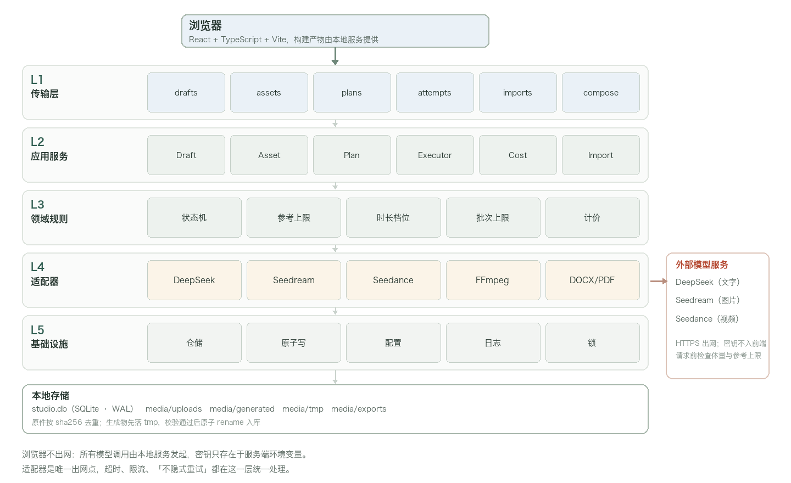
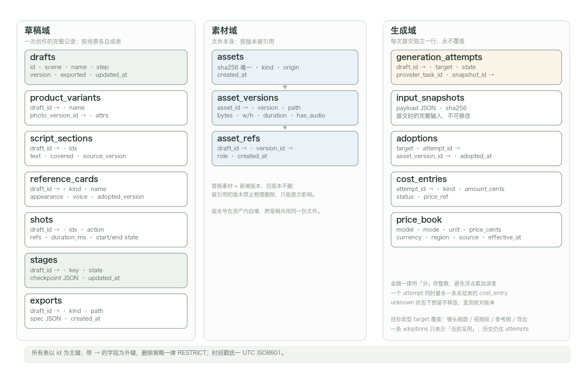
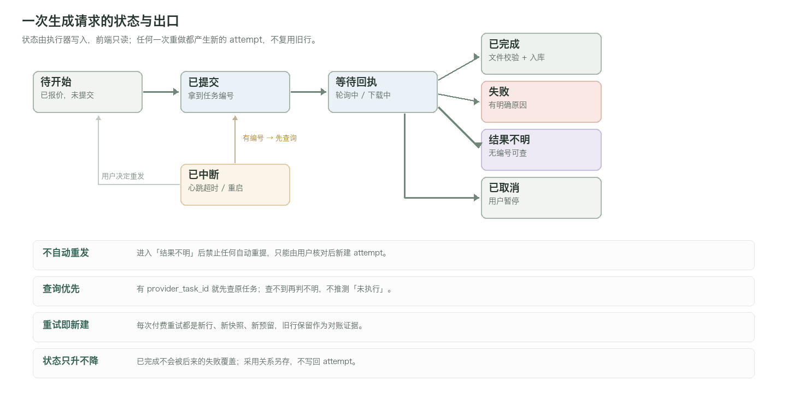
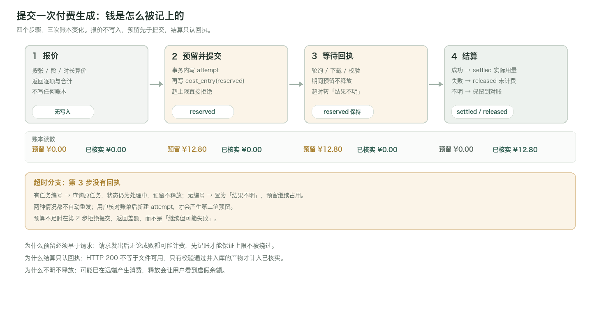

# 视觉创作工作台 Demo 后端技术方案

版本：V0.5　日期：2026年11月4日　对应文档：产品需求文档 V0.5；Demo 设计方案 V0.5

本方案说明本地服务怎么实现：用什么框架、数据怎么落、长任务怎么跑、模型怎么调、钱怎么记、崩了怎么恢复。产品规则以需求文档为准，本文只回答“工程上怎么做才不违反那些规则”。

## 1 目标与边界

### 要解决的四个问题

后端的复杂度不在接口数量，而在四件必须做到的事：

| 问题 | 落点 |
| --- | --- |
| 一次创作有十几个阶段、几百个候选，不能靠内存记住 | 状态与产物的唯一事实来源是数据库和文件，不是进程变量 |
| 付费请求可能在远端成功、本地超时，不能靠重试猜 | 每次提交先快照、先预留，结果不明就停下等对账 |
| 视频生成动辄几分钟，用户会关页面、会重启 | 执行器要把进度写进库，重启按记录继续，而不是从头再来 |
| 一件商品图可能被两份草稿引用，删错就丢成果 | 引用关系进表，删除前查引用，物理删除一律 RESTRICT |

### 与需求文档的对应

| 需求条目 | 本方案章节 |
| --- | --- |
| 11.1 运行形式与整体架构 | 第 3 节 |
| 11.3 数据如何保存和衔接 | 第 4、10 节 |
| 11.4 自动制作如何执行 | 第 5 节 |
| 11.2 模型分工与接入 | 第 6 节 |
| 11.5 导入、合成与费用规则 | 第 7、8、9 节 |
| 11.6 接口密钥与运行验证 | 第 12 节 |
| A01–A30 验收 | 第 14 节映射表 |

### 不做什么

不做账号、同步、云部署、多机调度；不做 OCR、时间线剪辑、声线克隆；不做自动审美评分。这些不是排期问题，是产品本版范围外，做了会引入无法验收的承诺。

## 2 现状盘点与迁移策略

### 现有代码能复用什么

仓库里的 `app/` 是一版更早的通用出图工具，代码量约 500 行。它不是这次要交付的东西，但里面有几处判断是对的，应当保留而不是重写。

| 模块 | 现状 | 处理 |
| --- | --- | --- |
| store.py | SQLite WAL、`rev` 乐观锁、任务抢占、30 秒优先级老化、重启把 running 标 interrupted | 思路保留，表结构全部重做 |
| engine.py | 两个工作线程、取消检查、`/data/` 路径沙箱、demo 模式 | 换成持久化阶段执行器，沙箱逻辑沿用 |
| providers.py | 纯 urllib、错误不泄漏上游响应、显式取消、保存 remote_id | 保留风格，扩展为三家适配器并改用 httpx |
| media.py | PIL 占位图、等比适配、FFmpeg 拼帧 | 校验与合成要重写，占位图逻辑留作演示素材 |
| server.py | Origin/Host 校验、上传大小限制、后缀白名单 | 换成 FastAPI，四条安全校验保留 |
| scene_prompts.py | 中文场景词到英文环境描述的映射 | 作为提示词素材保留，移到 prompts/ 目录 |

### 差在哪

| 缺口 | 影响 | 处理 |
| --- | --- | --- |
| 项目是一整块 JSON | 无法按款式、镜头、候选查询与约束，删除保护无从谈起 | 拆成实体表（第 4 节） |
| 任务只有 queued/running/succeeded | 表达不了「结果不明」「等待处理」「需重新检查」 | 六态状态机（第 5 节） |
| 没有费用记录 | 无法预扣、无法对账、无法阻止重复付费 | 账本三态 + 价格表（第 9 节） |
| 没有文档解析 | 短剧链路的第一步入不了 | python-docx / pypdf（第 7 节） |
| 合成统一去音 | 违反「不擅自去声」 | 保留音轨，静音另存（第 8 节） |
| 无 SSE | 前端只能轮询，阶段变化有延迟 | 单连接事件流（第 11 节） |

### 迁移三原则

数据不丢：旧 `studio.db` 的 projects 与 jobs 在首次启动时导入新表，旧库改名保留，不删。

行为不回退：迁移期间保留 `app/` 可运行，新服务在 `/api/v2` 前缀下并行开发，前端切换后再下线旧接口。

可验证：每个里程碑结束时跑一遍故障注入脚本（第 14 节），而不是只跑通正常路径。

## 3 总体架构

### 分层

分五层，依赖只向下：传输层不写业务，领域层不碰网络与磁盘，适配器是唯一出网点。



| 层 | 职责 | 不允许做的事 |
| --- | --- | --- |
| L1 传输 | 路由、参数校验、SSE、错误码映射 | 不写业务判断，不直接开事务 |
| L2 应用服务 | 事务边界、幂等、权限、编排 | 不拼 SQL，不直接调 HTTP |
| L3 领域规则 | 状态机、参考上限、时长档位、计价 | 不读环境变量，不碰文件 |
| L4 适配器 | 三家模型、FFmpeg、文档解析 | 不做重试决策，不写数据库 |
| L5 基础设施 | 仓储、原子写、配置、日志 | 不含业务语义 |

这样分层有一个直接好处：参考上限、时长档位、计价这些最容易写错的规则是纯函数，可以用表驱动测试一次测透，不用起服务、不用联网。

### 进程模型

单进程 uvicorn 加一个固定大小的后台线程池（图片 3、视频 2），执行器与 API 共享同一个 SQLite 连接池。不做多进程、不引入 Redis 与 Celery。

| 选择 | 理由 |
| --- | --- |
| 单进程 | 本地单用户，多进程只会带来「同一个任务被两个进程抢到」的问题 |
| 线程池而非全异步 | FFmpeg 是阻塞子进程，Pillow 与 pypdf 也是阻塞的；混进事件循环会拖慢 API |
| 数据库即队列 | 无需额外组件；`UPDATE … RETURNING` 就是一次原子的抢占 |
| SQLite WAL | 单写多读，读不阻塞写，足够支撑单用户几十个并发请求 |

### 目录结构

```text
app/
  main.py            FastAPI 实例、启动自检、静态资源
  api/               drafts.py assets.py plans.py attempts.py imports.py compose.py events.py
  schemas/           Pydantic 模型（请求/响应/领域枚举）
  services/          draft_service.py asset_service.py plan_service.py
                     executor.py  cost_service.py import_service.py compose_service.py
  domain/            states.py rules.py pricing.py chapters.py
  adapters/          deepseek.py seedream.py seedance.py ffmpeg.py docs.py
  infra/             db.py repo.py files.py config.py log.py
  migrations/        0001_init.sql 0002_costs.sql …
  static/            构建产物
media/  uploads/ generated/ tmp/ exports/
data/   studio.db
```

### 依赖清单

服务端：fastapi、uvicorn、pydantic>=2、httpx、python-multipart、python-docx、pypdf、Pillow、charset-normalizer。

系统：FFmpeg 与 ffprobe（必须带 libx264 与 aac）。启动时检查版本，缺失则只禁用合成相关接口，不影响草稿浏览。

版本在 `requirements.lock` 固定，启动时校验 Python 版本与依赖哈希，避免「昨天能跑今天不能」。

## 4 数据模型

### 三个域

草稿域记录创作，素材域管文件，生成域管每一次尝试。三者通过 id 关联，不通过 JSON 嵌套互相引用。



### 关键设计与理由

| 设计 | 理由 |
| --- | --- |
| 素材与素材版本分表 | 替换素材必须是新增版本，已有草稿继续引用旧版本 |
| 引用单独成表 | 删除保护、影响范围、备份完整性都靠它，不能靠扫描 JSON |
| 每次生成独立一行 | 重做不覆盖历史；对比、对账、回滚都依赖这一点 |
| 输入快照单独存 | 提交后继续编辑草稿，不能改变已提交的内容 |
| 金额存整数分 | 浮点累加会出现 12.799999，账本不能接受 |
| 采用关系独立表 | 「当前采用」是关系，不是状态位；历史版本仍在 attempts |

### 建表 DDL

只列核心八张，其余同构。

```sql
PRAGMA journal_mode = WAL;
PRAGMA synchronous = NORMAL;
PRAGMA foreign_keys = ON;

CREATE TABLE drafts (
  id          TEXT PRIMARY KEY,
  scene       TEXT NOT NULL CHECK (scene IN ('shop','drama')),
  name        TEXT NOT NULL,
  step        INTEGER NOT NULL DEFAULT 0,
  version     INTEGER NOT NULL DEFAULT 1,
  exported    INTEGER NOT NULL DEFAULT 0,
  cover_id    TEXT REFERENCES asset_versions(id) ON DELETE RESTRICT,
  created_at  TEXT NOT NULL,
  updated_at  TEXT NOT NULL
);

CREATE TABLE assets (
  id          TEXT PRIMARY KEY,
  sha256      TEXT NOT NULL UNIQUE,
  kind        TEXT NOT NULL CHECK (kind IN ('image','video')),
  origin      TEXT NOT NULL CHECK (origin IN ('upload','generated')),
  created_at  TEXT NOT NULL
);

CREATE TABLE asset_versions (
  id          TEXT PRIMARY KEY,
  asset_id    TEXT NOT NULL REFERENCES assets(id) ON DELETE RESTRICT,
  version     INTEGER NOT NULL,
  path        TEXT NOT NULL,
  bytes       INTEGER NOT NULL,
  width       INTEGER, height INTEGER,
  duration_ms INTEGER, has_audio INTEGER NOT NULL DEFAULT 0,
  created_at  TEXT NOT NULL,
  UNIQUE (asset_id, version)
);

CREATE TABLE asset_refs (
  draft_id   TEXT NOT NULL REFERENCES drafts(id) ON DELETE CASCADE,
  version_id TEXT NOT NULL REFERENCES asset_versions(id) ON DELETE RESTRICT,
  role       TEXT NOT NULL,
  created_at TEXT NOT NULL,
  PRIMARY KEY (draft_id, version_id, role)
);
```

```sql
CREATE TABLE generation_attempts (
  id             TEXT PRIMARY KEY,
  draft_id       TEXT NOT NULL REFERENCES drafts(id) ON DELETE CASCADE,
  target_type    TEXT NOT NULL,
  target_id      TEXT NOT NULL,
  stage          TEXT NOT NULL,
  state          TEXT NOT NULL CHECK (state IN
                 ('pending','submitted','polling','done','failed','unknown','canceled','interrupted')),
  provider       TEXT NOT NULL,
  model          TEXT NOT NULL,
  snapshot_id    TEXT NOT NULL REFERENCES input_snapshots(id) ON DELETE RESTRICT,
  provider_task_id TEXT,
  idem_key       TEXT UNIQUE,
  cost_cents     INTEGER,
  started_at     TEXT NOT NULL,
  finished_at    TEXT,
  heartbeat_at   TEXT,
  error_code     TEXT, error_msg TEXT
);

CREATE UNIQUE INDEX ux_attempt_task ON generation_attempts(provider_task_id)
  WHERE provider_task_id IS NOT NULL;
CREATE INDEX ix_attempt_state ON generation_attempts(state, started_at);

CREATE TABLE cost_entries (
  id          TEXT PRIMARY KEY,
  draft_id    TEXT NOT NULL REFERENCES drafts(id) ON DELETE CASCADE,
  attempt_id  TEXT REFERENCES generation_attempts(id) ON DELETE SET NULL,
  kind        TEXT NOT NULL CHECK (kind IN ('analysis','image','video','compose')),
  amount_cents INTEGER NOT NULL,
  currency    TEXT NOT NULL DEFAULT 'CNY',
  status      TEXT NOT NULL CHECK (status IN ('reserved','settled','released')),
  price_ref   TEXT NOT NULL,
  created_at  TEXT NOT NULL,
  settled_at  TEXT
);

CREATE UNIQUE INDEX ux_cost_open ON cost_entries(attempt_id)
  WHERE attempt_id IS NOT NULL AND status = 'reserved';
```

### 索引与约束

| 对象 | 索引 | 用途 |
| --- | --- | --- |
| drafts | (scene, updated_at DESC) | 草稿箱排序 |
| asset_refs | (version_id) | 删除前查引用 |
| generation_attempts | (state, started_at) | 执行器抢占 |
| generation_attempts | (draft_id, target_id) | 单镜历史 |
| cost_entries | (draft_id, status) | 余额与上限 |
| price_book | (model, mode, unit) | 报价 |

外键策略统一 RESTRICT：能被引用的行不物理删除。草稿删除走软删（`deleted_at`），P1 回收站才有意义。

## 5 状态机与执行器

### 六态与出口



| 状态 | 含义 | 可由谁写入 | 允许的下一步 |
| --- | --- | --- | --- |
| pending | 已报价、已预留，未提交 | API | submitted |
| submitted | 已发出，拿到任务编号 | 执行器 | polling / failed |
| polling | 轮询或下载中 | 执行器 | done / failed / unknown |
| done | 文件校验通过并入库 | 执行器 | 终态 |
| failed | 有明确失败原因 | 执行器 | 终态（可再新建） |
| unknown | 超时且无编号可查 | 执行器 | 终态（需人工对账） |
| canceled | 用户暂停 | API | 终态 |
| interrupted | 心跳超时或服务重启 | 启动恢复 | 终态（可再新建） |

### 抢占与心跳

执行器不是「把任务放进内存队列」，而是每次从表里抢一行：

```sql
UPDATE generation_attempts
   SET state = 'submitted', heartbeat_at = :now, worker = :worker
 WHERE id = (
   SELECT id FROM generation_attempts
    WHERE state = 'pending'
    ORDER BY started_at
    LIMIT 1)
RETURNING *;
```

抢占期间持 `BEGIN IMMEDIATE`，保证两个线程不会拿到同一行。执行中每 10 秒更新 `heartbeat_at`；启动时把心跳超过 90 秒的 submitted/polling 行改为 interrupted，并保留 provider_task_id 供查询。

### 恢复规则

| 情况 | 恢复动作 |
| --- | --- |
| 有 provider_task_id | 先查询远端；成功则继续下载入库，失败则标 failed，查不到标 unknown |
| 无 provider_task_id 且请求已发出 | 标 unknown，不重发；界面给「查询」与「标记结果不明」 |
| 无 provider_task_id 且请求未发出 | 可安全重试，标回 pending |
| 文件已下载但未入库 | 启动扫描 tmp，校验通过则补登记，否则保留 24 小时后清理 |

这条规则对应需求文档「不能假设远端未执行」。判断依据只有两个：有没有编号，以及能不能查到。

### 暂停、取消与重试

暂停作用在阶段边界，不打断正在进行的 HTTP 请求。取消只标记，不撤销已产生的远端消费。

重试永远新建一行：新 id、新快照、新预留、`idem_key` 加后缀。旧行保留，用于对账和解释「为什么有两笔钱」。

### 并发与限流

| 资源 | 并发 | 依据 |
| --- | --- | --- |
| 图片生成 | 3 | 单张 10–30 秒，串行会让 20 张的批次等 8 分钟 |
| 视频生成 | 2 | 单段 1–5 分钟，主要瓶颈在远端排队 |
| 文档解析 | 1 | CPU 与内存密集，并行无收益 |
| FFmpeg 合成 | 1 | 单个进程已吃满 CPU，并行只会互相拖慢 |

限流按供应商维护令牌桶（RPM 可配），触发时排队而不是报错。

## 6 模型适配层

### 统一接口

```python
class Provider(Protocol):
    name: str
    caps: ProviderCaps          # 支持的时长档位、参考上限、是否原生声音

    def text(self, req: TextRequest) -> TextResult: ...
    def image(self, req: ImageRequest) -> ImageResult: ...
    def submit_video(self, req: VideoRequest) -> str: ...       # 返回任务编号
    def poll_video(self, task_id: str) -> VideoStatus: ...
    def fetch_video(self, task_id: str, dest: Path) -> None: ...
```

适配器只做四件事：构造请求、发出去、把响应转成领域对象、把异常翻译成统一错误码。不做重试、不做降级、不写数据库。

### 三家差异

| 能力 | DeepSeek | Seedream | Seedance |
| --- | --- | --- | --- |
| 用途 | 剧本、分镜、改编 | 商品图、参考图、镜头图、改图 | 镜头视频与原生声音 |
| 入参 | 纯文本，JSON 模式 | 提示词 + 参考图（Base64 或 URL） | 首帧图 + 提示词 + generate_audio |
| 时长 | — | — | 取模型已核实的档位，不自由取值 |
| 多参考 | — | 按平台上限，超限直接拦 | 首帧与多参考是两种模式，不混用 |
| 结果 | 同步 | 同步返回图片 | 异步：提交拿编号，轮询，再下载 |

### 请求构造的硬校验

提交前在领域层做完，不依赖供应商报错：

参考张数不超过当前模式上限；图片编码后请求体不超过 24MB；时长必须是允许档位；比例在启动时选定并贯穿整条链路；声音开关显式传 `generate_audio`，不支持时直接拦下而不是偷偷改无声。

### 错误分类

| 类型 | 判定 | 处理 |
| --- | --- | --- |
| 参数错误 | HTTP 4xx | 不重试，回显字段级原因 |
| 限流 | 429 | 令牌桶退避，不算失败，不计费 |
| 服务错误 | 5xx | 可重试，但每次重试新建 attempt 并重新预留 |
| 提交前超时 | 连接阶段失败 | 可安全重试 |
| 提交后超时 | 已发出无回执 | 不能重试；有编号查编号，无编号标 unknown |
| 内容拒答 | 供应商返回安全拦截 | 不重试，提示更换素材或描述 |

最后两行是整个方案里最容易被写错的地方：**能不能重试，取决于请求处于「发出前」还是「发出后」**，而不是取决于错误文本。

### 不隐式重试

`httpx` 客户端显式关闭 transport 级重试；三家适配器内部都没有 while 循环重试。唯一允许的自动重试是「查询状态」与「下载文件」——这两种不产生新消费。

## 7 导入与解析

### 上传校验顺序

按字节数、魔数、可解析性、解析后字符数四步依次检查，任一步失败都不进入模型调用。

| 检查 | 实现 | 失败处理 |
| --- | --- | --- |
| 大小 | `Content-Length` 与实际字节数同时校验，上限 20,000,000 字节 | 拒绝并显示实际大小 |
| 魔数 | DOCX 取 `PK\x03\x04`，PDF 取 `%PDF-`，TXT/MD 不校验 | 提示格式与扩展名不符 |
| 解压 | DOCX 解压前检查目录项与解压后总量（上限 200MB） | 判定为异常压缩包，拒绝 |
| 解析 | 逐页/逐段提取，超时 60 秒 | 保留原件，提示更换文件 |

不信任扩展名。扩展名是 `.docx` 但内容不是 zip 的文件，直接拒绝，不尝试「尽力解析」。

### 四种格式的差异

| 格式 | 解析方式 | 已知限制 | 界面必须说明 |
| --- | --- | --- | --- |
| DOCX | python-docx，按 body 顺序遍历段落与表格 | 不读图片、批注、页眉页脚 | 插图内容不会被读取 |
| PDF | pypdf 逐页 `extract_text()` | 文字层缺失、多栏顺序错乱 | 无文字层阻止生成；顺序需逐页预览核对 |
| TXT | 编码探测 UTF-8 → UTF-8-SIG → GB18030 | 探测失败即要求用户选择 | 乱码不进入改编 |
| MD | 按纯文本读取，保留标题层级用于切分 | 表格与代码块按行读取 | — |

### 字符计数口径

统一按 Unicode 码点计数：Python 用 `len(s)`，前端用 `[...s].length`，两者对增补平面字符都算 1。含空格与换行。单文件上限 200,000，单次处理上限 20,000，粘贴区 5,000 触发转 TXT。

前后端各算一次并在报告里对齐，差异超过 0 即视为缺陷——口径不一致会让用户看到「你说超限，我说没超」。

### 章节切分与跨段一致性

超过 20,000 字符时按章节标题、场景分隔符切分，重叠 200 字。每段处理时携带上一段产出的三个东西：人物表、已发生事件摘要、道具当前状态。合并后对照原文做覆盖检查，缺段直接失败，不静默跳过。

分段不能代替完整性检查，这一点在实现上体现为：合并阶段要重新扫一遍原文的章节清单，逐段核对是否已有产物。

### 解析报告

```json
{
  "file": {"name": "山间来信.docx", "bytes": 182340, "sha256": "9f2c…"},
  "kind": "script",
  "chars": 18422,
  "preview": "第一场　山道　晨……",
  "chapters": [{"idx": 1, "title": "第一场", "chars": 3120, "covered": true}],
  "warnings": [
    {"code": "IMAGE_SKIPPED", "msg": "文档含 3 张插图，未读取图中文字"}
  ],
  "blocking": []
}
```

`blocking` 非空时不允许开始生成：无文字层的 PDF、加密文档、正文为空都属于这一类。

## 8 媒体处理

### 图片

上传后立即做三件事：EXIF 方向校正、`verify()` 加真实解码、按用途生成缩略图。超过 16MB 或解码失败保留原件并提示，不做静默压缩。

发送给模型前按模型上限二次缩放，缩放只影响发送副本，不改本地原件。

### 视频校验

下载完成的片段必须过 ffprobe，检查容器、视频编码、时长、分辨率与音轨，缺一项即判失败：

```text
ffprobe -v error -print_format json -show_streams -show_format clip.mp4
```

校验不通过的文件移到 `tmp/rejected/` 而不是删除，便于排查是模型问题还是下载问题。

### 合成与声音

合成是本地操作，不重新请求模型。规则：

| 场景 | 参数 | 说明 |
| --- | --- | --- |
| 有声成片 | `-c:v libx264 -pix_fmt yuv420p -c:a aac -ar 48000 -ac 2` | 保留原生音轨，统一采样率避免错位 |
| 静音导出 | 在成片基础上加 `-an` | 只改导出文件，原始片段不动 |
| 片段拼接 | concat demuxer，先统一分辨率与帧率 | 时间基从 0 开始，避免首帧黑屏 |

不做「自动去音」：如果选定有声模式而片段没有音轨，合成阶段直接失败并指出是哪一段，交给用户决定重做还是改静音。这是需求文档里明确的红线，实现在这里。

### 原子写入

```text
写入 media/tmp/{uuid}.part
→ fsync
→ 校验（PIL / ffprobe）
→ os.replace 到 media/generated/{sha}.ext
→ 事务内 INSERT asset_versions
```

顺序不能反。先写库后写文件会出现「有记录没文件」；先写文件后写库最坏只是多一个孤儿文件，启动扫描能处理。

## 9 费用账本

### 四步与三态



| 状态 | 何时写入 | 何时变更 |
| --- | --- | --- |
| reserved | 提交事务内，先于 HTTP 请求 | 成功转 settled，明确失败转 released |
| settled | 收到回执且文件校验入库 | 终态，金额取实际用量 |
| released | 明确失败且未计费 | 终态 |
| （保留） | 结果不明时保持 reserved | 对账后由用户或管理员处理 |

### 预留事务

提交必须在同一个事务里完成「写 attempt + 写预留 + 校验上限」，否则并发提交能绕过上限：

```sql
BEGIN IMMEDIATE;

INSERT INTO generation_attempts (id, draft_id, state, cost_cents, …)
VALUES (:id, :draft, 'pending', :cents, …);

INSERT INTO cost_entries (id, draft_id, attempt_id, kind, amount_cents, status, …)
VALUES (:cid, :draft, :id, :kind, :cents, 'reserved', …);

SELECT COALESCE(SUM(amount_cents), 0) INTO :used
  FROM cost_entries
 WHERE draft_id = :draft AND status IN ('reserved','settled');

-- 应用层判断 :used <= :cap，否则 ROLLBACK 并返回差额
COMMIT;
```

SQLite 没有存储过程，判断在应用层做，但整段仍包在一个 `BEGIN IMMEDIATE` 里，写锁保证读到的是最新值。

### 报价

`POST /api/plans/quote` 只读不写：按图片张数、视频段数与时长档位、文字调用次数算价，返回逐项、合计与上限校验结果。前端拿到的数字与提交时的预留金额必须一致，不一致说明价格表在两次调用之间变了，提交时重新报价。

### 价格表

`price_book` 记录模型、模式、计价单位、单价（分）、币种、地区、来源与生效时间。价格变更插入新行而不是改旧行，历史条目引用当时的 `price_ref`，对账时能还原「当时按什么价算的」。

## 10 自动保存与冲突

### 接口形态

`PATCH /api/drafts/{id}`，请求头带 `If-Match: 12`（当前版本号）。服务端在事务内比较版本号，匹配则写入并 `version = version + 1`，不匹配返回 409。

```json
{
  "error": "version_conflict",
  "server_version": 15,
  "client_version": 12,
  "changed": ["shots", "canvas.layers[3].text"],
  "server_updated_at": "2026-11-04T21:04:12Z"
}
```

409 不是错误提示，是一个选择界面：保留我的、用服务器的、另存副本。三种选择都对应一个明确的接口。

### 与浏览器临时内容的关系

前端在 IndexedDB 里存未提交的修改与新版本号。刷新后先拉服务器版本，若本地版本更新则展示差异摘要，用户选择后才合并。后端不参与合并算法，只提供版本与差异所需的字段。

### 保存失败的降级

写库失败返回 507 并保持事务回滚，前端不清空编辑器，显示「保存失败 · 已保留内容」并提供「下载当前文字与设置」。媒体只允许下载已成功入库的文件，这一点由接口保证：下载接口只接受 asset_versions 里的路径。

## 11 API 契约

### 资源清单

| 方法与路径 | 用途 | 幂等 |
| --- | --- | --- |
| GET /api/drafts | 列表（按场景筛选） | 是 |
| POST /api/drafts | 新建 | 否 |
| PATCH /api/drafts/{id} | 增量保存（If-Match） | 是 |
| POST /api/assets | 上传，返回版本 | 否 |
| GET /api/assets/{id}/refs | 引用清单 | 是 |
| POST /api/imports | 解析文档，返回报告 | 否 |
| POST /api/plans/quote | 报价，不写库 | 是 |
| POST /api/attempts | 提交生成（Idempotency-Key） | 是 |
| POST /api/attempts/{id}/retry | 新建一次尝试 | 否 |
| GET /api/attempts/{id}/reconcile | 查询远端状态 | 是 |
| POST /api/compose | 本地合成 | 否 |
| GET /api/costs | 账本与明细 | 是 |
| GET /api/events | SSE 事件流 | — |

### 提交生成

```http
POST /api/attempts
Idempotency-Key: 7f3a9c21
Content-Type: application/json

{"draft_id":"d_102","stage":"image","target_ids":["v1","v2"],
 "quote_id":"q_88","kind":"image"}
```

```json
{"attempt_ids":["a_901","a_902"], "reserved_cents":640,
 "balance_cents":1200, "state":"pending"}
```

同一个 `Idempotency-Key` 重复提交只返回原结果，不产生第二次预留。这是前端重试网络请求时的最后一道保护。

### SSE 事件

```text
event: attempt.updated
data: {"id":"a_901","state":"polling","target_id":"v1","cost":"reserved"}

event: cost.updated
data: {"reserved_cents":640,"settled_cents":1280,"balance_cents":1200}

event: draft.saved
data: {"id":"d_102","version":16}
```

心跳每 15 秒发一行注释，连接断开后前端用 `Last-Event-ID` 续传，服务端按事件序号补发最近 200 条。

### 错误码

| 码 | HTTP | 含义 |
| --- | --- | --- |
| invalid_reference | 422 | 参考数量或组合不支持 |
| budget_exceeded | 402 | 超出上限，返回差额 |
| version_conflict | 409 | 版本冲突 |
| result_unknown | 202 | 已提交但结果不明，需对账 |
| provider_unavailable | 503 | 未配置密钥或额度不足 |
| media_invalid | 415 | 文件校验未通过 |

## 12 安全与运行

### 本地服务的边界

只监听 `127.0.0.1`，不监听 `0.0.0.0`。校验 `Host` 与 `Origin` 白名单，防止浏览器里其他站点通过表单发起本地请求。写接口要求自定义头（触发预检），读接口不做额外限制。

### 密钥

只从环境变量读取（`DEEPSEEK_API_KEY`、`ARK_API_KEY`），不写文件、不进数据库、不进导出包。日志里出现密钥前缀与长度即脱敏，中间用星号。

### 路径沙箱

所有文件访问都经过 `resolve()` 后 `is_relative_to(media_root)` 校验，静态资源后缀白名单。用户输入永远不拼进 shell 命令，FFmpeg 参数全部是常量列表。

### 启动自检

| 检查 | 失败时 |
| --- | --- |
| 数据目录可写 | 拒绝启动并提示路径 |
| SQLite 可迁移 | 停在新版本之前，备份旧库 |
| FFmpeg 与 ffprobe | 可启动，合成相关接口返回 503 |
| 模型配置 | 可启动，付费接口提示未配置 |

### 日志与备份

结构化 JSONL 按天轮转，保留 14 天。日志字段固定：时间、路由、草稿 id、attempt id、耗时、错误码。不记录提示词全文与图片内容。

备份包只含草稿、素材、清单与配置的非敏感部分；密钥、临时文件、被拒绝的下载不进包。

## 13 性能与容量

| 项 | 设定 | 说明 |
| --- | --- | --- |
| SQLite | WAL，`busy_timeout=5000`，`synchronous=NORMAL` | 单写多读，读不阻塞 |
| 连接 | 每线程一个连接，复用 | SQLite 连接不能跨线程共享 |
| 图片 | 缩略图 320px 常驻磁盘 | 网格加载不读原图 |
| 视频 | 下载走流式写入文件 | 不把整段视频读进内存 |
| Base64 | 只在适配层构造，用完即释放 | 16MB 图片编码后约 21MB |
| SSE | 单连接，事件序号补发 | 页面切换不重建连接 |
| 容量 | 单草稿 500 个素材版本，单库 5 万条尝试 | 超过后按草稿归档，不阻塞 |

估算依据：一部长约 6 分钟的短剧约 40 段视频、800 张图、若干次重做，约 1200 条尝试记录，SQLite 完全够用；真正的瓶颈在磁盘与远端配额，不在数据库。

## 14 测试与验收

### 测试分层

| 层 | 覆盖 | 手段 |
| --- | --- | --- |
| 领域单测 | 状态机、计价、参考校验、切分 | 表驱动，纯函数，无 IO |
| 服务集成 | 事务、幂等、409、账本一致性 | 临时库 + 假供应商 |
| 适配器契约 | 请求体结构、错误映射 | 录制回放（fixture） |
| 故障注入 | 崩溃、断网、半写文件、重复回调 | 脚本化，进 CI 之外的夜间任务 |

假供应商是必需品：不能为了测试付费每次真调。它按脚本返回成功、失败、超时、无回执四种结果，并记录调用次数，用于断言「没有发生隐式重试」。

### 必须验证的七个故障

| 故障 | 期望 |
| --- | --- |
| 提交请求后进程被 kill | 重启后 attempt 为 interrupted，有编号则查询，不自动重发 |
| 文件下载一半 | tmp 残留，不入库，界面无「已完成」 |
| 回执成功但入库失败 | 状态保持 processing，重试入库，不重复下载 |
| 重复回调 | 以 provider_task_id 唯一索引幂等，不产生第二条账本 |
| 并发提交超上限 | 后到者被拒，返回差额，不等价于静默排队 |
| 磁盘写满 | 保存失败降级，可下载文字，不显示已保存 |
| 版本冲突 | 409 带服务器版本与差异，不静默覆盖 |

### 与验收编号的映射

| 编号 | 后端检查点 |
| --- | --- |
| A01 A22 | 两个场景独立表；引用表阻止物理删除 |
| A03 A05 A18 A26 | 每次重做新 attempt；采用关系独立；旧版本可回切 |
| A04 A21 | If-Match 保存；崩溃恢复与 409 处理 |
| A07–A11 | 解析报告、字符口径、章节覆盖 |
| A13 A14 | 参考上限在领域层拦截 |
| A16 A17 A27 | 阶段执行器、预留事务、暂停与继续 |
| A19 A23–A25 | 合成前 ffprobe 校验；保留音轨；静音另存 |
| A20 | 影响范围由引用表与状态规则计算 |
| A30 | 文件校验与入库成功后才置 done |

## 15 实施计划

| 里程碑 | 内容 | 产出 | 人日 |
| --- | --- | --- | --- |
| M0 | FastAPI 骨架、配置、日志、迁移框架 | 可启动、可自检 | 2 |
| M1 | 草稿、素材、版本、引用、保存与 409 | 电商与短剧都能建草稿 | 3 |
| M2 | 文档解析与章节切分 | 导入链路可跑通 | 3 |
| M3 | 图像链路、报价、预留、结算 | 电商闭环后端可用 | 4 |
| M4 | 阶段执行器、视频轮询、合成 | 短剧链路可跑通 | 5 |
| M5 | 故障注入、恢复、对账、验收 | 可通过第 14 节全部检查 | 3 |

合计约 20 人日，不含前端与模型评测。M0–M2 可与前端并行，M3 之后需要真实密钥联调。

### 风险与待验证

| 项 | 影响 | 处理 |
| --- | --- | --- |
| Seedream 多参考与返回格式未核实 | 图片链路可能改接口 | 先按单图 + Base64 实现，多参考留能力开关 |
| Seedance 时长档位与声音开关细节 | 视频定价与参数可能变 | 能力表放配置，启动时校验 |
| Base64 体积上限 | 大图可能被拒 | 发送前缩放，超限直接提示 |
| FFmpeg 在不同机器的编解码器差异 | 合成可能失败 | 启动时探测 libx264 与 aac，缺失则禁用 |
| SQLite 写并发 | 高并发下偶发 busy | 超时 5 秒 + 退避，单用户足够 |

所有待验证项在实现时先写成能力探测与开关，不把「猜的参数」固化进代码。
