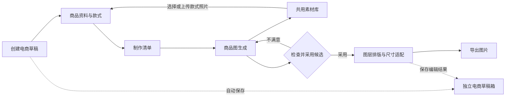
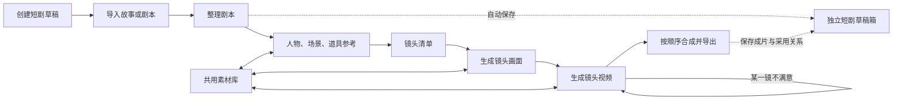

# 视觉创作工作台：场景、用户需求与 MVP 核心模块

## 一、产品背景与目标

视觉创作工作台面向需要制作图片和视频的创作者，在电脑网页中提供“商品图”和“短剧”两个入口。用户可以把上传的素材与生成结果组织成一份可继续修改的草稿，完成从输入、生成、检查、调整到导出的流程。

本方案同时覆盖电商和短剧两个场景：电商侧解决多款商品图片制作与排版问题；短剧侧解决故事转成分镜、视频并合成的问题。两类创作记录分别管理，可以引用同一个素材库。

**实现边界：** 当前 Demo 在本机管理草稿和文件，通过 DeepSeek、千问图像和万相视频的 API 进行模型推理。题目原始背景要求本地模型和本地推理，本方案采用 API 是为当前 Demo 作出的调整；因此不能将其表述为满足原题“全部推理在本地完成”。

## 二、用户是谁，需要完成什么

| 用户 | 典型任务 | 主要困难 | 期望结果 |
|---|---|---|---|
| 电商运营、小型商家 | 为不同颜色或规格的商品制作主图和场景图 | 款式多、照片容易用错；商品外形或包装可能被改动 | 每个款式都能对应自己的照片，较快得到可检查、可导出的图片 |
| 电商视觉设计与内容人员 | 统一一组图片风格，调整文字和不同渠道的尺寸 | 在多个工具间搬运图片；改价格或标题需要重复排版 | 原图与文字分开编辑，生成多个尺寸，局部不满意时只重做对应图片 |
| 短剧与故事视频创作者 | 把故事或剧本做成可播放短片 | 不熟悉分镜；多人物、场景、道具容易混乱；某镜头失败需要重来 | 既能逐步检查，也能一键制作；每镜可重做，最后导出完整视频 |

## 三、为什么选择这两个场景

两个场景都属于视觉内容创作，均需要素材导入、生成、检查、修改、保存和导出，适合同一个工作台复用素材库与创作基础能力。它们的创作记录、步骤和评价重点不同：电商更关注商品外观与款式对应；短剧更关注剧情顺序、人物一致、动作与声音。

本项目采用两个场景是当前产品范围的选择。题目中的示例允许选择一个场景；覆盖两个场景扩大了实现与验证范围，不能因此假设所有能力都已验证。

## 四、MVP 的核心模块

### 4.1 两个场景共用的基础模块

| 模块 | 用户遇到的问题 | 模块做什么 | 与其他模块如何协作 |
|---|---|---|---|
| 场景入口与独立草稿箱 | 作品多，退出后难以找到上次做到哪里；商品与短剧的信息不能混在一起 | 分别新建、查找、继续、复制和管理商品图草稿与短剧草稿 | 保存场景内的制作设置、采用关系和进度；草稿通过引用使用素材库文件 |
| 共用素材库 | 上传图片、人物参考、生成结果散落，难以复用 | 保存和展示图片、视频、原始文件及生成结果；保留原件与新候选 | 向商品模块、参考卡、分镜和画布提供素材；同一文件可被不同草稿引用，草稿内容仍各自独立 |
| 模型生成与结果管理 | 用户需要生成图片和视频，又要知道结果来自哪次输入 | 将本次文字、已选参考和设置交给对应模型；保存生成记录、结果及候选版本 | 商品模块和短剧模块提出生成请求；结果先进入素材库，再由用户或自动流程采用 |
| 自动保存与草稿恢复 | 编辑途中关闭页面、断网或中断后担心丢失修改 | 自动保存草稿，保留待保存内容；恢复时提示冲突或未完成状态 | 所有创作步骤和结果回写本地记录；重新打开草稿可继续，已导出文件不被后续编辑覆盖 |
| 检查、失败处理与重做 | 生成文件不一定内容正确；某项失败不应要求整套重来 | 显示结果、来源和状态；保留旧候选，允许选择、局部重做或处理异常 | 对商品图逐张、对短剧逐镜处理；结果不明时保留记录，避免盲目重复提交 |
| 导出 | 创作完成后需要可使用的图片或视频，同时还想继续修改 | 导出图片、视频和相关创作资料；导出后保留草稿 | 从画布或短剧成片读取用户当前采用的版本；再次导出形成新结果 |

### 4.2 电商场景模块

| 模块 | 解决什么问题 | 主要输入与输出 |
|---|---|---|
| 商品资料与款式管理 | 同一商品不同颜色、容量或规格容易混用照片 | 输入商品名称、已知资料和不同款式；每个款式绑定自己的照片。行业中常称可独立售卖的款式为 SKU |
| 制作清单与商品图生成 | 用户难以一次说明要为哪些款式制作哪些图片 | 根据款式、照片、图片类型、风格和数量形成清单，逐项生成展示图或场景图；每项分别保留结果 |
| 批量风格处理 | 多张已有图片风格不统一，逐张操作耗时 | 对所选图片生成统一风格的新候选，保留原图和款式对应关系；用户检查后采用 |
| 图层画布与尺寸适配 | 商品图中文字、图片混在一起，修改价格或适配尺寸不方便 | 将图片、标题、卖点等作为独立图层编辑；调整位置、大小和顺序，适配不同尺寸后导出 |

**例子：** 商家为米白色和深绿色保温杯各上传一张照片，选择为每款做一张场景图。清单把每张待生成图片与正确款式绑定；用户发现深绿色杯子的颜色不对，就只重做这一张，选好结果后再放入画布添加价格。

### 4.3 短剧场景模块

| 模块 | 解决什么问题 | 主要输入与输出 |
|---|---|---|
| 故事或剧本导入 | 用户的内容格式不同，不知道系统能读什么 | 接收粘贴文字及 TXT、MD、DOCX、PDF 的文字内容；检查大小、正文长度和提取结果，提示本步骤不识图 |
| 剧本整理 | 故事不一定能直接拍摄，已有剧本也可能缺少结构 | 故事转为有场景、人物、动作和对白的剧本；已有剧本整理结构，保留原文和剧情 |
| 人物、场景与道具参考 | 不同镜头中的人物、服装和环境容易变化或混淆 | 为需要保持的对象建立参考卡，上传、选择或生成参考图；同一人物可有不同造型 |
| 分镜脚本与镜头清单 | 一段故事需要拆成可执行的短镜头，用户不一定懂分镜 | 为每镜记录画面、动作、人物、对白、运镜、时长和参考；允许编辑、调整顺序和局部重做 |
| 镜头图与视频生成 | 用户需要把文字变成画面和视频，但每镜可能出错 | 先根据镜头和参考生成画面，再生成视频片段；保留每次结果并允许单镜采用或重做 |
| 成片合成 | 分散片段需要按顺序拼成完整短片，声音不能丢失 | 按镜头顺序合成已采用的视频；有声模式保留并检查音轨，缺少必要片段时提示处理 |
| 逐步制作与一键成片 | 有的用户要逐项控制，有的用户希望少操作 | 逐步制作由用户逐项检查；一键成片按已选设置自动接续，关键歧义或失败时暂停。两种方式使用同一份短剧草稿 |

**边界：** 多角色参考可以帮助保持一致，但不能保证每个镜头都完全一致；每镜可使用的参考数量和组合需受实际模型接口限制。生成的视频有音轨也不代表对白或音色一定准确，用户需要检查。

## 五、模块如何协作

### 电商：从商品照片到宣传图

商品与款式模块先确定“用哪张照片做哪款商品”，生成模块据此逐项出图。素材库保留原图和生成候选；检查通过后，用户把采用的图片交给画布排版，最后导出。自动保存贯穿各步骤。

### 短剧：从文字到完整视频

剧本整理提供人物和情节信息，参考卡提供要保持的外观与场景，镜头清单告诉生成模块“每一镜拍什么”。镜头画面和视频分别保存，最终只把采用的视频按顺序合成。逐步与一键模式使用相同模块，差别是各阶段由用户确认还是按规则自动接续。

## 六、MVP 的完成标准与当前验证边界

- **电商闭环：** 多个款式各绑定正确照片，生成并检查图片，采用结果后完成图层排版与尺寸导出；可只重做某一项。
- **短剧闭环：** 从故事或已有剧本进入，完成剧本、参考、镜头、画面、视频和合成；既提供逐步制作，也提供一键成片；支持多角色参考和单镜重做。
- **共同要求：** 草稿自动保存并可恢复；原文、原图及旧结果保留；模型返回成功后仍检查文件与内容；失败或结果不明时说明状态并提供处理入口。

独立验证已用真实模型完成一张电商图，以及短剧两镜画面、两段有声视频和本地合成。短剧一键流程在分析警告后暂停，后续以逐步方式完成；暂停后返回一键继续仍有缺口。多角色一致性、批量风格及单镜付费重做等尚需进一步实测。实际费用统计只留扩展接口。
