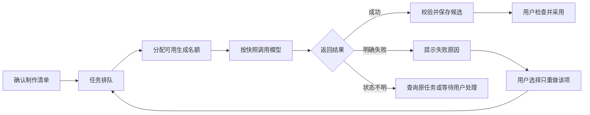

# 视觉创作工作台：多任务并发产品策略

## 一、要解决的问题

用户制作一组商品图或一部短剧时，经常希望“一次生成多张”，也希望在等待生成时继续改文字、整理其他素材。生成需要时间，多个任务还可能出现排队、失败、暂停或结果晚到。产品需要让用户知道每项做到哪里，已完成的结果不丢，修改也不被旧结果覆盖。

本文是并发能力的产品策略，包含当前 Demo 能力与后续方案。原始题目以端侧本地推理为背景；当前 Demo 使用云端模型 API，因此两种资源限制不同，不能把云端限流描述为本机显存不足，也不能宣称当前 Demo 已实现真正的多任务生成并发。

## 二、当前 Demo 能做到什么

| 用户动作 | 当前产品行为 | 边界 |
|---|---|---|
| 一次选择多张或多镜生成 | 一次建立一份包含多项的制作计划，系统按顺序逐项执行 | 属于批量顺序处理，并非多张同时推理 |
| 正在生成时编辑其他草稿 | 其他草稿可以浏览和编辑，本地保存不依赖当前生成完成 | 当前制作中的草稿在页面上暂时只读；不能承诺在同一草稿中边生成边编辑 |
| 同时发起两份制作计划 | 当已有计划准备或执行时，新计划会被拦截，提示返回或暂停当前制作 | 没有跨草稿等待队列、优先级或可调整并发数 |
| 暂停制作 | 停止提交后续步骤；已发送的视频任务继续查询和保存 | 暂停不等于撤销已发出的请求，也不保证退款 |
| 失败或重启 | 已保存结果保留；有远端任务编号时可查询原任务；无编号且结果不明时不自动重发 | 状态恢复受远端接口可查询性和结果保存情况限制 |

独立验证中，真实短剧视频批次验证了“在途任务完成并保存后暂停，再继续下一段”。短剧一键分析遇到警告后，确认并回到一键继续的入口仍不完整；目前可转逐步模式完成。完整并发方案尚未实现，也未验证。

## 三、产品目标：后续支持哪些并发体验

1. **批量生成可控：** 用户一次提交多张商品图或多个镜头；系统在可用资源和平台限制内并行执行，超出的项目有序等待。
2. **生成时可继续编辑：** 用户可以在生成过程中编辑同一草稿或其他草稿；每个生成请求使用提交时的输入快照，不随界面上的新修改悄悄变化。
3. **出错只处理受影响项：** 单项失败不删除其他成功项；同一镜头可单独重新生成，旧版本仍可查看。
4. **状态真实、结果可追溯：** 区分等待、生成、已完成、失败、结果不明及暂停；展示所属款式或镜头、输入版本和采用关系。
5. **尽量不丢稿：** 编辑自动保存，运行记录和已保存文件独立持久化；对仍未写入本机的内容明确提示，不能承诺任何故障下绝不丢失。

## 四、任务排队与资源分配

### 4.1 用户看到的流程

制作清单把一组任务拆成独立项目：例如“两款商品各两张”显示为四项，短剧的每个镜头视频也分别显示。每项至少展示名称、目标款式或镜头、当前状态、已完成数量和失败原因；不能用虚构百分比或无法确认的剩余时间制造进度感。

### 4.2 调度规则

- **先完成正确的依赖顺序：** 视频依赖已选定的镜头画面，合成依赖所有必要视频。没有满足前置条件的项目不进入生成。
- **限制同时运行数量：** 图片、视频和文字分别设定并发名额；具体默认值应根据账户额度、模型接口限制与实测确定，不把厂商某个页面的速率上限当成产品承诺。
- **超出名额进入队列：** 未开始的任务按提交顺序等待；用户可查看待处理项目。后续如引入优先级，应避免大批任务长期占用名额，也避免低优先级任务一直等不到。
- **区分批量与并行：** 同一批次可以包含许多项目，即使平台只允许一个并行名额，也能排队逐项完成；界面明确告知“等待中”“正在生成”，不宣称全部同时运行。
- **按服务能力降速：** 遇到限流时先停止继续提交、提示等待；仅对明确可安全重试的请求进行有限次数和间隔的重试，不把创建新付费生成当成免费状态查询。

## 五、边生成边编辑：如何避免覆盖

### 5.1 基本规则

用户点击生成时，系统为每一项保存输入快照：使用的款式或镜头、提示词、参考素材及其版本、比例、声音等。之后用户继续编辑，不改变已经发出的请求。

例如：10:00 用户用“米白色杯子”照片生成场景图；10:01 用户将同一米白色款式的参考照片换成另一拍摄角度。10:02 旧请求返回时，结果仍标记为“基于10:00的原照片生成”，保存为候选，不自动覆盖当前采用的图片。用户可以查看、采用旧结果，或用新照片重新生成。不同颜色的款式仍分别管理。

### 5.2 上游修改影响下游

- 修改标题、价格文字等画布图层，通常不需要重生成商品图；只保存新的画布编辑版本。
- 修改商品照片、人物外观、镜头动作或参考素材时，找出引用旧输入的结果，标记“需要检查”，保留旧文件。
- 修改剧情顺序、人物关系或道具状态时，提示可能受影响的后续镜头；系统可以依据明确的素材引用和已记录的前后事件给出范围，语义影响仍需要用户复核。
- 已提交请求正常返回后，只归入原快照对应的候选；新版本不会被迟到结果自动覆盖。用户明确采用后，当前版本才切换。
- 编辑与后台进度分别保存；生成状态变化不应把用户正在输入的文字当作旧版本覆盖。保存冲突时保留本地待保存内容，提供恢复或另存副本。

## 六、中断、失败和恢复

| 情况 | 用户看到什么 | 产品处理 |
|---|---|---|
| 尚未开始的任务被暂停 | 显示已暂停和未开始项目 | 不再提交后续任务；已经完成的结果保留 |
| 已发送请求后用户暂停 | 显示“已提交，正在等待结果” | 继续查询或接收原请求结果；不能承诺撤销、立即停止远端推理或退款 |
| 一项明确失败 | 显示失败项、原因及单项重做入口 | 保留其他成功项。是否继续同批其他无依赖项由清单规则决定；依赖失败结果的下游项暂停 |
| 网络中断，已有远端任务编号 | 显示“连接中断，正在找回任务” | 恢复连接后查询原编号，完成后下载并保存，不新建同一生成请求 |
| 请求超时且没有远端编号 | 显示“结果不明，可能已经提交” | 记录输入与时间，禁止自动重复提交；用户核对平台记录后再决定是否新建请求，可能产生再次收费 |
| 模型已返回，下载或保存失败 | 显示“生成已完成，文件待恢复” | 在链接有效且可访问时重新下载并校验原结果；过期或无法找回时明确提示，不能把恢复下载说成必然成功 |
| 本地服务或电脑重启 | 显示上次保存的草稿和未完成制作 | 恢复检查点；先核对原任务，再决定继续、暂停或等待用户处理；不默认整批从头执行 |
| 上游被修改，旧任务晚到 | 显示结果基于旧输入，相关内容待检查 | 保存为旧版本候选，不覆盖当前编辑或已采用结果 |
| 合成失败或缺少镜头 | 显示缺失或损坏的具体片段 | 保留所有原片段；修复后只重试合成，不重新生成已经可用的视频 |

## 七、哪些能解决，哪些存在边界

| 问题 | 产品策略 | 能否保证 |
|---|---|---|
| 一次处理多张、多镜 | 拆成独立任务，排队，按可用名额执行 | 可以设计和实现；实际同时运行数量取决于部署和服务限制，需实测 |
| 生成时继续编辑 | 输入快照、候选版本、自动保存和冲突提示 | 可以降低覆盖风险；当前 Demo 同草稿编辑在运行时受限，完整体验待开发验证 |
| 某项失败不影响已完成文件 | 独立状态、独立候选和局部重做 | 已成功保存的文件可保留；尚未写入本机的结果仍可能受故障影响 |
| 避免因超时自动重复付费 | 记录请求、远端编号和结果不明状态；默认不重复创建 | 可避免产品自动盲目重发；不能保证平台一定没有执行或收费 |
| 远端已经开始后立即停止并退款 | 暂停后续、继续查询原任务 | 无法由本产品保证；取决于供应商是否支持取消、任务所处状态与计费规则 |
| 所有生成结果一定准确 | 展示参考、逐项预览、局部重做 | 不能保证；模型可能改变商品细节、人物、剧情、对白或声音，仍需人工检查 |
| 任意异常均不丢稿 | 自动保存、版本记录和本地暂存，失败时提供下载文字与设置 | 不能绝对保证；未保存的瞬间输入、本地磁盘损坏、文件未下载或浏览器数据清理都可能造成损失 |
| 实际费用与总预算精准控制 | 本版费用接口返回“未接入”；生成前提示平台按量计费 | 当前不实现真实账单对接、费用结算和预算硬拦截；测试或使用的实际收费以平台为准 |

## 八、端侧本地推理与当前 API 方案的差异

题目原设为本地设备和本地模型：如果将来改为端侧推理，排队和并发名额应依据可用显存、内存、设备温度以及不同模型占用决定；资源不足时降低同时运行数量、等待、提示释放资源或停止新增任务。没有具体设备与实测数据，不能给出可信的固定并发数，也不能承诺所有模型能在该设备上运行。

当前 Demo 将推理请求发送到 DeepSeek 和千问 AI 平台：服务端限流、账号权限、网络连接、远端任务查询和媒体链接有效期成为主要限制；本地仍负责编辑、保存、文件处理与视频合成。两种架构都需要队列、快照和恢复机制，但资源瓶颈与可取消性不同。

## 九、实施顺序与验收

1. **当前阶段：** 保持单份计划顺序执行，先修复一键成片暂停确认后无法顺畅继续的问题；完成真实短样本验证。实际费用统计不接入。
2. **下一阶段：** 增加可见队列与独立任务状态，完善快照、版本和失败恢复；先在受控条件下验证同一草稿边生成边编辑。
3. **再引入有限并行：** 根据真实接口和设备测试为不同任务配置名额；验证限流、暂停、重启、迟到结果与不同任务相互影响，再逐步开放。

验收应至少覆盖：批量中某一项失败而其他已保存结果不丢；生成时修改原输入后旧结果不能覆盖新版本；暂停不新提交但在途任务仍被记录；服务重启后有编号查询原任务、无编号不自动重发；用户能够确认各项当前状态和需要采取的动作。真实并发吞吐、等待时间、失败率及资源占用应在明确模型、账号、设备和任务规模后测量，当前没有实测数值。
